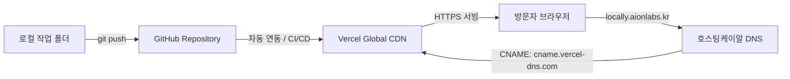

# 로컬리(Locally) 웹사이트 Vercel 배포 및 도메인 연동 가이드

본 문서는 제작된 **로컬리(Locally) 서비스 포트폴리오 웹사이트**를 GitHub를 통해 버전 관리하고, **Vercel**에 정적 호스팅으로 배포한 뒤, **호스팅케이알(Hosting.kr)**에 등록된 보유 도메인(`aionlabs.kr`)의 서브도메인인 **`locally.aionlabs.kr`** 주소로 전 세계에 안전하게(HTTPS) 서비스하는 전체 절차를 안내합니다.

---

## 📌 배포 아키텍처 및 전체 흐름



| 구분 | 대상 | 역할 |
| :--- | :--- | :--- |
| **소스 저장소** | **GitHub** | 소스 코드 버전 관리 및 Vercel 자동 배포 트리거 |
| **호스팅 엔진** | **Vercel** | 고성능 정적 웹 서빙, 무료 글로벌 CDN, 무료 SSL 자동 발급 |
| **도메인 관리** | **호스팅케이알 (Hosting.kr)** | `locally` 서브도메인의 DNS CNAME 레코드 라우팅 |
| **최종 접속 주소** | **`https://locally.aionlabs.kr`** | 방문자에게 노출되는 최종 공식 URL |

---

## 📁 0단계. 배포 준비 완료 항목 (사전 구성됨)

원활한 배포를 위해 프로젝트 루트에 다음 설정 파일들이 이미 준비되었습니다:

1. **`index.html`**: Vercel 기본 루트 엔트리 포인트 (메인 포트폴리오 문서와 동기화됨)
2. **`vercel.json`**: Vercel 정적 라우팅 및 클린 URL 설정
3. **`.gitignore`**: 운영체제 임시 파일(`.DS_Store` 등) 제외 설정

---

## 🚀 1단계. GitHub 저장소 생성 및 소스 푸시

### 1-1. GitHub에서 새 저장소(Repository) 생성
1. [GitHub](https://github.com)에 로그인합니다.
2. 우측 상단의 **`+`** 버튼 클릭 ➡️ **`New repository`** 선택.
3. 설정 입력:
   - **Repository name**: `locally-portfolio` (또는 원하는 이름)
   - **Public / Private**: 자유 선택 (Vercel 연동은 둘 다 지원)
   - **Initialize this repository with...**: 모두 체크 해제 (README, .gitignore 생성 안 함)
4. **`Create repository`** 버튼 클릭.

### 1-2. 로컬 터미널에서 Git 초기화 및 푸시
프로젝트 폴더(`/Users/kael.kim/SynologyDrive/50_Zero/30_Apply/20_Current/40_2026 AI서비스개발 프로젝트`)에서 터미널을 열고 다음 명령어를 순서대로 실행합니다:

```bash
# 1. Git 저장소 초기화
git init

# 2. 파일 전체 스테이징
git add .

# 3. 최초 커밋 생성
git commit -m "feat: 로컬리(Locally) 서비스 포트폴리오 웹사이트 초기 배포"

# 4. 기본 브랜치를 main으로 설정
git branch -M main

# 5. 생성한 GitHub 저장소 주소 연결 (본인의 GitHub ID로 변경)
git remote add origin https://github.com/<본인의_GITHUB_아이디>/locally-portfolio.git

# 6. GitHub로 코드 푸시
git push -u origin main
```

---

## ⚡ 2단계. Vercel 연동 및 1차 배포

1. [Vercel 공식 홈페이지](https://vercel.com)에 접속하여 로그인합니다. (GitHub 계정으로 로그인 권장)
2. 대시보드 우측 상단의 **`Add New...`** 버튼 클릭 ➡️ **`Project`** 선택.
3. **Import Git Repository** 목록에서 방금 푸시한 **`locally-portfolio`** 저장소 우측의 **`Import`** 클릭.
4. **Configure Project** 화면:
   - **Project Name**: `locally` (또는 기본값 유지)
   - **Framework Preset**: `Other` (정적 HTML 프로젝트이므로 기본값 유지)
   - **Root Directory**: `./` (기본값)
   - **Build and Output Settings**: 수정 불필요
5. **`Deploy`** 버튼 클릭.
6. 10~20초 후 **"Congratulations!"** 화면과 함께 배포가 완료되며, 기본 제공 도메인(`https://locally-xxx.vercel.app`)이 생성됩니다. 해당 주소를 눌러 웹페이지가 정상 동작하는지 확인합니다.

---

## 🌐 3단계. 호스팅케이알(Hosting.kr) DNS 레코드 설정

보유하신 `aionlabs.kr` 도메인의 서브도메인 `locally`를 Vercel 서버로 연결합니다.

1. [호스팅케이알(Hosting.kr)](https://www.hosting.kr)에 로그인합니다.
2. 상단 메뉴의 **`도메인 관리`** ➡️ **`나의 도메인`** 클릭.
3. 목록에서 **`aionlabs.kr`** 도메인을 찾아 클릭합니다.
4. 좌측 또는 상단 탭에서 **`DNS 레코드 관리`** (또는 네임서버/DNS 설정) 메뉴를 선택합니다.
5. **`[+ 레코드 추가]`** 버튼을 클릭하고 아래 표와 같이 입력합니다:

| 설정 항목 | 입력값 | 설명 |
| :--- | :--- | :--- |
| **레코드 유형 (Type)** | **`CNAME`** | 도메인 별칭 레코드 |
| **이름 / 서브도메인 (Host)** | **`locally`** | `locally.aionlabs.kr`의 앞부분 |
| **값 / 목적지 주소 (Value)** | **`cname.vercel-dns.com`** | Vercel 글로벌 DNS 주소 (뒤 점 유무는 시스템 허용형식) |
| **TTL** | **`300`** 또는 **`3600`** (기본값) | 캐시 유지 시간 |

6. **`저장`** 또는 **`적용`** 버튼을 누릅니다.

> [!NOTE]
> DNS 설정이 전 세계 DNS 서버로 전파되는 데는 보통 수 분에서 최대 1시간 정도 소요될 수 있습니다. (대부분 3~5분 이내 전파 완료)

---

## 🔒 4단계. Vercel에 커스텀 도메인 등록 및 SSL(HTTPS) 활성화

1. Vercel 대시보드에서 2단계에서 배포한 프로젝트를 클릭합니다.
2. 상단 메뉴 탭의 **`Settings`** 클릭 ➡️ 좌측 사이드바의 **`Domains`** 클릭.
3. 도메인 입력 창에 연결할 전체 주소를 입력합니다:
   ```text
   locally.aionlabs.kr
   ```
4. **`Add`** 버튼을 클릭합니다.
5. Vercel이 호스팅케이알에 등록된 CNAME 레코드를 자동으로 조회합니다.
   - 3단계에서 호스팅케이알 CNAME이 올바르게 등록되었다면, 잠시 후 파란색/초록색 체크 마크와 함께 **`Valid Configuration`** 문구가 표시됩니다.
   - Vercel이 무료 **Let's Encrypt SSL 보안 인증서(HTTPS)**를 1분 이내에 자동으로 발급하여 장착합니다.

---

## ✅ 5단계. 최종 검증 및 사후 관리

### 최종 접속 확인
웹 브라우저를 열고 다음 주소로 접속합니다:
👉 **`https://locally.aionlabs.kr`**

- 메인 포트폴리오 화면(`index.html`)이 깨짐 없이 잘 열리는지 확인합니다.
- 좌측 사이드바의 4가지 세부 기획서 링크(`01~04`) 클릭 시 페이지 이동이 매끄러운지 확인합니다.
- 각 세부 문서의 상단/하단 "00. 전체 포트폴리오로 돌아가기" 버튼이 잘 작동하는지 확인합니다.
- 섹션 06의 UI/UX 목업 스크린샷과 클릭 시 라이트박스 팝업이 원활히 작동하는지 확인합니다.

---

## 💡 유용한 팁 & 지속적인 업데이트 방법 (자동 배포)

- **원클릭 업데이트 (CI/CD)**: 향후 로컬에서 문서나 스타일을 수정한 뒤, 터미널에서 다음 명령어만 실행하면 Vercel이 변경 사항을 감지하여 15초 이내에 `https://locally.aionlabs.kr`에 자동으로 최신 버전을 실시간 배포합니다.
  ```bash
  git add .
  git commit -m "docs: 내용 보완 및 업데이트"
  git push
  ```
- **모바일 접속 지원**: Vercel CDN은 전 세계 Anycast 네트워크를 사용하므로 모바일, 태블릿, PC 어디서든 초고속으로 로딩됩니다.
