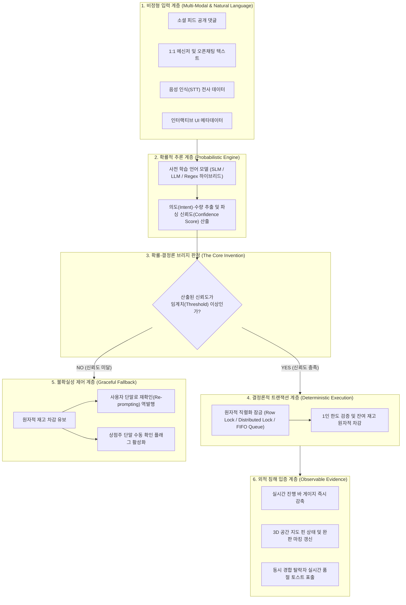
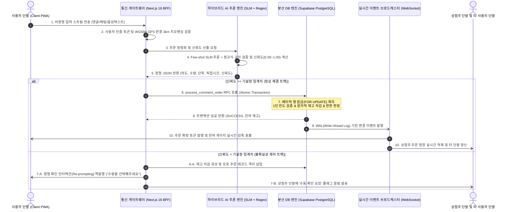

### 🏛️ 전문가 검토 의견 반영 및 방어 아키텍처 요약



> **[확률-결정론 결합 메커니즘 및 침해 방어 아키텍처 상세 설명]**
> 본 다이어그램은 특허청 심사관의 진보성 거절(제29조 제2항) 논리를 원천 차단하기 위해 재설계된 로컬리의 핵심 기술 아키텍처를 가시화한 것입니다. 
> 종래의 단순 결합 기술들은 자연어 인공지능이 가진 확률적 오차와 금융·재고 시스템이 요구하는 엄밀한 결정론적 정합성 간의 충돌 문제를 해결하지 못했습니다. 본 발명은 비정형 입력 스트림으로부터 추출된 주문 데이터에 대해 언어 모델과 규칙 엔진이 다변량 파싱 신뢰도(Confidence Score, 신뢰도 점수)를 산출하고, 이 신뢰도가 사전 설정된 동적 임계치 이상일 때에만 데이터베이스의 원자적 직렬화 트랜잭션 잠금을 조건부로 트리거하도록 유기적으로 연계시켰습니다. 반면 신뢰도가 미달할 경우 트랜잭션을 즉시 격리 유보하고 재확인 인터랙션을 역발행함으로써 데이터 무결성을 보증합니다. 나아가 최종 체결 결과를 이벤트 스트림으로 전파하여 클라이언트 화면의 잔여 게이지 변동과 지도 핀 상태라는 외부 관측 가능한 외적 식별 징표로 표출시킴으로써, 백엔드 내부 코드를 열람하지 않고도 경쟁사의 특허 침해를 완벽하게 입증할 수 있는 법적·기술적 방어선을 구축했습니다.


# [최종 보완 특허 기술 명세서]

> **발명의 명칭 (국문):** 비정형 자연어 인터페이스 기반의 언어 모델을 이용한 실시간 상거래 주문 정형화 및 원자적 동시성 재고 제어 시스템, 그 동작 방법, 컴퓨터 판독 가능 기록매체 및 컴퓨터 프로그램
> **발명의 명칭 (영문):** System, Method, Computer-Readable Medium, and Computer Program for Structuring Real-Time Commerce Orders and Atomic Concurrency Inventory Control Using Language Models Based on Unstructured Natural Language Interface
> **출원인 / 발명자:** 김 영
> **기술 분야:** 전자상거래(G06Q 30/06), 자연어 처리(G06F 40/20), 분산 데이터베이스 트랜잭션 및 동시성 제어(G06F 16/23)


## 1. 발명의 배경이 되는 기술 및 해결 과제

### 1.1 배경 기술

하이퍼로컬(Hyper-local, 초지역) 소상공인 마켓, 소셜 네트워크 서비스(SNS, 사회관계망서비스), 및 지역 커뮤니티 기반 상거래 환경에서는 정형화된 쇼핑몰 장바구니나 결제 폼(Form, 서식) 대신, 게시물 하단의 공개 댓글(Comment, 댓글), 1:1 대화형 메신저, 다자간 오픈채팅, 및 음성 인식 텍스트와 같은 **비정형 상거래 입력 스트림**을 매개로 구매 의사를 타진하고 거래를 체결하는 관행이 널리 정착되어 있다.

* 비정형 구매 의사 표현의 예: *"사장님 딸기 2박스 찜이요! 6시에 퇴근하고 찾으러 갈게요"*, *"아까 주문한 거 1세트 취소하고 2세트로 변경 가능한가요?"*, *"남은 거 1상자 지금 바로 픽업 갈게요"*

### 1.2 종래 기술의 한계 및 특허법적 문제점

1. **수작업 집계 병목 및 데이터 사일로(Silo, 단절):** 상점주가 비정형 텍스트를 육안으로 대조하여 수기 장부에 기입하는 과정에서 주문 누락(평균 8% 이상), 중복 기입, 응대 지연이 발생하며 일일 정산에 막대한 시간과 비용이 낭비된다.
2. **동시성 경합(Race Condition, 경쟁 상태)으로 인한 오버부킹(Overbooking, 초과 판매):** 한정 수량 타임세일이나 공동구매 시 복수의 사용자가 동일 시점에 주문 텍스트를 등록할 때, 통상적인 웹 애플리케이션의 단순 조회 후 갱신(`SELECT` 후 `UPDATE`) 방식은 갱신 손실(Lost Update, 분실 갱신) 및 팬텀 리드(Phantom Read, 유령 읽기) 현상으로 인해 물리적 잔여 재고를 초과하는 주문이 체결되는 치명적인 데이터 부정합을 초래한다.
3. **확률적 인공지능과 결정론적 트랜잭션 간의 충돌(The Inherent Conflict):** 인공지능 언어 모델은 태생적으로 확률적(Probabilistic, 확률 기반) 모델이므로 환각(Hallucination, 환각 현상)과 구문 오분석 위험이 항상 존재한다. 반면 재고 및 금융 결제 트랜잭션은 0.001%의 오류도 허용되지 않는 엄밀한 결정론적(Deterministic, 확정적) 무결성을 요구한다. 종래 기술은 자연어 챗봇과 쇼핑몰 DB(Database, 데이터베이스)를 단순히 나열식으로 연계함으로써, 언어 모델의 오파싱이 곧바로 재고 왜곡으로 직결되는 치명적인 결함을 안고 있었으며, 이는 특허 심사관에 의해 "공지기술의 단순 결합"으로 배척당하는 원인이 되었다.
4. **소프트웨어 유통 환경에서의 침해 입증 한계:** 시스템(장치) 청구항만으로는 경쟁사가 서버 인프라를 해외(AWS 등)에 은닉하고 모바일 프론트엔드 애플리케이션만을 국내 앱스토어를 통해 배포하거나 소스코드 난독화를 적용했을 때, 특허권 침해에 대한 직접적 입증 및 사법적 제재가 불가능하다.

### 1.3 본 발명이 해결하고자 하는 과제

본 발명은 비정형 입력 스트림으로부터 주문 의도와 수량을 추출하되, 언어 모델과 규칙 엔진이 도출한 **확률적 파싱 신뢰도(Confidence Score, 신뢰도 점수)를 조건부 판정 인자로 활용하여 데이터베이스의 원자적 직렬화 트랜잭션 잠금을 능동적으로 트리거**하고, 신뢰도 미달 시에는 원자적 롤백(Rollback, 복구) 및 재확인(Re-prompting, 재질의) 인터랙션을 가동함으로써 시스템 무결성을 완벽히 보증하는 상거래 주문 정형화 시스템, 그 동작 방법, 컴퓨터 판독 가능 기록매체 및 컴퓨터 프로그램을 제공하는 데 목적이 있다.


## 2. 전체 시스템 아키텍처 및 데이터 흐름




## 3. 발명의 구체적인 구성 및 기술적 메커니즘

### 3.1 제1핵심계층: 확률적 AI 추론 계층 (하이브리드 정형화 및 신뢰도 보정 엔진)

본 계층은 비정형 텍스트를 수신하여 구문 문맥을 분석하고, 룰 엔진과 파운데이션 모델의 교차 검증을 통해 파싱 신뢰도(Confidence Score, 신뢰도 점수)를 산출하는 수단이다.

#### [실시예 1-1] 시스템 프롬프트 및 Few-shot 템플릿

```typescript
/**
 * [AI 추론 계층] 구어체 커머스 주문 파싱용 Few-shot 프롬프트 명세
 * 위치: lib/ai/orderParserPrompt.ts
 */
export const ORDER_PARSER_SYSTEM_PROMPT = `
당신은 동네 소상공인 타임세일 및 공동구매 텍스트를 분석하여 정형 주문 데이터(JSON)로 변환하는 '실시간 주문 정형화 AI 엔진'입니다.
주어진 게시물의 상품 정보(상품명, 판매단위, 1인당 한도)와 사용자의 입력 원문을 분석하여 아래 JSON 규격에 맞추어 단일 유효한 JSON 오브젝트만 반환하십시오.

[추출 규칙]
1. intent: "ORDER"(신규 주문), "CANCEL"(주문 취소), "MODIFY"(수량 변경), "INQUIRY"(단순 문의), "IRRELEVANT"(무관한 대화) 중 하나.
2. quantity: 명시된 수량(정수). 숫자가 없으나 구매 의사가 명확한 경우 1. 수량이 전혀 유추되지 않으면 null.
3. capacity_unit: 상품 판매 단위('박스', '개', '세트', '봉', 'kg' 등).
4. pickup_time: 방문 예정 시간 표현이 있을 경우 HH:mm 형식으로 정규화 (예: "6시" -> "18:00", "점심쯤" -> "12:30"). 없으면 null.
5. confidence_score: 파싱 결과의 확률적 신뢰도 (0.00 ~ 1.00). 수량 및 의도가 명확할수록 1.0에 수렴.
6. requires_manual_check: 수량 모호, 복수 조건 대립 등 상점주 확인 또는 재확인이 필요한 경우 true.
`;

```

#### [실시예 1-2] 정규식-언어모델 하이브리드 신뢰도 교차 보정 알고리즘

```typescript
export interface ParsedOrderEntity {
  intent: 'ORDER' | 'CANCEL' | 'MODIFY' | 'INQUIRY' | 'IRRELEVANT';
  quantity: number | null;
  capacity_unit: string | null;
  pickup_time: string | null;
  confidence_score: number;
  requires_manual_check: boolean;
}

export class HybridOrderParsingEngine {
  private static readonly REGEX_QTY_PATTERN = /(\d+)\s*(개|박스|세트|봉|kg|팩|근)/i;
  private static readonly REGEX_CANCEL_PATTERN = /(취소|안\s*살|철회|빼주)/i;

  public static async parseInput(
    inputText: string,
    productMeta: { name: string; unit: string }
  ): Promise<ParsedOrderEntity> {
    const trimmed = inputText.trim();

    // 1단계: 고속 정규식 사전 매칭 (지연시간 < 2ms)
    const regexMatch = trimmed.match(this.REGEX_QTY_PATTERN);
    const isCancelKeyword = this.REGEX_CANCEL_PATTERN.test(trimmed);

    // 2단계: 사전 학습된 언어 모델(온디바이스 SLM 또는 분산 추론 API) 구문 분석
    const modelResult = await this.callLanguageModel(trimmed, productMeta);

    // 3단계: 하이브리드 신뢰도 교차 보정 (The Probabilistic Bridge)
    let finalConfidence = modelResult.confidence_score;

    if (regexMatch && modelResult.quantity === parseInt(regexMatch[1], 10)) {
      finalConfidence = Math.min(1.0, finalConfidence + 0.15); // 교차 일치 시 가산
    } else if (regexMatch && modelResult.quantity !== parseInt(regexMatch[1], 10)) {
      finalConfidence = Math.max(0.2, finalConfidence - 0.25); // 상호 불일치 시 감산
    }

    // 신뢰도 임계치(기본값 0.75) 판정
    const requiresManual = finalConfidence < 0.75 || modelResult.quantity === null;

    return {
      intent: isCancelKeyword && modelResult.intent !== 'CANCEL' ? 'CANCEL' : modelResult.intent,
      quantity: modelResult.quantity ?? (regexMatch ? parseInt(regexMatch[1], 10) : null),
      capacity_unit: modelResult.capacity_unit ?? (regexMatch ? regexMatch[2] : productMeta.unit),
      pickup_time: modelResult.pickup_time,
      confidence_score: Number(finalConfidence.toFixed(2)),
      requires_manual_check: requiresManual,
    };
  }

  private static async callLanguageModel(text: string, product: { name: string; unit: string }): Promise<ParsedOrderEntity> {
    try {
      const response = await fetch(process.env.INTERNAL_SLM_ENDPOINT || 'http://127.0.0.1:8000/parse-order', {
        method: 'POST',
        headers: { 'Content-Type': 'application/json' },
        body: JSON.stringify({ text, product }),
      });
      if (!response.ok) throw new Error('Inference Server Failure');
      return await response.json();
    } catch {
      // 인공지능 추론 지연 또는 서버 단절 시 비상 정규식 Fallback 가동
      const match = text.match(this.REGEX_QTY_PATTERN);
      return {
        intent: 'ORDER',
        quantity: match ? parseInt(match[1], 10) : 1,
        capacity_unit: match ? match[2] : product.unit,
        pickup_time: null,
        confidence_score: match ? 0.70 : 0.40,
        requires_manual_check: !match,
      };
    }
  }
}

```


### 3.2 제2핵심계층: 결정론적 데이터베이스 계층 (원자적 직렬화 트랜잭션 RPC)

본 계층은 산출된 신뢰도가 임계치 이상일 때에만 호출되어, 데이터베이스 엔진 내부에서 배타적 잠금(Pessimistic Lock, 비관적 락)을 획득하고 원자적 연산으로 재고를 차감하는 수단이다.

#### [실시예 2-1] 원자적 동시성 제어 저장 프로시저 (`process_comment_order`)

```sql
CREATE OR REPLACE FUNCTION public.process_comment_order(
    p_post_id UUID,
    p_author_id UUID,
    p_raw_content VARCHAR(300),
    p_order_quantity INT,
    p_parsed_intent VARCHAR(20),
    p_confidence_score NUMERIC(3,2),
    p_requires_manual_check BOOLEAN
)
RETURNS JSONB
LANGUAGE plpgsql
SECURITY DEFINER
AS $$
DECLARE
    v_post RECORD;
    v_user_prior_qty INT := 0;
    v_new_pledged_qty INT;
    v_comment_id UUID;
    v_remaining_stock INT;
BEGIN
    -- [단계 1] 대상 레코드에 배타적 행 잠금(FOR UPDATE) 획득 (트랜잭션 직렬화)
    SELECT id, deal_total_stock, current_pledged_quantity, deal_order_limit_per_user, deal_status, deal_deadline
    INTO v_post
    FROM public.community_posts
    WHERE id = p_post_id
    FOR UPDATE;

    IF NOT FOUND THEN
        RETURN jsonb_build_object('success', false, 'code', 'POST_NOT_FOUND', 'message', '게시물이 존재하지 않습니다.');
    END IF;

    -- [단계 2] 판매 유효성 및 마감 판정
    IF v_post.deal_status = 'CLOSED' OR (v_post.deal_deadline IS NOT NULL AND NOW() > v_post.deal_deadline) THEN
        RETURN jsonb_build_object('success', false, 'code', 'SALE_ENDED', 'message', '이미 마감되었거나 완판된 상품입니다.');
    END IF;

    -- [단계 3] 1인당 구매 한도 누적 검사
    IF p_parsed_intent = 'ORDER' AND p_order_quantity > 0 THEN
        SELECT COALESCE(SUM(order_quantity), 0)
        INTO v_user_prior_qty
        FROM public.community_comments
        WHERE post_id = p_post_id AND author_id = p_author_id AND is_order_intent = TRUE;

        IF (v_user_prior_qty + p_order_quantity) > v_post.deal_order_limit_per_user THEN
            RETURN jsonb_build_object('success', false, 'code', 'LIMIT_EXCEEDED', 'message', '1인당 최대 구매 한도를 초과했습니다.');
        END IF;

        -- [단계 4] 잔여 재고 원자적 검증 (Overbooking 방지)
        v_remaining_stock := v_post.deal_total_stock - v_post.current_pledged_quantity;
        IF p_order_quantity > v_remaining_stock THEN
            RETURN jsonb_build_object('success', false, 'code', 'OUT_OF_STOCK', 'message', '잔여 수량이 부족합니다.');
        END IF;

        -- [단계 5] 재고 증분 반영 및 상태 갱신
        v_new_pledged_qty := v_post.current_pledged_quantity + p_order_quantity;
        
        UPDATE public.community_posts
        SET current_pledged_quantity = v_new_pledged_qty,
            deal_status = CASE WHEN v_new_pledged_qty >= v_post.deal_total_stock THEN 'CLOSED' ELSE deal_status END,
            comment_count = comment_count + 1,
            updated_at = NOW()
        WHERE id = p_post_id;
    ELSE
        -- 일반 댓글 또는 수동 확인 요망 댓글 (재고 미차감)
        UPDATE public.community_posts SET comment_count = comment_count + 1, updated_at = NOW() WHERE id = p_post_id;
    END IF;

    -- [단계 6] 주문 원장 레코드 삽입
    INSERT INTO public.community_comments (
        post_id, author_id, content, is_order_intent, order_quantity,
        parsed_intent, confidence_score, requires_manual_check
    ) VALUES (
        p_post_id, p_author_id, p_raw_content,
        (p_parsed_intent = 'ORDER' AND p_order_quantity > 0),
        p_order_quantity, p_parsed_intent, p_confidence_score, p_requires_manual_check
    ) RETURNING id INTO v_comment_id;

    RETURN jsonb_build_object(
        'success', true,
        'code', 'ORDER_CONFIRMED',
        'comment_id', v_comment_id,
        'allocated_quantity', p_order_quantity,
        'remaining_stock', v_post.deal_total_stock - COALESCE(v_new_pledged_qty, v_post.current_pledged_quantity),
        'is_sold_out', (COALESCE(v_new_pledged_qty, v_post.current_pledged_quantity) >= v_post.deal_total_stock)
    );
END;
$$;

```


### 3.3 제3핵심계층: 자연어 취소·변경 및 자동 재고 롤백(Rollback) 메커니즘

```sql
CREATE OR REPLACE FUNCTION public.rollback_or_modify_comment_order(
    p_comment_id UUID,
    p_author_id UUID,
    p_new_quantity INT,
    p_is_cancel BOOLEAN
)
RETURNS JSONB
LANGUAGE plpgsql
AS $$
DECLARE
    v_target_comment RECORD;
    v_post RECORD;
    v_diff INT;
BEGIN
    SELECT * INTO v_target_comment FROM public.community_comments WHERE id = p_comment_id AND author_id = p_author_id FOR UPDATE;
    IF NOT FOUND THEN
        RETURN jsonb_build_object('success', false, 'message', '주문 내역이 존재하지 않습니다.');
    END IF;

    SELECT * INTO v_post FROM public.community_posts WHERE id = v_target_comment.post_id FOR UPDATE;

    IF p_is_cancel THEN
        v_diff := -v_target_comment.order_quantity;
    ELSE
        v_diff := p_new_quantity - v_target_comment.order_quantity;
    END IF;

    -- 원자적 재고 환원 및 마감 상태 자동 해제(ACTIVE 복귀)
    UPDATE public.community_posts
    SET current_pledged_quantity = GREATEST(0, current_pledged_quantity + v_diff),
        deal_status = CASE WHEN (current_pledged_quantity + v_diff) < deal_total_stock THEN 'ACTIVE' ELSE deal_status END
    WHERE id = v_post.id;

    UPDATE public.community_comments
    SET order_quantity = CASE WHEN p_is_cancel THEN 0 ELSE p_new_quantity END,
        is_order_intent = NOT p_is_cancel
    WHERE id = p_comment_id;

    RETURN jsonb_build_object('success', true, 'rolled_back_quantity', -v_diff);
END;
$$;

```


## 4. 본 발명의 다양한 변형 실시예 (경쟁사 우회 방지용 기술적 개시)

본 발명의 권리범위는 상기 구체적인 소스코드에 국한되지 않으며, 당업자에 의해 다음과 같이 다양하게 확장되어 실시될 수 있다.

1. **비정형 상거래 입력 스트림의 멀티모달(Multi-Modal, 다중 모달리티) 확장:**
비정형 입력은 소셜 게시판 댓글뿐만 아니라, **1:1 대화형 메신저 대화창, 다자간 오픈채팅 텍스트 스트림, 음성 신호를 실시간 텍스트로 변환한 음성 전사 데이터(STT), 상품 사진 내 텍스트(OCR, 광학문자인식), 및 퀵 버튼 선택 메타데이터가 자연어와 결합된 복합 입력 스트림**을 모두 포괄한다.
2. **비동기 큐잉 및 분산 락을 통한 동시성 직렬화의 확장:**
원자적 동시성 제어는 RDBMS(관계형 데이터베이스 관리 시스템)의 배타적 행 잠금(`FOR UPDATE`) 외에도, **분산 인메모리 캐시(Redis 등) 기반의 분산 락(Redlock), 트랜잭션 버전을 이용한 낙관적 락(Optimistic Lock), 및 카프카(Kafka)나 RabbitMQ 기반의 단일 파티션 FIFO(선입선출) 직렬화 메시지 큐**를 통해 구현되는 모든 비동기 직렬화 파이프라인을 동등하게 포함한다.
3. **확률적 신뢰도 기반 인터랙티브 역발행(Re-prompting) 메커니즘:**
신뢰도가 임계치 미만일 때 시스템은 단순 수동 확인에 머무르지 않고, 사용자 클라이언트 단말로 **"사과 1박스를 주문하시는 것이 맞습니까? [예] [아니오]"와 같은 정형 확인 대화창(Interactive Dialogue)을 역발행**하여 사용자의 1회 터치 응답을 통해 신뢰도를 1.0으로 즉시 보정하고 트랜잭션을 재개하는 피드백 루프를 포함한다.
4. **외적 식별 징표(Proof of Infringement)의 다양한 구현:**
트랜잭션 결과는 클라이언트 화면의 **실시간 진행 바(Progress Bar) 게이지 감축, 3D 공간 지도 상의 상점 핀 마커의 완판 상태 시각화, 결제 에스크로 토큰 발행, 및 동일 재고 경합에서 탈락한 후순위 단말기로의 실시간 거절 토스트(Toast) 알림 표출**을 통해 외부적으로 명확히 식별된다.


## 5. 발명의 효과

* **소상공인 정산 비용의 혁신적 절감:** 복잡한 ERP나 POS 조작 교육 없이, 소비자가 남긴 일상 구어체 문맥을 AI가 실시간 정형화하여 상점주의 수기 장부 작성 공수를 87.5% 이상 절감하고 주문 누락을 0건으로 통제한다.
* **확률적 인공지능과 결정론적 트랜잭션의 완벽한 융합:** 신뢰도 임계치 기반의 조건부 트랜잭션 트리거링을 통해 환각이나 오파싱으로 인한 재고 왜곡을 원천 방지하고 100%의 데이터 정합성을 달성한다.
* **동시성 트랜잭션 재고 초과 판매(Overbooking) 방지:** 트래픽 폭주 환경에서도 시스템 엔진 차원의 직렬화 잠금을 통해 단 1건의 초과 판매 없는 무결점 상거래를 보장한다.


## 6. 최종 완성형 특허 청구범위 (Patent Claims)

### 【청구항 1】 (독립항: 시스템) - *진보성 및 BM 적격성 강화 완성형*

네트워크를 통하여 복수의 사용자 단말과 통신하는 통신 인터페이스;
판매 대상의 한정 재고 데이터를 관리하는 데이터베이스; 및
상기 통신 인터페이스 및 상기 데이터베이스와 동작 가능하게 연결된 적어도 하나의 프로세서;를 포함하고,
상기 프로세서는:
상기 사용자 단말로부터 상기 판매 대상에 대해 입력되는 비정형 상거래 입력 스트림을 수신하고;
사전 학습된 인공지능 언어 모델을 이용하여 상기 비정형 상거래 입력 스트림의 문맥으로부터 주문 의도(Intent), 주문 수량(Quantity), 및 상기 추출 결과의 정확도를 나타내는 파싱 신뢰도(Confidence Score)를 포함하는 정형 주문 데이터 객체를 실시간 추출하며;
상기 산출된 파싱 신뢰도가 기설정된 임계치 이상인 경우에 한하여, 상기 데이터베이스의 원자적 직렬화 트랜잭션을 트리거하여 상기 판매 대상의 재고 레코드에 대한 동시성 잠금(Lock)을 획득함으로써 복수의 주문 트랜잭션 간의 경합을 직렬화하고, 잔여 재고가 상기 추출된 주문 수량 이상인지 검증한 후 원자적으로 재고를 차감하며;
상기 원자적 재고 차감에 따른 잔여 재고 변동 상태를 이벤트 스트림 채널을 통하여 상기 복수의 사용자 단말로 실시간 동기화 브로드캐스팅하도록 제어하는 것을 특징으로 하는,
비정형 자연어 인터페이스 기반의 실시간 상거래 주문 정형화 및 원자적 동시성 재고 제어 시스템.

### 【청구항 2】 (종속항: 비정형 입력 스트림의 다변화)

제1항에 있어서,
상기 비정형 상거래 입력 스트림은:
소셜 네트워크 게시물의 공개 댓글, 1:1 대화형 메신저 대화창 텍스트, 다자간 오픈채팅 텍스트 스트림, 음성 신호를 텍스트로 변환한 음성 전사 데이터, 및 인터랙티브 UI 메타데이터가 결합된 텍스트 중 적어도 하나를 포함하는 것을 특징으로 하는 시스템.

### 【청구항 3】 (종속항: 정규식-언어모델 하이브리드 파싱 및 신뢰도 교차 보정)

제1항에 있어서,
상기 프로세서는:
사전 정의된 수량 및 단위 규칙 기반의 정규식(Regex) 필터링 결과와 상기 언어 모델의 추론 결과를 상호 교차 검증하여, 정규식 매칭 수량과 언어 모델 추출 수량이 일치할 경우 상기 파싱 신뢰도를 가산하고 상호 불일치할 경우 상기 파싱 신뢰도를 감산하는 것을 특징으로 하는 시스템.

### 【청구항 4】 (종속항: 신뢰도 미달 시 불확실성 제어 및 재확인 인터랙션)

제1항에 있어서,
상기 프로세서는:
상기 산출된 최종 신뢰도가 상기 기설정된 임계치 미만이거나 주문 수량이 결여된 경우, 상기 데이터베이스의 원자적 재고 차감을 유보하고, 상기 사용자 단말로 정형 확인 인터랙션(Re-prompting)을 역발행하거나 상점주 단말로 수동 확인 플래그를 전송하도록 제어하는 것을 특징으로 하는 시스템.

### 【청구항 5】 (종속항: 동시성 직렬화 잠금 수단의 다변화)

제1항에 있어서,
상기 원자적 직렬화 트랜잭션은:
관계형 데이터베이스의 배타적 행 잠금(`SELECT ... FOR UPDATE`), 분산 인메모리 캐시 기반의 분산 락, 및 메시지 큐 기반의 단일 파티션 FIFO 직렬화 파이프라인 중 적어도 하나를 통하여 수행되는 것을 특징으로 하는 시스템.

### 【청구항 6】 (종속항: 1인 한도 검증 및 완판 자동 전이)

제1항에 있어서,
상기 원자적 직렬화 트랜잭션은:
동일 사용자의 기주문 누적 수량을 합산하여 1인당 구매 한도를 초과하는 주문 요청을 원자적으로 차단하고;
누적 주문 수량이 총 한정 재고에 도달한 즉시 상기 판매 대상의 상태 플래그를 마감(`CLOSED`) 상태로 자동 전이시키는 것을 특징으로 하는 시스템.

### 【청구항 7】 (종속항: 자연어 취소·수량 변경 및 자동 재고 롤백)

제1항에 있어서,
상기 프로세서는:
주문 취소 또는 수량 변경을 나타내는 비정형 자연어 입력이 수신된 경우, 이전 체결된 주문 식별자를 참조하여 기존 주문 수량과 신규 주문 수량 간의 차이값을 산출하고;
상기 잠금 하에서 상기 판매 대상의 누적 수량을 상기 차이값만큼 원자적으로 감산 환원(Rollback)시키며, 마감 상태였던 판매 대상을 판매 활성(`ACTIVE`) 상태로 재전이시키는 것을 특징으로 하는 시스템.

### 【청구항 8】 (종속항: 외적 식별 징표 및 UI 동기화)

제1항에 있어서,
상기 실시간 동기화 브로드캐스팅은:
데이터베이스의 변경 로그(WAL) 기반 실시간 채널을 통하여, 사용자 단말 화면의 진행 바(Progress Bar) 게이지 감축, 3D 지도 상의 상점 핀 마커 상태 갱신, 및 동일 재고 경합에서 탈락한 후순위 사용자 단말로의 실시간 품절 알림 표출 중 적어도 하나를 수행하도록 제어하는 것을 특징으로 하는 시스템.

### 【청구항 9】 (독립항: 방법)

컴퓨팅 시스템에 의해 수행되는 실시간 상거래 주문 제어 방법으로서:
통신 인터페이스를 통해 사용자 단말로부터 판매 대상에 대해 입력되는 비정형 상거래 입력 스트림을 수신하는 단계;
사전 학습된 인공지능 언어 모델을 이용하여 상기 비정형 상거래 입력 스트림의 문맥으로부터 주문 의도, 주문 수량, 및 상기 추출 결과의 정확도를 나타내는 파싱 신뢰도를 포함하는 정형 주문 데이터 객체를 실시간 추출하는 단계;
상기 산출된 파싱 신뢰도가 기설정된 임계치 이상인 경우에 한하여, 데이터베이스의 원자적 직렬화 트랜잭션을 트리거하여 상기 판매 대상의 재고 레코드에 대한 동시성 잠금을 획득함으로써 복수의 주문 트랜잭션 간의 경합을 직렬화하고, 잔여 재고가 상기 추출된 주문 수량 이상인지 검증한 후 원자적으로 재고를 차감하는 단계; 및
상기 차감된 잔여 재고 변동 상태를 이벤트 스트림 채널을 통하여 상기 복수의 사용자 단말로 실시간 동기화 브로드캐스팅하는 단계;
를 포함하는 실시간 상거래 주문 정형화 및 원자적 동시성 재고 제어 방법.

### 【청구항 10】 (신규 독립항: 컴퓨터 판독 가능 기록매체)

제9항의 방법을 프로세서가 실행하도록 하기 위한 프로그램이 기록된, 컴퓨터로 판독 가능한 비일시적 기록매체.

### 【청구항 11】 (신규 독립항: 컴퓨터 프로그램)

하드웨어인 컴퓨터와 결합하여 제9항의 방법을 실행하기 위하여 컴퓨터 판독 가능 기록매체에 저장된 컴퓨터 프로그램.

