# [Locally] 프로젝트 개발 현황 보고서 & 신규 팀원 온보딩 가이드

> **문서 버전:** v2.8.7 (단일 마스터 스키마 v3.25 엔터프라이즈: 특허 제2호 초지역 기상 방재 인텔리전스 인프라 확립, 조기경보 나우캐스팅 전국 226개 지자체 동적 8방위 방사형 스캐너, 기상청 API 쿼터 철벽 방어 및 내비게이션 벤치마킹 1분 단위 비구름 도착 ETA·3시간(180분) 상한 가드·28px 슬림 지도 컨트롤·수직 고도 분리 레이아웃 완비)  
> **기준 일자:** 2026-10-24  
> **타깃 독자:** 새로 합류한 풀스택/백엔드/프론트엔드 개발자, 프로젝트 관리자(PM, Project Manager) 및 자율형 LLM(Large Language Model, 대규모 언어 모델) 코딩 에이전트  
> **프로젝트 위치:** `<사용자 홈>/Github/locally-app` (예: `/Users/kaelkim/Github/locally-app`)  
> **기준 마스터 거점:** 경기도 화성시 효행구 봉담 (기준 좌표: `lat: 37.2181`, `lng: 126.9535` / 관할 구: `효행구`, 시: `화성시`)  
> **지자체 행정체계 팩트:** 화성특례시는 2026년 2월 1일부로 4개 일반구청(효행구·동탄구·병점구·만세구) 체제로 공식 개청하여 가동 중이며, 로컬리 플랫폼은 봉담읍을 효행구로 롤업(`HWASEONG_DISTRICT_LEAF_MAP`)하여 전국 대도시 일반구와 완벽한 형평성을 유지합니다.

---

## 1. 프로젝트 개요 및 핵심 철학

**로컬리(Locally)**는 대형 포털(네이버/카카오 등)이 세부적으로 다루지 못하는 **초지역(Hyper-Local) 생활 정보**를 모바일 PWA(Progressive Web App, 점진적 웹 앱)와 AI 동네집사 형태로 제공하는 하이퍼로컬 AI 라이프스타일 포털입니다.

### 🌟 핵심 비전 및 20대 가치
1. **초지역 실시간 생활 지능**: 전국 종합 예보가 아닌, 사용자 500m~5km 반경의 실시간 기상/미세먼지/교통 상황 요약 및 NASA GIBS·RainViewer 듀얼 실시간 위성 구름/강수 레이더 제공.
2. **골목상권 상생 커머스 & 특허 기반 자연어 주문 (특허 제1호)**: 소상공인을 위한 재고 소진형 **타임세일** 및 주민 참여형 **공동구매**, 그리고 댓글 기반 비정형 자연어(NL, Natural Language) 주문 파싱과 동시성 재고 제어 행 잠금(`SELECT FOR UPDATE`, `confirmed_stock` 조건부 원자적 트랜잭션, 특허 출원 완료).
3. **초지역 기상이변 피해 예측 및 임계 절단형 생체기상학 지수 (특허 제2호 최종 확정본 - v2.8.7 내비게이션 분 단위 ETA 및 쿼터 철벽 방어 완비)**: 기상 위성·레이더 연속 프레임의 오버스케일 무경계 합성과 $10^{(\text{dBZ}/10)}$ 역로그 가중 사영 접근 속도($V_{\text{rad}}$) 기반 **S1 레이더 물리 벡터 최우선주의(S1 Radar First)** 분 단위 도달 시간(ETA) 산출, 지상 0mm 건조 상태에서도 150km 광역 대류 전선 및 해상/육상 특보 앵커를 8방위 방사형으로 추적하는 **전국 226개 지자체 동적 나우캐스팅 엔진**, 3시간(180분) 상한 게이트 및 100% 분 단위 실시간 내비게이션 시계(`LiveEtaText`), 소스 승격 시 시프트 클린 리셋, 기상청 API허브 일일 20,000회 쿼터를 하루 7,344회(한도의 36.7%)로 칼같이 고정시키는 **4대 기둥 철벽 방어 아키텍처(In-Flight Coalescing, L1/L2 3-Tier 캐시, 기상특보 10분 싱글톤, 슈퍼컴 배포 3분 안전 버퍼 동적 TTL)**, 226개 시·군·구 불투수율/경사도 지형 가중 과거 기상 극값 매칭 및 당시 피해 뉴스 3건 조인, 선행 강수량 및 노면 온도 열수지 복원 기반 임계 절단형 러닝·등산·운전 100점 활동지수(XAI 감점 기여율 역산), 그리고 보행 유동인구 감쇠율($D_{\text{foot}} \ge 0.40$) 연동 **골목상권 타임세일 자동 점화 트리거**를 완성하여 특허 1호와 결합된 상권 선순환 기술적 해자(Moat) 확보.
4. **유가정보 쿼터 방어 & 불법유통 안전망**: 오피넷(Opinet) 1일 300콜 쿼터를 완벽 방어하는 3-Tier 캐시 아키텍처와 한국석유관리원 공표 마스터 기반 **불법 유통·행정처분 이력 4대 법적 안전장치**.
5. **ITS+GITS 하이브리드 교통 관제 & 실시간 CCTV**: 국토부 ITS(고속도로/간선망) + 경기도 GITS(시내 일반도로) 병렬 융합(150m 공간 3중 가드)으로 경기 남부 돌발 결측을 완전 종결하고, 월 930건 영속 캐시 쿼터 통제 및 Hls.js 기반 정품 HTTPS HLS(=4) 실시간 무지연 CCTV(Closed-Circuit Television, 폐쇄회로 텔레비전) 스트리밍 제공.
6. **자치단체장 선거구 기준 226개 구/군/시 독립 커뮤니티 공간 & 무경계 공간 로밍**: 읍 단위 유동성 한계를 극복하고 전국 226개 기초지자체 단위(`community_spaces`)로 공간을 분리하여 6시간 TTL(Time To Live, 유효 기간) 번개모임, 정시 AI 핫이슈 요약 및 GPS/지역선택 기반 실시간 무경계 공간 전환(`spaceResolver.ts`) 제공. (화성특례시는 2026년 2월 1일 개청된 4개 일반구 체제를 공식 반영하여 봉담읍을 효행구로 롤업 관리)
7. **사용자 계정 등록(Auth) & 카카오/네이버 듀얼 Dynamic Origin BFF 브릿지 및 소셜 인증**: 카카오·네이버 전용 독립 OAuth 2.0 BFF 브릿지(`/api/auth/kakao/*`, `/api/auth/naver/*`)를 통한 접속 호스트(`${origin}`) 동적 감지(localhost/ngrok 자동 분기), CSRF state 쿠키 가드, Supabase Service Role 기반 원자적 자동 프로비저닝(`v3.16` 스키마 트리거 완비) 및 magic link `verifyOtp` 세션 쿠키 직접 주입(URL 해시 노출 차단 Zero-Leakage), 미인증 게스트 쓰기 차단 인터셉터(`useAuthGuard`).
8. **소셜 인터랙션 & 팔로우/언팔로우 네트워크 및 프로필 퀵뷰 (`ProfileQuickViewModal`)**: 이웃 주민 간 팔로우/언팔로우 실시간 토글(`community_follows`), 피드/댓글 아바타 탭 시 작성자 프로필 요약 퀵뷰 모달 팝업, 작성자 게시글 모아보기 및 팔로워/팔로잉 카운팅 지원.
9. **내정보(MyInfo) 스토리지 아바타 인프라 & 10대 서브메뉴 통합 관리 & 내가 쓴 글 0ms 편집 동기화**: Supabase Storage `avatars` 버킷 기반 프로필 사진 업로드 및 3중 RLS 방어, 소개글(bio 100자) 확장, 댓글 원문 딥링킹([원문보기 ↗]), 내가 쓴 글 인라인 수정 및 0ms 로컬 상태 동기화, 팔로잉/팔로워 목록 관리, 주문 내역, 사업자 인증, 관리자 모달 및 실시간 프로필 수정 완비.
10. **골드 스탠다드 럭셔리 라이트 테마 (White Frosted Glassmorphism) & 200자 헌법 준수 게시글 편집**: 피드 내 Rich Content(OG 카드)의 어두운 배경을 배제하고 `bg-white/95 backdrop-blur-md` 럭셔리 라이트 테마로 전면 통일. PostgreSQL 200자 헌법 제약조건(`chk_normal_post_char_limit`)을 100% 준수하는 일반 게시글 편집 모달(`PostEditModal`)과 실시간 URL-OG 생명주기 양방향 동기화 제공.
11. **글로벌 모달 바디 스크롤 락 & 모바일 터치 격리 (`useBodyScrollLock`)**: 모달 팝업 시 배경 스크롤 체이닝(Scroll Chaining) 및 마우스 휠/터치 누출을 완벽 차단하는 모듈 레벨 카운터 락(`activeLockCount`), 데스크톱 레이아웃 시프트 방지 패딩 보정, iOS 사파리 제스처 누출 방지 탑재.
12. **로컬 뉴스 군(Gun)·구(Gu) 선거구 일원화 & 3단 계층형 탭**: 읍(Eup) 단위 크롤링을 완전히 배제하고 지자체 단체장 선거 기준인 구·군 단위로 공간 체계를 일원화. `sort=date` 최신순 강제 인입 및 클라이언트 SWR 0ms 쾌속 탭 전환(`[전체]`, `[구·군(TIER1)]`, `[시·도(TIER2)]`) 제공.
13. **로컬 뉴스 공간 품질 검증 엔진 (Locality Validator v1.5.0 & 인접 선거구 분리)**: 주체-객체 전도 결함(Subject-Object Inversion) 완치, 타 지자체 경합 40여 개 도시 목록 대조, 복수 지자체 병렬 나열(예: `대구·울산·경북 미분양`) 거시 비교 기사 배제, TIER2 광역 피드 내 인접 자치구 단독 기사 차단 및 Python ETL ↔ TypeScript BFF 100% 미러링 동기화.
14. **시맨틱 토픽 클러스터링 & 단일 대표 기사 선별**: 2-gram 음절 자카드 유사도(0.35+) 및 불용어 제거 엔티티 토큰 매칭 기반의 3중 시맨틱 판별로 통신사(연합뉴스/뉴시스 등)의 동일 현장 포토 뉴스 중복 도배를 완벽 차단하고, 공공·신뢰도 가중치 기반 단 1건의 대표 기사만 선별.
15. **저작권·개인정보 보호 & 앱 전역 시간 SSOT 가드레일**: 뉴스 본문 전재 배제(AI 3줄 요약 + 원본 직접 아웃링크), GPS 위치정보 최소 수집, 상대/절대 시간 단일 공급원(`timeFormatter.ts`), 비보안 환경 자동 IP 폴백 지원.
16. **골목 커머스 상점 신뢰 거버넌스 & 무위험 선주문 공동구매 C2B 엔진 (특허 제2호 연계)**: 국세청 실시간 사업자등록 진위확인 API(NTS_API) 연동을 통한 Zero-Trust 상점 인증, 전자상거래법 제13조 법정 정보 팝오버(`MerchantLegalPopover`), 1건 이상 주문 인입 시 핵심 조건 영구 수정 불가 락(Edit-Lock), 수량 스텝퍼 댓글 선주문(연타 방어 디바운스 가드), 비파괴적 취소선 슬레이트 박스(Soft-Cancel) 및 마감 시 이웃 주민 주문 댓글 프라이버시 실드(Privacy Shield) 완비.
17. **1:1 쪽지(DM) 리치 커뮤니케이션 & 3대 런타임 가드레일 & 다크모드 시인성 완치**: 텍스트 전용 쪽지함을 탈피하여 400ms 디바운스 실시간 URL-OG 링크 카드 프리뷰 및 최대 2장·장당 3MB 멀티미디어 사진 첨부 파이프라인 완비. 사진 단독 전송 방어(가드레일 1), 외부 이미지 네이티브 `` 에러 방어(가드레일 2), 430px 반응형 썸네일 그리드(가드레일 3), 그리고 맥 OS 다크모드에서도 시인성이 붕괴되지 않는 골드 스탠다드 럭셔리 라이트 테마 전역 리마스터링 달성.
18. **골목 커머스 럭셔리 라이트 테마 전역 완비 & 컨펌 모달 인라인 에러 배너 & 내정보 역할 DB 영속화 & 데스크톱 430px 프레임 핏 (`CommerceRegisterModal`, `GroupBuyRegisterConfirmModal`)**: 상점주 인증, 상품 등록 폼, 확인 모달 전역 럭셔리 라이트 리마스터링 완료. 확인 모달 내부 인라인 에러 배너 장착으로 등록 실패 시 블러 화면 뒤 은폐 없는 1초 직관 피드백 보장, 내정보 역할 전환(`handleCycleRole`) 시 Supabase DB `user_profiles.account_type` 실시간 동기화로 백엔드 403 거부 원천 방어, 모달 가로폭 `w-full max-w-[425px] sm:max-w-md`로 데스크톱 430px 중앙 프레임 정밀 일치화 달성.
19. **골목 커머스 등록 UX 혁신 & 유형 선택 모달(`CommerceTypeSelectModal`) & 2줄 제목 최적화 & 상단 헤더 데드센터 가드**: 좁은 모바일 탭 바에서 버튼 찌그러짐을 없애기 위해 복수 버튼(`+ 타임세일`, `+ 공동구매`)을 단일 `[+ 상품 등록]` 버튼으로 통합하고, 번개/소그룹 모임 개설 스타일의 유형 선택 팝업 신설 및 순차적 모달 전환(지터 방지) 장착. 최신 모바일 커머스 트렌드에 맞춰 긴 상품명 2줄 확장(`line-clamp-2 break-keep-all leading-snug`) 및 태그 행 분리 완료. 모바일 헤더 좌우 w-10(40px) 대칭 가드로 위치명 100% 데드센터 보장.
20. **기상 히어로 럭셔리 라이트 하이브리드 관측창 & 28px 슬림 컨트롤 바 & 수직 고도 분리 레이아웃 (`WeatherHeroCard`, `WeatherHeroMap`, `WeatherTimelineChart`)**: 순백색 위성 구름(NASA GIBS)과 강수 레이더(RainViewer)의 광학적 시인성을 100% 영구 보존하기 위해 상단 캔버스는 VWorld Midnight 다크 타일의 풀-블리드(`h-64 sm:h-72`)로 카드의 상단 라운드에 1:1 밀착시키고, 카드 외곽 및 하단 3단 실황 메트릭을 화이트 모던 테마(`#F8FAFF`)로 감싸는 애플/토스형 하이브리드 관측창 완비. 줌 컨트롤러를 28px 직경 슬림 바(`w-7 h-7`)로 고도 격상(`bottom-6 right-3`)하여 하단 저작권 워터마크(`bottom-1`)와의 텍스트 겹침을 0.00% 차단하고, 1분 단위 내비게이션 비구름 도착 뱃지(`LiveEtaText`) 및 `map.resize()` 듀얼 가드, 차트 로컬리 블루 SVG 곡선/포인트 도트 명도 가드 적용.
21. **모바일 Ngrok 실기기 호환 인프라 (세션·미디어·Origin)**: 로컬호스트에서는 정상인데 스마트폰 Ngrok(`https://*.ngrok-free.dev`)에서만 깨지던 문제를 구조적으로 해결. ① 세션 쿠키명 SSOT(`lib/auth/constants.ts` `AUTH_COOKIE_NAME`)로 서버/브라우저 쿠키 이름 100% 일치, ② `getEffectiveOrigin`(`X-Forwarded-Host/Proto` 우선)으로 OAuth 콜백 Origin 복원, ③ `/supabase-auth/:path*` ➔ `127.0.0.1:54321` Next.js rewrite + `resolveMediaUrl`로 스토리지 이미지 루프백 탈출, ④ `SafeImage`/`useSafeImageUrl`로 Ngrok 경고 인터스티셜(HTML) 우회 Blob 페칭 및 조기 마운트 방어.
22. **로컬 뉴스 Tier 보장 쿼리 & 화성 일반구 관할 롤업 & 6시간 초단기 예보 카드**: TIER1/TIER2 기사를 별도 쿼리로 병렬 조회해 TIER2 편중으로 인한 TIER1 누락을 방지하고, 효행구 등 화성시 일반구의 관할 읍면동(`HWASEONG_DISTRICT_LEAF_MAP`)을 검색·필터에 반영. 기상 이상징후 엔진에 `LIGHT_RAIN`/`HUMID_MUGGY` 카테고리를 추가하고 `WeatherHourlyForecastCard`(6시간 초단기 예보)를 동네생활 날씨 화면에 컴팩트 재도입.

---

## 2. 전체 기술 스택 명세 (Technology Stack)

| 구분 | 기술 / 도구 | 버전 | 주 사용 목적 및 특징 |
| :--- | :--- | :--- | :--- |
| **Frontend Framework** | **Next.js (App Router)** | `16.3.0` | React 19 호환, SSR/SSG 및 BFF API Gateway 라우트 제공 (비동기 Server Component, 비동기 params/headers 준수) |
| **UI Library** | **React** | `19.2.8` | 최신 Actions, Transition, Suspense 및 모바일 뷰포트 반응형 컴포넌트 |
| **Styling & Theme** | **Tailwind CSS & Luxury Light Theme** | `v4.0.0` | `@theme inline` 커스텀 브랜드 토큰 + **골드 스탠다드 럭셔리 라이트 테마** (`bg-white/95 backdrop-blur-md`, Vibrant Indigo/Emerald Accent Pills, OG 카드 통일) |
| **Data Fetching** | **SWR** | `^2.5.1` | 실시간 폴링, 클라이언트 캐싱, 낙관적 업데이트(Optimistic UI) |
| **Authentication** | **Supabase Auth / OAuth 2.0 (Kakao & Naver Dynamic BFF)** | 최신 규격 | **카카오 & 네이버 듀얼 독립 BFF OAuth 2.0 파이프라인 (`/api/auth/kakao/*`, `/api/auth/naver/*`, 접속 호스트 `${origin}` 동적 감지 & localhost/ngrok 자동 분기, `NAVER_AUTH_CLIENT_ID` 및 `KAKAO_CLIENT_ID` 분리, CSRF state 쿠키 가드, Supabase Service Role 자동 프로비저닝 & magic link verifyOtp 세션 쿠키 직접 주입)**, `useAuthGuard` 인터셉트 가드 |
| **Modal & Scroll Lock** | **useBodyScrollLock Hook** | Custom | 모달 오픈 시 배경 스크롤 체이닝 차단, 모듈 레벨 카운터 락(`activeLockCount`), 데스크톱 `paddingRight` 보정 및 iOS 사파리 터치 격리 |
| **Icons** | **Lucide React** | `^1.31.0` | 모바일 UI 아이콘 (`ImageIcon` alias 충돌 방지 적용, `Pencil` 수정 아이콘, 공식 명칭 준수) |
| **Map & Satellite** | **MapLibre GL / RainViewer / NASA GIBS** | Custom Tile | 3대 레이어 핀 + 하이브리드 LOD 클러스터링 + 실시간 위성 적외선 구름/강수 레이더 |
| **Video Streaming** | **Hls.js** | `^1.7.3` | ITS 공공 CCTV 실시간 고화질 스트리밍 (HTTPS HLS=4 전송 규약 완벽 지원) |
| **Image Processing** | **Pure TypeScript PNG Engine** | `zlib` 기반 | Scanline Unfiltering 및 Paeth Predictor 디코딩을 통한 격자 없는 투명 구름 타일 합성 |
| **GIS & Roaming** | **TypeScript KATEC Converter / proj4 / PostGIS / spaceResolver** | Custom / ^2.22.0 / 15+ | 순수 TS 브라우저/BFF KATEC(`EPSG:5179`) ↔ WGS84(`EPSG:4326`) 고속 변환 및 226개 선거구 공간 매핑·로밍 엔진 |
| **Edge AI Engine & Weather** | **TensorFlow.js / Teachable Machine / Weather Engine** | `^4.22.0` / `^0.8.5` | 온디바이스 영수증/상점 비전 인증 및 자연어 주문 의도 파싱 하이브리드 추론 기반 + **[특허 제2호 & v2.8.7] 초지역 기상·방재 및 내비게이션 비구름 ETA 엔진 (`SpatioTemporalRadarTracker`, `radarEventStore`, `adaptiveTimeBucket`, `weatherCacheManager`, `useCoarseNow`, `LiveEtaText`, `tests/test_eta_countdown.ts`)** |
| **Backend & ETL** | **Python (FastMCP, FastAPI)** | `3.10+` | Port 8000 기반 FastMCP 서버 및 Locality Validator v1.5.0 파이프라인(`sync_news.py`, `locality_validator.py`) |
| **Database** | **Supabase (PostgreSQL 15+)** | Cloud/Local | PostGIS 공간 쿼리, `pgvector`, RLS 보안 정책, **v3.25 엔터프라이즈 마스터 스키마([특허 제2호 인프라 & seed.sql 분리] 전국 226개 지형 취약 계수 district_topography_meta, 기상이변 과거 극값 DB weather_historical_extremes, 인접 연결망 district_adjacency_ring, 공간 K-Ring 및 피해 뉴스 매칭 RPC match_historical_weather_anomaly_v2, 타임세일 commerce_time_sales/commerce_time_orders·confirmed_stock, 5대 커머스 테이블 DML GRANT, storage.objects 유니크 인덱스, 1:1 쪽지 direct_messages 멀티미디어 사진 배열 media_urls 및 오픈그래프 og_metadata, 국세청 상점 인증 merchant_verifications, 공동구매 commerce_group_buys, 주문 트랜잭션 commerce_group_orders, Edit-Lock, Soft-Cancel, 프라이버시 실드, Auth 자동 프로비저닝, community_follows 복합PK 및 RLS, community_comments 영속화, avatars 스토리지 버킷 및 UPDATE RLS, TIER2 격리 제약조건, 200자 헌법 제약조건 `chk_normal_post_char_limit`)** |
| **Object Storage** | **Supabase Storage** | Cloud/Local | `community-media` (게시글 첨부 사진 3장), `avatars` (프로필 사진 2MB 제한, WebP/PNG/JPG) |
| **Dev Tunnel & Media Proxy** | **Ngrok / Next.js rewrites / SafeImage** | Free tier | 모바일 실기기 테스트 터널(`https://subfloor-deepness-afloat.ngrok-free.dev`). `next.config.ts`의 `allowedDevOrigins` 및 `/supabase-auth/:path*` ➔ `http://127.0.0.1:54321` rewrite, `resolveMediaUrl`, `SafeImage`/`useSafeImageUrl`(`ngrok-skip-browser-warning` 헤더 Blob 페처) |
| **Session Cookie SSOT** | **@supabase/ssr + `AUTH_COOKIE_NAME`** | `^0.12.4` | 서버(`createServerClient`)/브라우저(`createBrowserClient`) 쿠키명을 `sb-locally-auth-token`으로 통일하여 localhost·ngrok 어떤 도메인에서도 세션이 끊기지 않음 |
| **Public APIs** | **에어코리아 / 오피넷 / 국토부 ITS / 경기도 GITS / 기상청 / 한국석유관리원 / 국세청** | 최신 규격 | 에어코리아 v1.4, 오피넷 2026.06, ITS 4대 API(HLS=4), GITS 옴니 파서(XML/JSON), 기상청 단기예보, 석유관리원 행정처분, **국세청 NTS 사업자등록정보 진위확인 API** |
| **External Services** | **Kakao Local / Kakao Roadview / Naver Search & Login / Kakao Login / RainViewer** | REST API / JS SDK | 실시간 주소 역지오코딩, 360° 파노라마 로드뷰, 지역 언론 보도 검색, **네이버 로그인(`NAVER_AUTH_CLIENT_ID` 분리) 및 카카오 로그인**, 전 지구 실시간 강수/위성 |
| **Language & Testing** | **TypeScript / Python / ts-node / Node.js** | TS 5.x / Py 3.10+ | Strict Mode, Any 타입 금지, 395라인 Locality Validator 단위 검증(`tests/test_locality_validator_ts.ts`), 내비게이션 비구름 ETA 7대 검증(`tests/test_eta_countdown.ts`), 지자체 적합성 스크립트(`scripts/test-nationwide-relevance.ts`) |

---

## 3. 시스템 아키텍처 (System Architecture)

### 3.1 Mermaid 아키텍처 다이어그램

```mermaid
flowchart TB
    subgraph Client ["Client Layer (Mobile PWA - Max 430px)"]
        UI["LocallyMainApp (components/LocallyMainApp.tsx)"]
        T1["탭 1: 우리동네 (Living & Weather)"]
        T2["탭 2: 동네마당 (226개 구/군/시 독립 공간 SNS)"]
        T3["탭 3: 로컬커머스 (타임세일/공구/상인대시보드/공구등록폼/주문진척도위젯)"]
        T4["탭 4: 동네지도 (하이브리드 LOD & 듀얼반경 3km/5km & CCTV)"]
        T5["탭 5: 마이페이지 (DM편지함/팔로잉목록/아바타수정/댓글딥링킹/사업자인증)"]
        Modals["글로벌 모달군: AuthModal / AuthRequiredModal / MerchantVerifyModal / CommerceTypeSelectModal / CommerceRegisterModal / GroupBuyRegisterConfirmModal / MerchantLegalPopover / ProfileQuickViewModal / PostEditModal / GatheringCreateModal / UnifiedDialog / DM / 상점상세 / 교통돌발 / CCTV(HLS) / 동네선택 / 주유소 / 로드뷰 / 커머스작성 / 관리자AI"]
        SWR["SWR & Custom Hooks (useAuth, useAuthGuard, useBodyScrollLock, useUserLocation, useWeather, useLocalNews, useMapLayers, useCommunity, useCommerceDeals)"]
    end

    subgraph BFF ["Next.js 16 BFF API Gateway (/app/api & /app/auth)"]
        API_AUTH["/api/auth/kakao & /api/auth/naver (Dynamic Origin login/callback - Zero-Leakage verifyOtp 세션 주입)"]
        API_MERCHANT["/api/merchant/verify (국세청 NTS 진위확인 API 2대 가드레일)"]
        API_GEO["/api/geo (reverse, ip)"]
        API_W["/api/weather (hyper-local, layers, satellite, tiles/v2/[z]/[x]/[y])"]
        API_N["/api/news/local (3단 군·구 선거구 탭 & Locality Validator v1.5.0 & 시맨틱 토픽 클러스터링)"]
        API_C["/api/community/* (posts PATCH/POST/GET, comments, follows, likes, space, ai-digest, upload)"]
        API_D["/api/commerce/deals"]
        API_GB["/api/commerce/group-buys & group-order (공구 등록, Edit-Lock, 댓글 스텝퍼 선주문, Soft-Cancel)"]
        API_DM["/api/direct-messages"]
        API_M["/api/map/layers (병렬 RPC + 유가 캐시 L2 + 듀얼 반경)"]
        API_O["/api/oil/nearby & /api/oil/detail (쿼터 방어 & 처분 배치 조인)"]
        API_T["/api/traffic/events & /api/traffic/cctv (ITS+GITS 하이브리드 융합 & 월 930건 통제 영속 캐시)"]
    end

    subgraph PythonServer ["Python Backend & ETL (Port 8000)"]
        MCP["FastMCP Server (main.py)"]
        Collectors["Public API Collectors (Air, Oil, Traffic, News, Weather)"]
        Pipelines["ETL Pipelines (sync_oil, sync_traffic, sync_news, crawl_single_region)"]
        Val_Py["Locality Validator Python v1.5.0 (locality_validator.py, text_normalizer.py)"]
        Sanitizer["text_sanitizer.py (HTML 엔티티 및 정크 필터링)"]
    end

    subgraph Database ["Supabase PostgreSQL + PostGIS (v3.25 SSOT & seed.sql)"]
        TB_AUTH["auth.users (신규 가입 감지 트리거)"]
        FN_PROV["handle_new_user_provisioning() (@handle & xAI 180초 쿼터 원자적 자동 생성)"]
        TB_REG["korea_administrative_regions (3,838개 읍면동 격자 마스터, supabase/seed.sql 분리 자동 주입)"]
        TB_SPACE["community_spaces (전국 226개 구/군/시 독립 공간 마스터)"]
        TB_CRAWL["crawl_target_regions (동시성 수집 락 & 봉담읍 기본 거점 영구 시드)"]
        TB_TOPO["district_topography_meta (226개 지자체 불투수율 & 경사도, 특허 2호)"]
        TB_HIST["weather_historical_extremes (10개년 기상 극값 및 언론 보도, 특허 2호)"]
        TB_RING["district_adjacency_ring (1~3단계 인접 권역 공간 토폴로지, 특허 2호)"]
        FN_MATCH["match_historical_weather_anomaly_v2() (코사인 유사도 극값 매칭 RPC)"]
        TB_NEWS["local_news (chk_local_news_tier2_no_district 제약, idx_local_news_tier_composite 인덱스)"]
        TB_W["weather_cache & air_quality"]
        TB_OIL_CACHE["oil_price_cache (300콜 쿼터 방어 TTL 캐시)"]
        TB_OIL_DISP["oil_station_dispositions & v_active_oil_dispositions (1년 소멸 시효 보장)"]
        TB_TRAFFIC_CACHE["traffic_events_cache & traffic_cctv_cache (ITS 월 930건 통제 영속 캐시)"]
        TB_C["community_posts & comments (200자 헌법 제약 chk_normal_post_char_limit, RLS 42501 및 UUID 22P02 완치, 자연어 주문 락)"]
        TB_MERCHANT["merchant_verifications (국세청 사업자등록 인증 메타데이터)"]
        TB_GB["commerce_group_buys (공동구매 상품 & Edit-Lock & 200자 바운더리)"]
        TB_GO["commerce_group_orders (댓글 주문 트랜잭션 & 승인 토글 & Soft-Cancel)"]
        TB_TS["commerce_time_sales & orders (confirmed_stock 원자적 락 & 악천후 골든타임 트리거)"]
        TB_FOLLOW["community_follows (복합 PK: follower_id + following_id, RLS 완비)"]
        TB_DIGEST["ai_hourly_digests (정시 공간별 AI 핫이슈 요약)"]
        TB_STORAGE["storage.buckets: avatars & community-media (RLS 3중 방어)"]
        TB_DM["direct_messages"]
        TB_U["user_profiles (bio VARCHAR(100), is_merchant, UPDATE RLS) & user_quotas"]
    end

    subgraph External ["공공데이터 & 외부 인증/서비스"]
        EXT_KAKAO_AUTH["카카오 로그인 OAuth 2.0"]
        EXT_NAVER_AUTH["네이버 로그인 OAuth 2.0 (NAVER_AUTH_CLIENT_ID 분리 & BFF 브릿지)"]
        EXT_NTS["국세청 공공데이터포털 (사업자등록정보 진위확인 API)"]
        EXT_KAKAO["카카오 로컬 (역지오코딩 & 로드뷰 & 길찾기)"]
        EXT_IP["IP Geolocation (ipapi.co, geojs)"]
        EXT_RAIN["RainViewer & NASA GIBS (위성 레이더)"]
        EXT_NAVER["네이버 뉴스 검색 API"]
        EXT_AIR["한국환경공단 에어코리아"]
        EXT_OIL["한국석유공사 오피넷 (1일 300콜 제한)"]
        EXT_KPETRO["한국석유관리원 (행정처분 공표 자료)"]
        EXT_ITS["국가교통정보센터 ITS (돌발/재난/위험물/CCTV HTTPS HLS=4)"]
        EXT_GITS["경기도교통정보센터 GITS (시내도로 돌발/차로통제 OpenAPI)"]
        EXT_KMA["기상청 단기예보 Open API"]
    end

    UI --> SWR
    SWR --> BFF
    BFF --> Database
    BFF -. On-Demand Run .-> Pipelines
    Pipelines --> Database
    Pipelines --> External
    BFF --> External
    TB_AUTH --> FN_PROV
    FN_PROV --> TB_U
```



---

## 4. 디렉토리 구조 & 마인드맵 (Markmap & Tree)

### 4.1 Markmap 다이어그램

```markdown
# locally-app
## app (Next.js 16 App Router)
### auth
- callback/route.ts - **[v1.6.0 고도화]** 카카오/네이버/소셜 OAuth 콜백 처리 & 세션 복구 및 리다이렉트
### api (BFF 라우트)
- auth/kakao (login, callback) - **[v2.6.0 신설]** 카카오 독립 OAuth 2.0 Dynamic Origin BFF 브릿지 (접속 호스트 `${origin}` 자동 감지 & localhost/ngrok 동적 분기, CSRF state 가드, Supabase Admin 자동 프로비저닝, magiclink verifyOtp 세션 쿠키 주입)
- auth/naver (login, callback) - **[v1.8.0 고도화]** 네이버 독립 OAuth 2.0 BFF 브릿지 (`NAVER_AUTH_CLIENT_ID` 분리) & Supabase Service Role 자동 프로비저닝 & magic link 액션 링크 세션 복구
- merchant/verify - **[v1.9.0 신설]** 국세청 사업자등록정보 진위확인 API & 2대 가드레일 (No Phantom Imports, 이중 안전망 인코딩) & Mock 폴백
- geo (reverse, ip) - 4단계 위치 복원 체계 (GPS -> IP -> Cache -> Default)
- weather (hyper-local, layers, satellite, tiles/satellite/v2/[z]/[x]/[y]) - 실시간 기상 및 위성 구름 래스터
- news/local - 3단 군·구 선거구 탭 & Locality Validator v1.5.0(주어-객체 전도 방어/광역 분리) & 3중 시맨틱 토픽 클러스터링
- map/layers - 3대 레이어(커머스, 주유소, 교통돌발) 병렬 집계 & 듀얼 반경(3km/5km)
- oil (nearby, detail) - 오피넷 300콜 쿼터 방어 & 단일 주유소 상세/행정처분 조회
- traffic (events, cctv) - ITS+GITS 하이브리드 영속 캐시 & HTTPS HLS=4 스트리밍
- commerce/deals - 타임세일 & 공동구매
- commerce/group-buys - **[v1.9.0 신설]** 공동구매 등록, 목록 조회 및 1건 이상 주문 시 Edit-Lock 제어
- commerce/group-order - **[v1.9.0 신설]** 댓글 기반 공동구매 주문 생성, 상점주 승인 토글, 취소(Soft-Cancel) 처리
- commerce/time-sales - **[v2.6.x]** 타임세일 등록/수정/삭제/조기마감 (BOLA 가드: `post.author_id` 교차검증)
- commerce/time-order - **[v2.6.x]** 타임세일 주문 조회(GET, 미승인 포함 선착순 조인)/승인/반려 (`confirmed_stock` 조건부 원자적 UPDATE)
- og - 링크 OpenGraph 메타 수집 (DM·게시글 URL 프리뷰)
- community (posts, comments, follows, space, ai-digest, likes, upload) - **[v1.8.0 고도화]** posts PATCH 일반 게시글 수정 지원, `author:user_profiles` 조인 반환, 200자 헌법 제약 준수, 구/군/시 독립 공간 SNS
- direct-messages - 1:1 실시간 메시지
### layout.tsx & page.tsx (430px 모바일 셸 & AuthProvider & LocallyMainApp 로딩)
### globals.css (Tailwind v4 테마 및 모바일 애니메이션)
## components (UI 컴포넌트)
### LocallyMainApp.tsx - **[v1.6.0 신설]** 메인 앱 셸 컴포넌트 (5대 탭, 전역 모달 총괄 및 공간 로밍 상태 제어, 댓글 원문 딥링킹 스크롤 & 하이라이트)
### common - **[v1.6.0 신설]**
- UnifiedDialog.tsx - 확인/취소 및 경고 일관된 글로벌 커스텀 모달 다이얼로그
- SafeImage.tsx - **[v2.7.0 신설]** Ngrok 환경 조기 마운트 방어·Blob 페칭 투명 드롭인 이미지 (`hideOnError`, `fallbackText`)
- ImageLightboxModal.tsx - **[v2.7.0 고도화]** 이미지 전체보기(`z-[999999]`), `SafeImage`/`resolveMediaUrl` 적용, DM·피드 공용
### auth
- AuthModal.tsx - **[v1.8.0 고도화]** 네이버 BFF 로그인 연동(`handleNaverLogin`), 소셜 3초 로그인(카카오/네이버/구글) & 이메일 회원가입/로그인 모달
- AuthRequiredModal.tsx - 미인증 게스트 쓰기 동작 인터셉트 및 안내 모달
### merchant - **[v1.9.0 신설]**
- MerchantVerifyModal.tsx - **[v1.9.0 신설]** 국세청 진위확인 API 연동 실시간 사업자등록 상점 인증 모달
### layout (MobileAppShell - [상단 3단 대칭 grid-cols-[40px_1fr_40px] 100% 데드센터 보장], TopNavigation, RegionSelectModal)
### weather (WeatherHeroCard - [상단 풀-블리드 밀착형 하이브리드 관측창 & #F8FAFF 실황 메트릭], WeatherHeroMap - [VWorld Midnight & NASA/RainViewer 듀얼 레이어 & 듀얼 map.resize() 리사이즈 보정 & bottom-6 right-3 28px 슬림 줌 컨트롤 핏 & bottom-1 워터마크 분리], EnvironmentSafetyCard, WeatherTimelineChart - [화이트 모던 카드 & 로컬리 블루 #2563eb SVG 기온 곡선 & 고대비 포인트 도트], WeatherCalendarCard, WeatherSatelliteMapCard)
- WeatherHourlyForecastCard.tsx - **[v2.7.0 신설]** 6시간 초단기 예보 컴팩트 카드 (`grid-cols-6`, 430px 핏, `LocallyMainApp`에서 `weather.fcst_timeline`으로 렌더)
- LiveEtaText.tsx - **[v2.8.7 신설]** 내비게이션 비구름 도착 예정시간 30초 틱 저전력 말단 리프 컴포넌트 (지도 WebGL 리렌더링 0회)
- EtaShiftDetailModal.tsx - **[v2.8.7 신설]** 도착시간 변동 사유 및 시프트 상세 안내 모달
### news (NewsFeed - [3단 세그먼트 탭], NewsCard - [AI 요약 하이브리드 표출 & formatAppTime])
### community - **[v1.9.0 고도화]**
- CommunityView.tsx - **[v1.8.0 고도화]** 구/군/시 독립 공간 피드, 모임 수정(`GatheringCreateModal`)과 일반 게시글 수정(`PostEditModal`) 이원화 라우팅
- PostCard.tsx - **[v1.9.0 고도화]** 상점 인증 뱃지 & 전자상거래법 제13조 법정 정보 팝오버 연동, 본인 작성 글 연필 수정 아이콘(`<Pencil />`), Rich Content(OG 카드) 골드 스탠다드 럭셔리 라이트 테마(`bg-white/95 backdrop-blur-md`) 리디자인, 200자 제약 렌더링, 인라인 팔로우, 휴지통 삭제 패리티
- PostEditModal.tsx - **[v1.8.0 신설]** 200자 헌법(`maxLength={200}`) 준수 일반 게시글 편집 모달, 실시간 URL-OG 생명주기 양방향 동기화, 이미지 교체
- CommentThread.tsx - **[v1.9.0 고도화]** 수석 팁 ③ 반영 프라이버시 실드(공구 마감 시 이웃 주민 주문 마스킹 및 상점주 수령 안내 공지만 노출), 본인 댓글 삭제, 아바타 탭 시 퀵뷰 연동
- ProfileQuickViewModal.tsx - 프로필 퀵뷰 모달 (팔로우/언팔로우, 소개글, 작성글 목록)
- GatheringCreateModal.tsx - 모임/번개 생성 및 수정 모달
- CommercePostModal.tsx - 타임세일/공동구매 및 모임(번개/소그룹) 통합 작성 모달
- AdminAiChatModal.tsx - 관리자 전용 대화형 AI 커뮤니티 관리 모달
### commerce - **[v2.3.0 전면 고도화]**
- CommerceView.tsx - **[v2.2.0 고도화]** 타임세일 & 공동구매 탭, 단일 `[+ 상품 등록]` 버튼, 카드명 2줄 줄바꿈(`line-clamp-2 break-keep-all leading-snug`) 및 태그 행 분리, 다크 잔존 색상(검정 뱃지/버튼) 완전 제거, 상점 인증 뱃지 연동
- CommerceTypeSelectModal.tsx - **[v2.2.0 신설]** 번개/소그룹 모임 개설 스타일의 타임세일 vs 공동구매 유형 선택 모달 & 순차적 등록 모달 핸드오프
- CommerceRegisterModal.tsx - **[v2.1.0 신설 / v2.1.1 고도화]** 데스크톱 430px 프레임 정렬(`w-full max-w-[425px] sm:max-w-md`) 모드 전용(타임세일/공구) 통합 등록 모달
- MerchantDashboardView.tsx - 소상공인 상인 전용 실시간 딜 현황, 재고 소진율, 주문자 목록 및 상태 제어 대시보드
- MerchantLegalPopover.tsx - **[v1.9.0 신설]** 전자상거래법 제13조 소비자 보호 법정 정보 팝오버
- GroupBuyCreateForm.tsx - **[v1.9.0 신설]** 수석 팁 ① 반영(200자 바운더리) 공동구매 상품 등록 폼 (SQLSTATE 22001 원천 방어)
- GroupBuyRegisterConfirmModal.tsx - **[v1.9.0 신설 / v2.1.2 고도화]** 공구 등록 최종 확인 모달 (내부 인라인 에러 배너 장착)
- GroupBuyOrderCommentInput.tsx - **[v1.9.0 신설]** 수석 팁 ② 반영(디바운스 가드) 댓글 수량 스텝퍼 선주문 입력
- GroupBuyCommentItem.tsx - **[v1.9.0 신설]** 주문 댓글 아이템, 상점주 원클릭 승인 토글 & 취소선 슬레이트 박스(Soft-Cancel)
- GroupBuyProgressWidget.tsx - **[v1.9.0 신설]** 실시간 주문 수량, 참여 인원, 목표 달성률 게이지 & 카운트다운 타이머 (수석 팁 ③ 프라이버시 실드)
- TimeSaleCreateForm.tsx / TimeSaleRegisterConfirmModal.tsx - **[v2.6.x]** 타임세일 등록 폼(공동구매와 항목 순서 1:1 대칭, 안전 분모 가드) 및 최종 확인 모달
- TimeSaleOrderCommentInput.tsx / TimeSaleCommentItem.tsx / TimeSaleProgressWidget.tsx - **[v2.6.x]** 타임세일 선주문 입력(디바운스), 주문 아이템(승인/Soft-Cancel), 재고 소진 진척도 위젯
### map (LocallyMap, CloudOverlayLayer, GasStationDetailModal, ShopDetailModal, TrafficEventModal, CCTVDetailModal, KakaoRoadviewModal, RoadviewModal - 카카오 JS SDK 사용 모달은 `NEXT_PUBLIC_KAKAO_JAVASCRIPT_KEY` + 콘솔 JS SDK 도메인 등록 필요)
### dm (DirectMessageModal - 2단계 슬라이드시트)
### myinfo - **[v1.9.0 고도화]**
- MyInfoView.tsx - **[v1.9.0 고도화]** 사업자 인증 상태 뱃지, 법정 정보 팝오버 및 실시간 인증 모달 연동, '내가 쓴 글' 리스트 수정 연동(`onEditPost`, `onEditGathering`) 및 0ms 로컬 상태(`myPosts`) 즉각 동기화, 아바타 업로드, 댓글 원문 딥링킹([원문보기 ↗]), 팔로잉/팔로워 탭 및 목록 모달, bio 소개글 수정
## hooks (SWR & Auth 커스텀 훅)
### useBodyScrollLock.ts - **[v1.8.0 신설]** 모달 오픈 시 배경 바디 스크롤 체이닝 차단, 모듈 레벨 카운터 락(`activeLockCount`), 데스크톱 `paddingRight` 레이아웃 시프트 보정 및 iOS 사파리 터치 격리
### useTimeSaleTicker.ts - **[v2.6.x 신설]** 앱 전역 단일 1초 interval 싱글톤 (PWA 배터리 누수 방어)
### useCoarseNow.ts - **[v2.8.7 신설]** 30초 싱글톤 저전력 시간 틱 훅 (내비게이션 분 단위 비구름 카운트다운)
### useAuth.tsx - Supabase Auth 전역 세션 및 user_profiles 실시간 구독 공급자
### useAuthGuard.ts - 비인가 게스트 쓰기 액션 인터셉트 및 인증 후 자동 재개 훅
### useUserLocation.ts (GPS -> IP -> Cache -> Fallback 4중 안전장치)
### useWeather.ts
### useLocalNews.ts (3단 군·구 선거구 계층 로컬 뉴스 SWR 훅)
### useMapLayers.ts (주유소 3km / 교통 3km-5km 듀얼 반경 및 레이어 동기화)
### useCommerceDeals.ts - **[v1.9.0 고도화]** 타임세일 & 공동구매 딜 SWR 훅 및 새로고침(`refreshDeals`)
### useCommunity.ts - **[v1.8.0 고도화]** updatePost 지원 필드 확장, 구/군/시 독립 공간 피드, 실시간 팔로우/좋아요/댓글 동기화
### useDirectMessage.ts
## lib (유틸리티 & 비즈니스 로직)
### supabase (client.ts, server.ts) - 브라우저 싱글톤 및 서버 컴포넌트/BFF용 클라이언트 (**양쪽 모두 `cookieOptions.name = AUTH_COOKIE_NAME`**)
### auth - **[v2.7.0 신설]** (constants.ts - `AUTH_COOKIE_NAME`='sb-locally-auth-token' 쿠키명 SSOT, originHelper.ts - `getEffectiveOrigin(request)` X-Forwarded-Host/Proto 우선 Origin 복원)
### hooks - **[v2.7.0 신설]** (useSafeImageUrl.ts - Ngrok Blob 페처, `Map<string, Blob>` 캐시, 게으른 초기화로 조기 마운트 방어)
### location - **[v1.6.0 신설]** (locationStore.ts - 전역 위치 스토어)
### geo (katec.ts, haversine.ts, spaceResolver.ts - **[v1.6.0 신설]** 전국 226개 선거구 공간 매핑 및 화성시 4개 일반구 롤업)
### news (newsTabResolver.ts, newsRelevanceFilter.ts - **[v1.6.0 신설]** 관련성 스코어링 및 인접 지자체 노이즈 필터링)
### utils (timeFormatter.ts - 앱 전역 시간 표기 SSOT `formatAppTime`, mediaUrl.ts - **[v2.7.0 신설]** `resolveMediaUrl`/`resolveMediaUrls` Supabase 로컬 스토리지 ➔ `/supabase-auth` 프록시 경로 정규화)
### opinet (opinetService.ts, opinetTtl.ts)
### traffic (gitsService.ts, trafficCacheService.ts, trafficClassifier.ts, laneParser.ts)
### ai (HybridOrderParsingEngine.ts - 룰+LLM 자연어 주문 파싱, orderParserPrompt.ts)
### community (districtResolver.ts, mockFeedData.ts, textParser.tsx)
### weather - **[v2.8.7 전면 고도화]**
- `weatherCacheManager.ts` (기상청 API허브 4대 기둥 쿼터 방어, In-Flight Coalescing, 3-Tier L1/L2 캐시, 기상특보 10분 싱글톤, 7,344회 고정 & 63.3% 안전 버퍼)
- `radarEventStore.ts` (S1 레이더 물리 벡터 최우선주의, 소스 승격 시 시프트 클린 리셋, 내비게이션형 분 단위 동적 도착시간 조절)
- `adaptiveTimeBucket.ts` (100% 분 단위 실시간 내비게이션 시계 `formatEtaClock(ms, 1)`, KST 타임존 하드닝, 토큰 치환기 `resolveEtaTokens`)
- `SpatioTemporalRadarTracker.ts` ($V_{\text{rad}}$ 이류 벡터 및 1분 단위 연속 정밀 강우 도달 ETA 산출)
- `BiometeorologyIndexEngine.ts` (임계 절단형 러닝/등산/운전 100점 지수 및 XAI 100% 감점 요인 분해)
- `HyperLocalActionOrchestrator.ts` (보행 유동인구 감쇠율 $D_{\text{foot}} \ge 0.40$ 연동 골든타임 타임세일 자동 트리거 및 64자리 SHA-256 토큰)
- `runningScore.ts`, `uvService.ts`, `geoConverter.ts`, `timeHelper.ts`
## server (Python ETL & FastMCP)
### etl
#### collectors (air, oil, traffic, news_naver, weather)
#### pipelines (sync_oil, sync_traffic, sync_news, crawl_single_region)
#### core (locality_validator.py, text_normalizer.py, ai_summarizer.py, text_sanitizer.py)
### mcp (main.py - Port 8000)
## tests & scripts - **[v2.8.7 확충]**
### tests/test_eta_countdown.ts - **[v2.8.7 신설]** 내비게이션 비구름 ETA 카운트다운 7대 단위 검증 테스트 슈트 (7/7 전수 통과)
### tests/test_locality_validator_ts.ts - 395라인 Locality Validator 단위 검증 테스트 슈트
### tests/test_locality_validator.py - Python Locality Validator 검증
### scripts/test-nationwide-relevance.ts - 전국 주요 지자체 뉴스 적합성 검증 스크립트
### scripts/test-news-relevance.ts - 뉴스 관련성 필터링 검증 스크립트
### scripts/test-tab-resolution.ts - 탭 리졸버 검증 스크립트
## next.config.ts - **[v2.7.0]** `allowedDevOrigins`(localhost, 127.0.0.1, LAN, `*.ngrok-free.dev`, 현재 고정 터널 도메인), `/supabase-auth/:path*` ➔ `http://127.0.0.1:54321` rewrites, `images.remotePatterns`(kakaocdn, googleusercontent, pstatic)
## supabase
### config.toml - **[로컬 개발 SSOT]** 카카오 OAuth ([auth.external.kakao]) 및 avatars/community-media 스토리지 설정, `additional_redirect_urls`에 `*.ngrok-free.dev` 및 고정 터널 주소 `/auth/callback/**` 등록
### migrations
- 20260813_init_locally_schema.sql - **[v3.24 엔터프라이즈 통합 마스터 스키마 (단일 SSOT)]** 타임세일(섹션 19-B)·DML GRANT(v3.24)·storage 유니크 인덱스(v3.23) 포함, merchant_verifications, commerce_group_buys, commerce_group_orders DDL 및 섹션 18 RLS, handle_new_user_provisioning(), community_follows RLS, community_comments 영속화, avatars 스토리지 버킷, user_profiles UPDATE RLS, TIER2 CHECK 제약조건
```

---

## 5. 모듈별 심층 아키텍처 및 세부 명세

### 5.1 [클라이언트] 모바일 PWA & UI 계층

* **역할**: 모바일 430px 뷰포트 내에서 5대 탭 및 글로벌 모달군을 매끄럽게 렌더링하고 SWR과 Auth Provider로 실시간 데이터 동기화.
* **Next.js 16 비동기 서버 컴포넌트 & 2-Hop 플래시 박멸 아키텍처 (`app/page.tsx`)**:
  - **핵심 원칙**: Next.js 16 App Router 표준에 따라 `app/page.tsx`는 async Server Component로 동작하며, 서버가 초기 HTML을 빌드할 때부터 `initialTab`을 주입하여 하이드레이션 불일치(Hydration Mismatch)와 0.3초 화면 깜빡임(2-Hop Flash)을 0.0초로 동시 박멸했습니다. 신규 개발자는 `page.tsx`를 임의로 `'use client'`로 변경하거나 `typeof window` 분기를 넣지 마십시오.
  - **OAuth 비상 포워딩 가드**: 쿼리 파라미터 `?code=...`가 유입될 경우, 홈 화면을 단 1프레임도 그리지 않고 `cookies()`의 `locally_auth_return_url`과 결합하여 즉시 `/auth/callback`으로 서버 리다이렉트(`redirect()`)합니다.
* **주요 컴포넌트 명세**:

| 컴포넌트 파일 | 세부 기능 및 기술적 특징 |
| :--- | :--- |
| `app/page.tsx` | **[비동기 서버 컴포넌트 & 2-Hop 플래시 박멸]** Next.js 16 App Router 표준 준수(`async Page({ searchParams })`), 서버단 `initialTab` 주입(0.0초 하이드레이션), OAuth `code` 파라미터 유입 시 서버단 즉시 리다이렉트(`redirect()`) 처리 |
| `components/LocallyMainApp.tsx` | **[v1.6.0 신설]** 메인 앱 셸: 5대 탭 상태 총괄, 226개 공간 무경계 로밍(`spaceResolver`), 듀얼 반경(3km/5km) 파라미터 바인딩, 글로벌 모달군 관리, 댓글 원문 딥링킹 브릿지(`handleNavigateToPost`) 조율 |
| `components/common/UnifiedDialog.tsx` | **[v1.6.0 신설]** 확인, 취소, 삭제 경고 등 일관된 UX를 제공하는 글로벌 통합 다이얼로그 시스템 |
| `components/auth/AuthModal.tsx` | **[v1.8.0 고도화]** 네이버 독립 BFF 브릿지(`handleNaverLogin`), 카카오/네이버/구글 소셜 3초 로그인 및 이메일 회원가입/로그인 모달 (Tailwind v4 글래스모피즘) |
| `components/auth/AuthRequiredModal.tsx` | 미인증 게스트가 동네마당 글쓰기, 모임 등록, 커머스 구매 등 쓰기 동작을 시도할 때 차단 안내 및 로그인 유도 |
| `components/merchant/MerchantVerifyModal.tsx` | **[v1.9.0 신설] 국세청 NTS 진위확인 상점 인증 모달**: 10자리 사업자등록번호 유효성 검증, 2대 가드레일(No Phantom Imports, 이중 안전망 인코딩) 적용, 인증 완료 시 프로필 갱신(`refreshProfile`) 및 상점 인증 마크 부여 |
| `components/community/ProfileQuickViewModal.tsx` | **[v1.6.0 신설]** 피드나 댓글의 아바타/닉네임 탭 시 즉시 팝업되는 프로필 퀵뷰 모달. 팔로우/언팔로우 실시간 토글, 사업자 인증 뱃지, 자기소개(bio), 최근 작성글 모아보기 제공 |
| `components/community/CommunityView.tsx` | **[v1.8.0 고도화]** 구/군/시 독립 공간 분리 탭(`community_spaces`), 11대 소셜 기능, 게시글 편집 이원화 라우팅(모임은 GatheringCreateModal, 일반글은 PostEditModal), 정시 AI 핫이슈 요약 브리핑 |
| `components/community/PostCard.tsx` | **[v1.9.0 고도화]** 상점 인증 뱃지 및 전자상거래법 제13조 법정 정보 팝오버(`MerchantLegalPopover`) 연동, 본인 작성 글 연필 수정 아이콘(`<Pencil />`), 골드 스탠다드 럭셔리 라이트 테마 OG 카드, 200자 제약 렌더링, 인라인 팔로우, 휴지통 삭제 패리티 |
| `components/community/PostEditModal.tsx` | **[v1.8.0 신설] 200자 헌법 준수 일반 게시글 편집 모달**: `maxLength={200}` 강제, 실시간 글자수 카운터(`N/200자`), 실시간 URL-OG 생명주기 양방향 동기화, 이미지 3장 편집 및 바디 스크롤 락 연동 |
| `components/community/CommentThread.tsx` | **[v1.9.0 고도화] 프라이버시 실드(Privacy Shield)**: 공구 마감 시 이웃 주민 주문 댓글 마스킹 및 상점주 수령 공지만 노출, 일반 댓글 및 자연어 주문 댓글 실시간 렌더링, 본인 댓글 삭제(`<Trash2 />`), 아바타 탭 시 프로필 퀵뷰 연동 |
| `components/commerce/CommerceView.tsx` | **[v1.9.0 고도화]** 타임세일 & 공동구매 2대 커머스 뷰, 상점 인증 뱃지 및 법정 팝오버 연동, 상인 권한 시 [공동구매 상품 등록] 버튼 표출 및 등록 폼 토글, SWR 캐시 갱신(`refreshDeals`) |
| `components/commerce/MerchantDashboardView.tsx` | 소상공인 상인 전용 실시간 딜 현황, 재고 소진율, 주문자 목록 및 상태 제어 대시보드 |
| `components/commerce/MerchantLegalPopover.tsx` | **[v1.9.0 신설] 전자상거래법 제13조 법정 정보 팝오버**: 상호명, 사업자등록번호, 대표자명, 개업일자, 인증기관(국세청 NTS API) 뱃지를 표출하는 법적 소비자 보호 오버레이 |
| `components/commerce/CommerceTypeSelectModal.tsx` | **[v2.2.0 신설] 번개/소그룹 스타일 유형 선택 모달**: 좁은 모바일 탭 바 버튼 찌그러짐을 해결하기 위해 `[+ 상품 등록]` 클릭 시 팝업되어 `⚡ 마감 임박 타임세일` vs `👥 이웃 공동구매` 개념 비교 안내 및 모달 스태킹 지터 방지 순차적 핸드오프 제공 |
| `components/commerce/CommerceRegisterModal.tsx` | **[v2.1.0 신설 / v2.1.1 고도화] 통합 상품 등록 모달**: 데스크톱 430px 프레임 정밀 일치(`w-full max-w-[425px] sm:max-w-md`), 상단 탭 바 제거 100% 모드 전용(타임세일/공구) 등록 폼 서빙 |
| `components/commerce/GroupBuyCreateForm.tsx` | **[v1.9.0 신설] 공동구매 상품 등록 폼 (수석 팁 ① 반영)**: 상품명(50자), 수령 방식, 가격, 목표 수량 입력 및 부모 테이블 `community_posts.content` `maxLength={200}` 바운더리 강제로 SQLSTATE 22001 원천 차단 |
| `components/commerce/GroupBuyRegisterConfirmModal.tsx` | **[v1.9.0 신설 / v2.1.2 고도화]** 공동구매 상품 등록 최종 확인 모달 (하단 인라인 에러 배너 장착으로 등록 실패 시 블러 화면 뒤 메시지 은폐 결함 완치) |
| `components/commerce/GroupBuyOrderCommentInput.tsx` | **[v1.9.0 신설] 댓글 수량 스텝퍼 선주문 입력 (수석 팁 ② 반영)**: 원클릭 수량 증감(+, -) 스텝퍼, 주문 클릭 즉시 `isSubmitting = true` 디바운스 가드로 중복 주문 연타 원천 차단, 자연어 댓글 자동 포맷팅 |
| `components/commerce/GroupBuyCommentItem.tsx` | **[v1.9.0 신설] 주문 댓글 관리 & Soft-Cancel**: 상점주 전용 원클릭 [주문 승인/대기] 토글, 구매자 본인 주문 취소 시 물리 삭제 대신 비파괴적 취소선 슬레이트 박스(Soft-Cancel) 렌더링 |
| `components/commerce/GroupBuyProgressWidget.tsx` | **[v1.9.0 신설] 실시간 주문 진척도 위젯 (특허 연계)**: 실시간 총 주문 수량, 참여 인원, 목표 도달률(%) 게이지바, 초 단위 마감 카운트다운 타이머, 최소 수량 미달/달성 뱃지 및 마감 상태 실시간 알림 |
| `components/myinfo/MyInfoView.tsx` | **[v1.9.0 고도화 / v2.1.2 영속화]** 사업자 인증 상태 뱃지 및 법정 정보 팝오버(`MerchantLegalPopover`) 연동, 실시간 상점 인증 모달(`MerchantVerifyModal`) 호출, SWR KeyedMutator 기반 0ms 낙관적 게시글 편집/삭제 동기화(`mutateMyPosts`), 역할 전환(`handleCycleRole`) 시 Supabase DB `user_profiles.account_type` 실시간 동기화로 403 거부 원천 방어, 아바타 스토리지 업로드, 댓글 원문 딥링킹(`[원문보기 ↗]`), 팔로잉/팔로워 목록 관리 |
| `hooks/useBodyScrollLock.ts` | **[v1.8.0 신설] 글로벌 모달 바디 스크롤 락 & 모바일 터치 격리 훅**: 스크롤 체이닝 차단(`overflow: hidden`, `touch-action: none`), 모듈 레벨 카운터 락(`activeLockCount`), 데스크톱 `paddingRight` 레이아웃 시프트 방지 보정 |
| `components/layout/MobileAppShell.tsx` | **[v2.2.0 고도화] 100% 데드센터 상단 헤더**: 좌우 슬롯에 동일한 w-10(40px) 컨테이너 가드(`grid-cols-[40px_1fr_40px]`)를 부여하여 동네 위치명이 단 1픽셀의 오차도 없이 수학적 정중앙에 위치하도록 보장, 현위치 뱃지, 알림 벨 |
| `components/layout/TopNavigation.tsx` | 상단 탭 네비게이션 & 하단 5탭 독 (DM 및 알림 실시간 뱃지) |
| `components/layout/RegionSelectModal.tsx` | GPS 재측위 요청 및 전국 주요 지자체 수동 선택 모달 |
| `components/weather/WeatherHeroCard.tsx` | **[v2.3.0 고도화] 상단 풀-블리드 밀착형 하이브리드 관측창**: 순백색 위성 구름(NASA GIBS)과 강수 레이더(RainViewer)의 광학적 시인성을 100% 영구 보존하는 다크 캔버스 풀-블리드 상단 밀착(`h-64 sm:h-72`), 소프트 블루 AI 브리핑 티커, 하단 3단 실황 메트릭(#F8FAFF) 및 430px 모바일 줄바꿈 방어 핏 |
| `components/weather/WeatherHeroMap.tsx` | **[v2.3.0 고도화] 듀얼 map.resize() 보정 & 줌 컨트롤 핏**: 인셋 창 매립 시 캔버스 찌그러짐을 방지하는 즉시+지연 듀얼 `map.resize()` 트리거, 하단 축소(-) 버튼 잘림 없는 바닥 밀착형 컨트롤러(`bottom-3 right-3`, 직경 30px) 완비 |
| `components/weather/WeatherTimelineChart.tsx` | **[v2.3.0 고도화] 화이트 모던 기온 차트 & SVG 명도 가드**: 다크 테마 완전 제거 및 럭셔리 라이트 테마 전환, 밝은 배경에서도 선명한 로컬리 블루 SVG 기온 곡선(`stroke="#2563eb"`)과 흰색 테두리 원형 도트(`fill="#2563eb" stroke="#ffffff"`) 장착 |
| `components/weather/EnvironmentSafetyCard.tsx` | 5대 생활지수 및 **야외 러닝 쾌적도 점수(100점 만점)** 분해 모달 (특허 1 연동), 자외선(UV) 단계별 대응 가이드 |
| `components/news/NewsFeed.tsx` | 구/군 선거구 기준 3단 세그먼트 탭 (`[전체]`, `[구·군]`, `[시·도]`), SWR 인메모리 0ms 쾌속 탭 전환 |
| `components/news/NewsCard.tsx` | **AI 3단 요약 하이브리드 표출**: LLM 요약문(`summary_250ja`) 최우선 표출 + 미요약 기사 클라이언트 정규화 폴백, 원본 공식 아웃링크, `formatAppTime` SSOT 시간 적용 |
| `components/map/LocallyMap.tsx` | 실시간 반응형 LOD 엔진, 줌인/아웃 라벨 중첩 100% 종결, 빈 상태 안심 배너, 3km/5km 듀얼 반경 마커 공간 필터링 |
| `components/map/GasStationDetailModal.tsx` | 유종별 실시간 단가 그리드, 편의시설 뱃지, 불법유통·행정처분 이력 공표 배너(1년 시효 2중 가드) |
| `components/map/CCTVDetailModal.tsx` | HLS.js 기반 ITS 공공 실시간 고화질 스트리밍 (가짜 UTIS 링크 완전 제거, HTTPS HLS=4) |
| `components/dm/DirectMessageModal.tsx` | 1:1 실시간 DM (대화방 목록 ➔ 1:1 채팅방), `formatAppTime` SSOT 시간 적용. **[v2.7.0]** 첨부 사진을 `SafeImage`로 렌더하고 탭 시 `ImageLightboxModal`(전체보기)로 열람 (기존 `window.open` 제거) |
| `components/common/SafeImage.tsx` | **[v2.7.0 신설] 투명 드롭인 안전 이미지**: Ngrok 환경에서 `displayUrl` 확정 전에는 ``를 DOM에 올리지 않고 스켈레톤만 유지(조기 마운트 방어), 실제 오류 시에만 폴백 배지, `hideOnError`로 완전 숨김 지원, `displayUrl` 변경 시 에러 상태 자동 리셋 |
| `components/common/ImageLightboxModal.tsx` | **[v2.7.0 고도화]** 이미지 전체보기 모달 (`z-[999999]`로 모든 모달 위), `resolveMediaUrl` 원본 링크, `SafeImage` 렌더 |
| `components/weather/WeatherHourlyForecastCard.tsx` | **[v2.7.0 신설]** 6시간 초단기 예보(기온·강수 등) 6열 컴팩트 그리드 카드, 시간 텍스트 `suppressHydrationWarning`, 럭셔리 라이트 테마 |
| `components/commerce/TimeSaleCreateForm.tsx` 외 TimeSale* 5종 | **[v2.6.x]** 타임세일 등록 폼/확인 모달/주문 입력/주문 아이템/진척도 위젯 (공동구매와 UX 1:1 대칭, `useTimeSaleTicker` 중앙 타이머 구독) |
| `components/map/RoadviewModal.tsx`, `KakaoRoadviewModal.tsx`, `GasStationDetailModal.tsx`, `components/community/FlashMeetForm.tsx` | 카카오 지도/로드뷰 JS SDK(`dapi.kakao.com/v2/maps/sdk.js`)를 각자 `<Script>`로 로드. **JS 키 + 콘솔 [JavaScript SDK 도메인] 등록 필수** (5.4-19 참조) |

---

### 5.2 [서버 & BFF] Next.js API Gateway 라우트 명세

* **역할**: 클라이언트의 요청을 받아 Supabase DB 조회, 카카오/네이버 OAuth 인증 프로비저닝, 팔로우 네트워크 트랜잭션, 오피넷 쿼터 방어 캐시 제어, ITS 교통 영속 캐시 서빙 및 Locality Validator v1.5.0 필터링 수행.

| 엔드포인트 라우트 | 주요 기능 및 아키텍처 설계 |
| :--- | :--- |
| `app/auth/callback/route.ts` | **[v1.6.0 고도화]** 카카오/소셜 OAuth 인가 코드 교환 및 Supabase 세션 확립 후 원래 페이지로 안전 리다이렉트 |
| `app/api/auth/naver/login/route.ts` | **[v1.8.0 고도화] 네이버 OAuth 2.0 독립 인가 라우트**: `NAVER_AUTH_CLIENT_ID` 환경변수 엄격 분리, CSRF 방어용 암호화 난수 state 및 접속 페이지(`?next=`)를 HTTP-Only 쿠키에 보관 후 네이버 인가 엔드포인트로 307 임시 리다이렉트 |
| `app/api/auth/naver/callback/route.ts` | **[v1.8.0 고도화] 네이버 OAuth 토큰 교환 & Supabase 자동 프로비저닝**: state 검증, 네이버 토큰 교환 및 프로필 수신, Supabase Service Role 기반 `auth.admin.createUser` 멱등 생성 및 매직링크 `action_link` 검증 후 클라이언트 세션 확립 |
| `app/api/merchant/verify/route.ts` | **[v1.9.0 신설] 국세청 사업자등록정보 진위확인 API (2대 가드레일)**: No Phantom Imports(createClient 인라인 생성), 공공데이터포털 디코딩/인코딩 이중 안전망(`encodeURIComponent(decodeURIComponent(rawKey))`), Mock 폴백 및 Supabase `merchant_verifications`와 `user_profiles.is_merchant` 원자적 갱신 |
| `app/api/commerce/group-buys/route.ts` | **[v1.9.0 신설] 공동구매 상품 등록/조회 & Edit-Lock**: 공구 상품 등록 시 `community_posts` 부모 글 동시 생성, 1건 이상 유효 주문 인입 시 상품명·가격·수량·마감일 수정 불가 Edit-Lock 강제 집행, 목표 수량 및 마감일 필터링 목록 서빙 |
| `app/api/commerce/group-order/route.ts` | **[v1.9.0 신설] 댓글 기반 공동구매 주문 트랜잭션 & Soft-Cancel**: 댓글 주문 생성, 상점주 전용 원클릭 [주문 승인/대기] 토글, 구매자 본인 주문 취소 시 비파괴적 취소선 슬레이트 박스(Soft-Cancel) 및 잔여 수량 자동 환원 처리 |
| `app/api/community/follows/route.ts` | **[v1.6.0 신설]** GET: 특정 유저의 팔로잉/팔로워 목록 조회, POST: 팔로우/언팔로우 원자적 토글 (자신에 대한 팔로우 차단, `community_follows` 복합 PK 기반 멱등성 보장) |
| `app/api/community/posts/route.ts` | **[v1.8.0 전면 고도화] 일반 게시글 수정(PATCH) & 구/군/시 독립 공간 SNS**: PATCH 본인 작성 글 검증, 200자 헌법 제약조건 준수 검증, `author:user_profiles` 및 `space:community_spaces` 필수 조인 반환으로 `@unknown` 아바타 깜빡임 원천 차단, 공간별 피드 격리 페이징 |
| `app/api/community/comments/route.ts` | **[v1.6.0 고도화]** 댓글 목록 조회 및 작성, DB 영속화 RLS 완비, 자연어 주문 파싱 하이브리드 엔진(`HybridOrderParsingEngine`) 연동 |
| `app/api/community/likes/route.ts` | 게시글 좋아요 토글 및 원자적 카운트 증감 트랜잭션 |
| `app/api/community/space/route.ts` | 사용자 현위치 기반 관할 구/군/시 독립 공간(`community_spaces`) 자동 매핑 |
| `app/api/community/ai-digest/route.ts` | 매 정시마다 공간별 핫이슈를 LLM으로 요약하여 서빙하는 캐시 엔드포인트 |
| `app/api/community/upload/route.ts` | 커뮤니티 사진 최대 3장 Supabase Storage(`community-media`) 업로드 |
| `app/api/geo/reverse/route.ts` | PostGIS 공간 RPC(`resolve_user_region_spatial`) 기반 위경도 ➔ 3단계 행정구역 역지오코딩 |
| `app/api/geo/ip/route.ts` | 모바일 사설망/HTTP 환경 Geolocation 차단 시 IP 기반 자동 위치 감지 (ipapi/geojs) |
| `app/api/news/local/route.ts` | **[v1.6.0 고도화]** Locality Validator TS v1.5.0 & newsRelevanceFilter 내장, 주체-객체 전도 결함 완치, 전국 40여 개 경합 지자체 대조, 복수 지자체 나열 거시 비교 차단, TIER2 광역 피드 내 인접 자치구 단독 기사 차단, 3단 군·구 선거구 탭 & 시맨틱 토픽 클러스터링 |
| `app/api/weather/hyper-local/route.ts` | **[v2.8.7 전면 고도화] 특허 제2호 초지역 기상 방재 인텔리전스 & 4대 기둥 쿼터 방어**: 기상청 API허브 In-Flight Request Coalescing, 3-Tier L1/L2 캐시, 기상특보 10분 싱글톤, 15~65분 가변 동적 TTL로 일일 7,344회 고정 & 63.3% 쿼터 세이프티 버퍼 사수. **S1 레이더 물리 벡터 최우선주의(S1 Radar First, 180분 상한)** 및 100% 분 단위 실시간 내비게이션 ETA, 소스 승격 시 시프트 클린 리셋, 226개 지자체 동적 8방위 나우캐스팅 |
| `app/api/weather/satellite/route.ts` | RainViewer 기상 레이더 메타데이터 수신 및 보라/파랑 네온 스무딩 타일 URL 생성 |
| `app/api/weather/layers/route.ts` | 위성 구름 레이더 및 RainViewer 강수 레이더 복합 메타데이터 서빙 |
| `app/api/weather/tiles/satellite/v2/[z]/[x]/[y]/route.ts` | Next.js API Routes 기반 위성 타일 프록시 (RainViewer 원천 이미지 수신 후 클라이언트 전달) |
| `app/api/weather/tiles/satellite/[z]/[x]/[y]/route.ts` | 구버전 위성 타일 프록시 엔드포인트 |
| `app/api/oil/nearby/route.ts` | 5km 반경 최저가 주유소 3곳 및 불법처분 이력 융합 서빙 |
| `app/api/oil/detail/route.ts` | 주유소 상세 스펙 및 1년 이내 한국석유관리원 불법처분 이력 서빙 |
| `app/api/traffic/events/route.ts` | ITS 국가교통정보센터 돌발 정보 실시간 서빙 (월 930건 쿼터 방어 캐시) |
| `app/api/traffic/cctv/route.ts` | ITS 국가교통정보센터 실시간 CCTV 목록 서빙 (HLS 스트리밍) |
| `app/api/commerce/deals/route.ts` | 동네마당 커머스 딜 목록 서빙 및 실시간 재고 락 조회 |
| `app/api/direct-messages/route.ts` | 1:1 다이렉트 메시지 송수신 및 대화방 목록 서빙. **[v2.7.0]** 응답/저장 `media_urls`를 `resolveMediaUrls`로 정규화(상대 `/supabase-auth/...` 경로 허용) |
| `app/api/auth/kakao/login/route.ts`, `callback/route.ts` | **[v2.6.0/v2.7.0]** 카카오 Dynamic Origin BFF. `getEffectiveOrigin(request)`로 Ngrok `X-Forwarded-*` 반영한 콜백 URL 생성, CSRF state 쿠키, 세션 쿠키명 `AUTH_COOKIE_NAME` |
| `app/api/commerce/time-sales/route.ts`, `time-order/route.ts` | **[v2.6.x]** 타임세일 CRUD·승인/반려·조기마감 (BOLA 403 가드, `confirmed_stock` 조건부 UPDATE, GET 주문 조회 조인) |
| `app/api/og/route.ts` | URL OpenGraph 메타 스크래핑 (DM/게시글 링크 카드) |
| `app/api/community/upload/route.ts` | **[v2.7.0]** 업로드 결과 URL을 `resolveMediaUrl`로 정규화하여 반환 (Ngrok 모바일에서도 로드 가능) |
| `app/api/map/search/route.ts` | 카카오 로컬 키워드/주소 검색 BFF. 서버에서 `KAKAO_REST_API_KEY` 우선, 없으면 JS 키 페일오버 |

---

### 5.3 [데이터베이스] Supabase PostgreSQL + PostGIS (v3.25 엔터프라이즈 단일 마스터 스키마 체계)

* **아키텍처**: 클라우드 기반 완전관리형 PostgreSQL 17 + PostGIS 공간 데이터베이스 엔진.
* **RLS (Row Level Security, 행 수준 보안)**: 모든 테이블에 RLS 강제 활성화, 익명 사용자 SELECT 허용, 인증 사용자 본인 데이터 INSERT/UPDATE/DELETE 보장.
* **마스터 스키마 이력**:
  - v3.0 ~ v3.12: 기본 엔티티, 유가 캐시, 행정구역, 공간 인덱스.
  - v3.13: `auth.users` 연동 트리거, `user_profiles` 프로비저닝, 지오펜스 공간 격리 RLS.
  - v3.16: `community_follows` 복합 PK, 226개 선거구 `community_spaces` 공간 로밍.
  - v3.18: `community_posts` 모임(GATHERING) 7대 결함 완치, 3대 런타임 가드레일, 원자적 PATCH 지원.
  - v3.19: **골목 커머스 상점 인증 & 공동구매 트랜잭션 시스템**: `merchant_verifications`(국세청 사업자 인증), `commerce_group_buys`(공동구매 상품 마스터 & Edit-Lock), `commerce_group_orders`(주문 내역 & Soft-Cancel), `user_profiles.is_merchant` 플래그 및 RLS 정책 완비.
  - v3.20: `direct_messages.media_urls TEXT[]`, `og_metadata JSONB` (1:1 DM 리치 미디어).
  - v3.21: 타임세일 마스터 `commerce_time_sales` / 주문 `commerce_time_orders`(`orderer_id`, `quantity`, `is_confirmed`, `is_cancelled`) 및 `confirmed_stock` (섹션 19-B).
  - v3.22: 긴급 DB 데이터 정제 베이스라인 (SSOT 인라인 병합).
  - v3.23: `storage.objects` `objects_name_bucket_id_key` 유니크 인덱스 멱등 생성 (Storage API upsert 42P10 완치).
  - v3.24: 커머스 5대 테이블(`merchant_verifications`, `commerce_group_buys`, `commerce_group_orders`, `commerce_time_sales`, `commerce_time_orders`) service_role/authenticated/anon DML GRANT 및 `ALTER DEFAULT PRIVILEGES` 안전망.
  - **v3.25 (현재)**: **[특허 제2호 초지역 기상 방재 인프라 & seed.sql 분리 표준화]** 전국 226개 지자체 불투수율/경사도 지형 취약 계수 `district_topography_meta`, 10개년 기상이변 과거 극값 및 언론 보도 3건 `weather_historical_extremes`, 1~3단계 인접 권역 공간 토폴로지 `district_adjacency_ring`, 코사인 유사도 매칭 RPC `match_historical_weather_anomaly_v2` 완비. 3,838개 행정구역 격자 및 정적 시드 데이터 `supabase/seed.sql`로 분리하여 DDL 마스터 스키마 경량화 및 `npm run db:reset` 자동 주입 완비.

| 테이블 / 객체명 | 스키마 버전 | 핵심 기능 및 인덱스/제약조건 설계 |
| :--- | :---: | :--- |
| `user_profiles` | **v3.13/v3.19 갱신** | 사용자 프로필 (`id` UUID PK ➔ `auth.users`, `nickname`, `avatar_url`, `manner_score`, **`is_merchant` 상인 인증 여부**, `created_at`) |
| `merchant_verifications` | **v3.19 신설** | **[골목 커머스 국세청 진위확인]** `user_id` FK, `b_no` (10자리 사업자등록번호), `b_nm` (상호), `p_nm` (대표자명), `start_dt` (개업일), `verified_at`, `status` |
| `commerce_group_buys` | **v3.19 신설** | **[공동구매 상품 마스터 & Edit-Lock]** `post_id` FK (부모 글 연동), `merchant_id` FK, `item_name`, `target_qty`, `order_qty`, `price`, `pickup_method`, `end_date`, `status` |
| `commerce_group_orders` | **v3.19 신설** | **[공동구매 주문 트랜잭션 & Soft-Cancel]** `group_buy_id` FK, `orderer_id` FK, `comment_id` FK, `quantity`, `status` ('PENDING', 'CONFIRMED', 'CANCELLED'), `ordered_at` |
| `community_spaces` | v3.11/v3.16 | 226개 기초지자체(구/군/시) 독립 소셜 공간 (`id` PK, `code`, `name`, `type`, `polygon` 공간 인덱스) |
| `community_follows` | v3.16 | 소셜 팔로우 네트워크 (`follower_id` + `following_id` 복합 PK, RLS) |
| `news_articles` | v3.6/v3.12 | 2-Tier 로컬 뉴스 기사 (`feed_tier` 'TIER1' 동네소식 vs 'TIER2' 시정소식), `target_city`, `target_district`, `summary_250ja`, 72h TTL |
| `oil_price_cache` | v3.7 | 1일 300콜 쿼터 방어 캐시 (`dong_code` + `fuel_type` 복합 Unique B-Tree 인덱스, `expires_at` 인덱스) |
| `oil_station_dispositions` | v3.8 | 한국석유관리원/오피넷 공표 마스터 (`station_code`, `disposition_type`, `disposition_content`, `published_date`) |
| `v_active_oil_dispositions` | v3.8 | **[1년 소멸 시효 보장 뷰]** `published_date >= (CURRENT_DATE - INTERVAL '1 year')` 동적 필터로 법적 안전성 보장 |
| `traffic_events_cache` | v3.9 | ITS 돌발 월 930건 쿼터 방어 영속 캐시 (전국 돌발 JSONB, `expires_at` 인덱스) |
| `traffic_cctv_cache` | v3.9 | ITS CCTV 월 930건 쿼터 방어 영속 캐시 (전국 CCTV 경량 5개 필드 JSONB, `expires_at` 인덱스) |
| `community_posts` | **v3.13/v3.19 갱신** | 구/군/시 공간 바인딩 & 11대 소셜 통합 (`space_id` FK, `post_type`, `expires_at`, **200자 헌법 제약조건 `chk_normal_post_char_limit` (`char_length(content) <= 200 OR post_type != 'NORMAL'`)**, 마감 시 물리삭제 차단 RLS, **UUID 22P02 및 RLS 42501 완치**, 작성자 PATCH 수정 지원) |
| `ai_hourly_digests` | v3.11 | 정시 AI 핫이슈 요약 캐시 (`space_id`, `summary_title`, `summary_content`, `top_post_ids`, `generated_hour`) |
| `community_likes` | v3.3 | 소셜 인터랙션 (`post_id`, `user_id`, 트리거 기반 `like_count` 원자적 증감) |
| `storage.buckets (community-media)` | v3.11 | 사진 첨부용 Supabase Storage 버킷 자동 생성 멱등 구문 (공개 SELECT 및 인증/익명 INSERT RLS 완비) |
| `prevent_closed_deal_reopening()` | v3.10 | [마감 거래 상태 역전 차단 트리거] CLOSED/COMPLETED 거래의 임의 역전 방어 |
| `process_comment_order()` | v3.10 | [원자적 주문 처리 RPC] `SELECT ... FOR UPDATE` 배타적 행 잠금 기반 실시간 재고 차감 |
| `rollback_or_modify_comment_order()` | v3.10 | [원자적 주문 취소/수량변경 RPC] 주문 롤백 및 재고 자동 환원 (완판 자동 해제) |
| `purge_expired_locally_data()` | v3.11 | 72h 뉴스, 만료 유가/교통 캐시 및 6시간 경과 만료 번개모임 자동 마감 |
| `resolve_user_region_spatial` | v3.5 | 위경도 입력 시 최단거리 행정동(ST_Distance) 및 기상 격자를 도출하는 공간 RPC |

---

### 5.4 [핵심 비즈니스 로직, GIS, 인증 & 소셜 파이프라인]

#### 1) 소셜 팔로우 네트워크, 프로필 퀵뷰 및 소셜 인터랙션 패리티
* **팔로우/언팔로우 원자적 트랜잭션 (`app/api/community/follows/route.ts`)**:
  - `public.community_follows` 테이블의 복합 PK `(follower_id, following_id)`를 활용하여 중복 팔로우를 원천 차단하고 멱등적 토글 수행.
  - 자기 자신에 대한 팔로우 시도를 사전에 차단하고, 팔로우 상태 변경 시 SWR 뮤테이션으로 피드 및 프로필 통계가 즉각 동기화.
* **프로필 퀵뷰 모달 (`components/community/ProfileQuickViewModal.tsx`)**:
  - 피드(`PostCard`) 및 댓글(`CommentThread`)에서 작성자의 프로필 이미지나 닉네임을 클릭하면 하단 바텀시트/모달로 퀵뷰가 호출됨.
  - 작성자의 프로필 사진, 닉네임, 핸들(@handle), 자기소개(bio), 사업자 인증 뱃지, 팔로워/팔로잉 수, 최근 작성한 게시글 목록을 한눈에 확인하고 바로 팔로우/언팔로우 인터랙션 가능.
* **게시글 소유권 기반 휴지통 삭제 패리티 (`PostCard.tsx` vs `CommentThread.tsx`)**:
  - 본인이 작성한 글(`isMyPost === true`)에는 우측 상단에 무의미한 1:1 쪽지(DM) 아이콘을 숨기고, 댓글 리스트와 완벽히 동일한 빨간색 휴지통 아이콘(`<Trash2 />`)을 표출.
  - 클릭 시 `UnifiedDialog` 확인 모달을 호출하여 실수에 의한 영구 삭제를 방지하고 안전하게 삭제 트랜잭션 수행.

#### 2) 1:1 쪽지(DM) 리치 미디어 파이프라인 & 3대 런타임 가드레일 (`components/dm/DirectMessageModal.tsx`, `hooks/useDirectMessage.ts`, `app/api/direct-messages/route.ts`)
* **실시간 URL-OG 인라인 프리뷰 파이프라인**:
  - textarea 입력창에 입력되는 텍스트를 실시간 정규식(`/(https?:\/\/[^\s]+)/i`)으로 감지하고 400ms 디바운스로 `/api/og` 엔드포인트를 호출하여 제목, 설명, 썸네일 이미지를 동적으로 획득.
  - 입력창 상단에 미려한 인라인 OG 카드 프리뷰를 제공하며, [X] 닫기 버튼을 통해 사용자가 원치 않는 링크 카드를 전송에서 손쉽게 제외(Dismiss)할 수 있는 UI 상태 머신 완비.
* **최대 2장 & 파일당 3MB 이하 멀티미디어 사진 첨부 파이프라인**:
  - `<ImageIcon />` 버튼 및 히든 파일 인풋 연동을 통해 장당 3MB 이하의 사진을 최대 2장까지 첨부 가능(용량 초과 및 개수 초과 시 사전 알림 가드).
  - 업로드 대기 중인 사진의 썸네일 스트립 및 개별 [X] 삭제 기능을 지원하며, 메시지 발송 시 `/api/community/upload` 비동기 파이프라인을 경유하여 Supabase Storage `community-media` 버킷에 영속화.
* **수석 감리관 3대 런타임 가드레일 & 무한 루프 완치 파이프라인**:
  - **가드레일 1 (DB NOT NULL 결함 방어)**: 텍스트 없이 사진만 첨부하여 전송할 경우 클라이언트 및 BFF 라우트 핸들러 2중 방어로 `finalContent = rawContent || '(사진)'`으로 자동 치환하여 `direct_messages.content NOT NULL` 제약조건 위반 에러를 원천 차단.
  - **가드레일 2 (외부 이미지 호스트 SSR 도메인 미등록 크래시 방어)**: Next.js `<Image />` 대신 네이티브 `` 태그를 사용하고 `onError` 폴백 핸들러를 적용하여 외부 링크 이미지 404나 도메인 화이트리스트 누락으로 인한 런타임 크래시를 원천 방어.
  - **가드레일 3 (모바일 430px 반응형 썸네일 그리드)**: 1장 첨부 시 `max-w-[200px]`, 2장 첨부 시 `grid-cols-2 max-w-[240px]`로 레이아웃 붕괴를 차단하고, 탭 시 새 창(`window.open(url, '_blank')`)으로 고화질 원본을 열람하도록 지원.
  - **이벤트 주도형 모달 클린업 (`handleClose`)**: `useEffect` 내에서 `!isOpen`을 감시하며 `setState`를 실행하는 패턴을 전면 폐기하고, 사용자가 닫기 버튼/오버레이 클릭 시 `handleClose`에서 1회만 이벤트 주도적으로 상태를 초기화하여 `Maximum update depth exceeded` 무한 리렌더링을 원천 소탕.
  - **Blob 메모리 누수 방어 (`URL.revokeObjectURL`)**: 썸네일 제거 및 모달 닫기, 컴포넌트 언마운트 시 브라우저 메모리에 할당된 임시 Blob URL(`blob:`)을 안전하게 해제하여 모바일 PWA 환경의 OOM(Out of Memory) 방어.
  - **SWR 훅 모듈 레벨 불변 빈 배열 보장 (`EMPTY_ROOMS`, `EMPTY_MESSAGES`)**: 캐시 미스 시 매 렌더링마다 새 인스턴스(`[]`)가 생성되던 결함을 고치고, `hooks/useDirectMessage.ts` 모듈 레벨 불변 상수를 참조시켜 렌더링 참조 안정성을 100% 확립.
* **마스터 DDL v3.20 스키마 확장 & 멱등적 승격**:
  - `direct_messages` 테이블에 `media_urls TEXT[] DEFAULT '{}'` 및 `og_metadata JSONB DEFAULT NULL` 컬럼을 정식 추가하여 수신/발신 모든 단말에서 멀티미디어가 영속화되도록 구축.

#### 3) 골드 스탠다드 럭셔리 라이트 테마 전역 완비 & 다크모드 시인성 결함 완치
* **소그룹 배너 및 전역 dark: 잔존 유틸리티 전면 퇴출**:
  - 맥 OS 다크모드(`prefers-color-scheme: dark`) 환경에서 `PostCard.tsx` 495행 소그룹 배너가 `dark:from-indigo-950/60` 등으로 인해 어둡게 흑화되어 텍스트 가독성이 무너지던 결함을 완치.
  - 앰버-인디고 럭셔리 라이트 테마(`bg-gradient-to-r from-amber-50/80 via-indigo-50/60 to-blue-50/70 border-amber-200/70`, 고대비 Slate-900 텍스트)로 전면 리마스터링.
  - `PostCard.tsx`, `GroupAnalyticsWidget.tsx`, `CommentThread.tsx`, `DirectMessageModal.tsx` 내 잔존하던 모든 `dark:` 유틸리티 클래스를 100% 제거하고 White Frosted Glassmorphism 토큰으로 통일.

#### 4) 내정보(MyInfo) 스토리지 아바타 인프라 & 댓글 원문 딥링킹 (`components/myinfo/MyInfoView.tsx`)
* **댓글 원문 딥링킹 (Deep-Linking to Post)**:
  - 내정보의 '작성한 댓글' 목록에서 각 항목 상단 `[원문: ...] ↗` 뱃지를 클릭하면 `onNavigateToPost(postId, spaceId, targetRegion)` 핸들러가 트리거됨.
  - 만약 해당 게시글이 현재 보고 있는 지역과 다른 지자체에 속해 있을 경우 `setManualLocation`을 통해 해당 공간으로 자동 전환한 뒤, 동네마당 탭으로 즉각 이동.
  - 이후 대상 게시글 DOM(`document.getElementById('post-${postId}')`)을 찾아 화면 중앙으로 부드럽게 스크롤(`scrollIntoView({ behavior: 'smooth', block: 'center' })`)하고, `ring-2 ring-blue-500`으로 1.5초간 하이라이트 애니메이션을 실행하여 사용자가 작성했던 맥락을 즉시 파악할 수 있도록 지원.
* **Supabase Storage `avatars` 버킷 연동**:
  - 2MB 이하의 이미지 파일(PNG, JPEG, WebP)을 안전하게 업로드하고, 기존 아바타 덮어쓰기(`upsert: true`) 시 발생하는 권한 오류를 방지하기 위해 RLS 3중 방어(SELECT, INSERT, UPDATE) 적용.
* **프로필 소개글(bio 100자) 및 정보 수정**:
  - UI 40자 소개글 입력을 DB `VARCHAR(100)`에 안전하게 반영하고, `user_profiles` UPDATE RLS 정책을 통해 본인 프로필을 실시간 갱신(0-Row Silent Update 결함 완치).
* **팔로잉/팔로워 목록 관리**:
  - 내가 팔로우하는 이웃 및 나를 팔로우하는 이웃의 목록을 탭별로 조회하고 즉시 언팔로우/맞팔로우 가능.

#### 5) 226개 자치단체장 선거구 무경계 공간 로밍 거버넌스 & 화성특례시 4개 일반구 팩트 (`lib/geo/spaceResolver.ts`, `lib/community/districtResolver.ts`)
* **화성특례시 2026년 2월 4개 일반구 공식 개청 팩트**:
  - 화성특례시는 **2026년 2월 1일부로 4개 일반구청(효행구·동탄구·병점구·만세구) 체제로 공식 개청하여 가동 중**입니다.
  - 로컬리 플랫폼은 구 화성시 읍·면 체제에 머무르지 않고, 봉담읍을 포함한 남부 생활권을 효행구로 롤업(`HWASEONG_DISTRICT_LEAF_MAP`)하여 수원·성남·용인·고양 등 전국 특례시 및 광역시 일반구와 완벽한 거버넌스 형평성을 유지합니다.
* **전국 226개 구/군/시 독립 공간 자동 매핑 & 무경계 로밍**:
  - 사용자가 GPS를 통해 이동하거나 상단 지역 선택 모달(`RegionSelectModal`)을 통해 수동으로 다른 지역을 선택했을 때, `spaceResolver.ts`가 위경도 및 행정구역명을 기반으로 226개 `community_spaces`의 `space_id`(`DISTRICT_GU_xxx`, `DISTRICT_GUN_xxx`, `DISTRICT_SI_xxx`)를 초고속 해석.
  - 공간 이동 시 동네마당 피드, 정시 AI 요약, 3단 로컬 뉴스 탭이 해당 선거구의 데이터로 원활하게 무경계 전환(Roaming)됨.

#### 6) 사용자 계정 등록(Auth) & 카카오/네이버/구글/이메일 소셜 인증 (`hooks/useAuth.tsx`, `hooks/useAuthGuard.ts`, `app/auth/callback/`)
* **미인증 게스트 쓰기 인터셉터 (`useAuthGuard`)**:
  - 비인가 게스트 사용자가 글쓰기, 댓글 작성, 모임 생성, 커머스 구매를 시도할 경우 에러나 화면 깜빡임 없이 부드러운 안내 모달(`AuthRequiredModal.tsx`)을 띄우고, 로그인 성공 시 보류된 동작(`pendingAction`)을 유실 없이 자동 재개.
* **카카오 & 네이버 소셜 로그인 프로비저닝**:
  - OAuth 2.0 인가 코드를 받아 Supabase Auth와 연동하고, DB 트리거(`trg_on_auth_user_created`)를 통해 `user_profiles`(@handle 자동 부여) 및 `user_quotas`(xAI Voice 180초 기본 제공)가 즉시 원자적 생성됨.

#### 7) 로컬 뉴스 공간 품질 검증 엔진 Locality Validator v1.5.0 & 인접 선거구/광역 분리 필터링 (`server/etl/core/locality_validator.py`, `app/api/news/local/route.ts`, `lib/news/newsRelevanceFilter.ts`)
* **주체-객체 전도 결함(Subject-Object Inversion) 완치**:
  - 타 지자체가 기사의 주어(발신자/주최자)이고 대상 지자체는 단순 협약 상대나 비교군으로 언급된 기사를 식별하여 배제.
* **전국 40여 개 경합 지자체 목록 및 상위 광역단체 역색인 동적 필터**:
  - `NATIONWIDE_COMPETITORS` 목록과 대상 지자체의 상위 광역단체를 동적으로 계산하여 오폭(False Negative) 없이 타 지자체 뉴스 침범 차단.
* **TIER2 광역 피드 내 타 자치구 단독 기사 차단**:
  - 서울시 전체 뉴스(TIER2) 조회 시 특정 구(예: 중구)만의 단독 로컬 행정 기사가 타 자치구 사용자에게 노출되는 현상을 완벽 차단.
* **Python ETL ↔ TypeScript BFF 100% 미러링 & 단위 테스트 검증**:
  - 수집 엔진(Python)과 실시간 서빙 엔드포인트(TypeScript)가 완벽히 동일한 로직을 수행하도록 설계되어 정책 표류(Policy Drift) 0% 달성 (`tests/test_locality_validator_ts.ts` 전 테스트 통과).

#### 8) 특허 출원 1: 스포츠 생체기상학 지수 & 무경계 위성 타일러 (`patent docs/PATENT_SPECIFICATION_WEATHER_ENGINE.md`)
* 기온(15~22°C 최적), 습도(40~60%), 풍속(0~3.5m/s), 강수 형태, 초미세먼지(PM2.5)의 5대 요소를 결합한 **야외 러닝 쾌적도 지수(100점 만점) 산출 엔진** (`lib/weather/runningScore.ts`).
* NASA GIBS 및 RainViewer 적외선 위성 데이터를 Scanline Unfiltering 및 Paeth 디코딩을 거쳐 경계선 없는 투명 타일로 합성하는 순수 TypeScript in-memory 래스터 엔진.

#### 9) 특허 출원 2: 비정형 자연어(NL) 댓글 주문 파싱 & 동시성 재고 제어 원자적 락 (`patent docs/PATENT_SPECIFICATION_NL_COMMERCE_CONCURRENCY.md`)
* 마이크로블로그 내 비정형 한국어 댓글을 온디바이스 정규식 룰베이스 ➔ LLM 프롬프트로 연계하는 2단계 하이브리드 파싱 엔진 (`lib/ai/HybridOrderParsingEngine.ts`).
* 다중 동시 주문 시 발생하는 레이스 컨디션을 방지하기 위해 Supabase PostgreSQL 수준에서 `SELECT ... FOR UPDATE` 배타적 행 잠금을 수행하는 원자적 주문 RPC(`process_comment_order`) 및 취소/수량변경 롤백 RPC(`rollback_or_modify_comment_order`).

#### 10) 오피넷 300콜 쿼터 방어 & 불법 유통 4대 법적 안전장치 (`lib/opinet/opinetService.ts`)
* **3-Tier TTL 전략 (`lib/opinet/opinetTtl.ts`)**: 인메모리 L1 캐시 + `oil_price_cache` L2 캐시 연동으로 1일 300콜 엄격 방어.
* **한국석유관리원 공표 이력 1회 배치 조인 (`fetchActiveDispositionsBatch`)**: 대상 주유소 코드(`UNI_ID`) 일괄 `in` 쿼리로 추가 외부 콜 0건.
* **4대 법적 안전장치 가드레일**: 건조한 사실 위주 객관적 표기, 1년 소멸 시효 2중 가드(`v_active_oil_dispositions` 뷰 + 코드 필터), 공표 출처 명시, 처분 이행 상태 표기.

#### 11) ITS+GITS 하이브리드 교통 관제망 & 스마트 차로 파서 & 실시간 LOD (`lib/traffic/`, `components/map/`)
* **ITS + GITS 하이브리드 융합 (`lib/traffic/gitsService.ts`, `trafficCacheService.ts`)**: 국토부 ITS와 경기도 GITS를 병렬 수집하여 경기 남부 시내도로 결측 종결, 150m 공간 융합 3중 안전 가드(`deduplicateEvents`) 및 월 930건 통제 영속 캐시.
* **스마트 차로 파서 (`lib/traffic/trafficClassifier.ts`, `laneParser.ts`)**: 비정형 메시지 본문에서 차로 통제 정보 자동 추출 복원.
* **실시간 반응형 LOD 엔진 (`components/map/LocallyMap.tsx`)**: `zoom`+`zoomend`+`moveend` 멱등적 바인딩으로 Zoom 14.0 경계 라벨 중첩 버그 100% 종결.
* **CCTV 스트리밍 가드레일**: 한국도로공사/ITS 정품 HTTPS HLS(`cctvType=4`) 스트리밍만 Hls.js를 통해 무지연 재생.

#### 12) 시맨틱 토픽 클러스터링 & 단일 대표 기사 선별 엔진 (`app/api/news/local/route.ts`)
* 2-gram 음절 자카드 유사도(0.35+), 엔티티 토큰 매칭, 제목 정규화 일치를 결합한 3중 시맨틱 판별로 통신사 포토 뉴스 중복 도배를 완벽 차단.
* 언론사 인지도 스코어링(공공 +100, 통신/방송 +70, 일반 +50, 단순포토 -20)으로 최고 품질의 대표 기사 1건만 선별 서빙.

#### 13) 앱 전역 시간 표기 단일 진실 공급원(SSOT) 표준 체계 (`lib/utils/timeFormatter.ts`)
* 23시간 59분까지 상대 시간(`방금 전`, `N분 전`, `N시간 전`), 24시간 이상 절대 날짜(`YYYY.MM.DD`) 단일 원칙을 뉴스, 커뮤니티, DM, 커머스, 마이페이지 전역에 일괄 적용.

#### 14) 네이버 로그인 BFF OAuth 2.0 브릿지 & 환경변수 격리 (`app/api/auth/naver/`, `components/auth/AuthModal.tsx`)
* **API Key 환경변수 엄격 분리**: 뉴스 검색용(`NAVER_CLIENT_ID`, `NAVER_CLIENT_SECRET`)과 로그인 OAuth용(`NAVER_AUTH_CLIENT_ID`, `NAVER_AUTH_CLIENT_SECRET`)을 엄격 분리하여 토큰 발급 및 프로필 조회 시 발생하는 키 충돌/인증 오류를 원천 차단.
* **CSRF 위변조 방어 & 클라이언트 리턴 URL 복원**: `crypto.randomUUID()` 기반 난수 `state`와 원래 접속 탭/경로(`?next=`)를 HttpOnly/Secure 쿠키(`naver_oauth_state`, `locally_auth_return_url`)에 안전 보관하고, 콜백 라우트에서 엄격 대조 검증.
* **Supabase Service Role 자동 프로비저닝 & 매직링크 세션 복구**: 네이버 `/v1/nid/me` 프로필 수신 후 `supabaseAdmin.auth.admin.createUser`로 멱등 생성(기존 계정은 `updateUserById`로 메타데이터 갱신). 이후 `supabaseAdmin.auth.admin.generateLink`로 발급된 매직링크의 `action_link` 런타임 존재 가드를 거쳐 세션 복귀 리다이렉트 직행.

#### 15) 동네마당 럭셔리 라이트 테마 Rich Content & 200자 헌법 준수 게시글 편집 시스템 (`components/community/`, `components/myinfo/`, `app/api/community/posts/`)
* **골드 스탠다드 럭셔리 라이트 테마 (White Frosted Glassmorphism)**: 피드 내 URL 인라인 Rich Content(OG 카드)의 어두운 배경을 영구 폐기하고, `bg-white/95 backdrop-blur-md border border-amber-100/60 shadow-sm hover:shadow-md`, Vibrant Indigo Pill 뱃지(`bg-indigo-50 text-indigo-700 border-indigo-200/60`), 고대비 텍스트 계층(`text-slate-900`, `text-slate-600`)을 적용하여 전역 럭셔리 라이트 테마 완성.
* **마이크로블로그 200자 헌법 준수 (`chk_normal_post_char_limit`)**: PostgreSQL CHECK 제약조건과 동기화하여 `maxLength={200}`을 클라이언트 레벨에서 강제하고, 실시간 글자수 카운터(`N/200자`) 및 200자 도달 시 주황 경고 뱃지를 제공하여 DB 500 에러를 원천 차단.
* **실시간 URL-OG 생명주기 양방향 동기화**: 본문에서 URL이 삭제되면 기존 OG 카드가 0ms 즉시 증발하고, 새 URL 입력 시 500ms 디바운스 실시간 OG 메타데이터 스크래핑 인디케이터 제공. 모달 닫기/취소 시 생명주기 완전 초기화.
* **게시글 편집 이원화 라우팅**: 모임(`GATHERING`)은 `GatheringCreateModal`, 일반 글(`NORMAL`)은 `PostEditModal`로 분기.
* **마이페이지 내가 쓴 글 0ms SWR 낙관적 동기화 (`MyInfoView.tsx`)**: 마이페이지 내 PostCard 연필 수정 클릭 시 동일한 모달 호출, 수정 완료 즉시 백엔드 PATCH와 병행하여 SWR 캐시를 즉각 낙관적 갱신(`mutateMyPosts`)하여 새로고침 없이 0ms 즉각 UI 반영 및 `useEffect` 상태 복제에 의한 무한 렌더링 루프 원천 차단.
* **필수 외래키 조인 반환 (`app/api/community/posts/route.ts`)**: PATCH 요청 반환 시 `author:user_profiles!author_id(...)` 및 `space:community_spaces!space_id(...)`를 필수 조인하여 프론트엔드에서 `@unknown` 아바타 깜빡임 원천 차단.

#### 16) 글로벌 모달 바디 스크롤 락 & 모바일 터치 격리 (`hooks/useBodyScrollLock.ts`)
* **스크롤 체이닝(Scroll Chaining) 및 배경 누출 원천 차단**: 모달 활성화 시 `document.body`에 `overflow: hidden`, `touch-action: none`을 동적 주입하여 마우스 휠 및 모바일 터치 제스처 누출을 완벽 방지.
* **모듈 레벨 카운터 락 (`activeLockCount`)**: 중첩 모달(모달 위 알림창/다이얼로그) 환경에서 자식 모달이 unmount되더라도 부모 모달이 열려 있는 한 바디 스크롤 락이 조기 해제되지 않도록 안전하게 카운팅 보호.
* **데스크톱 레이아웃 시프트 방지**: 스크롤바 너비(`window.innerWidth - document.documentElement.clientWidth`)를 측정하여 `paddingRight`를 자동 보정함으로써 모달 오픈/클로즈 시 화면 덜컹거림 100% 방지.

#### 17) 골목 커머스 상점 인증 거버넌스 & 무위험 선주문 공동구매 C2B 엔진 (특허 제2호 연계)
* **국세청 실시간 사업자등록 진위확인 API(NTS_API, 국세청 진위확인 응용 프로그램 인터페이스) 연동 & 3대 런타임 엔지니어링 가드레일 (`app/api/merchant/verify/route.ts`, `components/merchant/MerchantVerifyModal.tsx`)**:
  - **가드레일 1 (No Phantom Imports, 유령 임포트 방지)**: 클라이언트 인스턴스를 파일 최상단이나 외부에 의존하지 않고 라우트 핸들러 내부에서 인라인(`createClient`)으로 안전하게 생성하여 모듈 임포트 실패를 원천 방어.
  - **가드레일 2 (공공데이터포털 URL 인코딩 이중 안전망)**: 공공데이터포털 인증키의 인코딩/디코딩 상태 불일치로 인한 401/Invalid Key 오류를 방지하기 위해 `encodeURIComponent(decodeURIComponent(rawKey))` 이중 안전망 처리 적용 및 Mock 폴백 데이터 지원.
  - **가드레일 3 (전자상거래법 제13조 법정 정보 팝오버)**: 인증된 상점에 대해 상호명, 사업자등록번호, 대표자명, 개업일자, 인증기관(국세청 NTS API) 뱃지를 오버레이 팝오버(`MerchantLegalPopover.tsx`)로 노출하여 소비자 권익과 전자상거래법 준수.
* **수석 아키텍트 3대 실무 디테일 팁(Runtime Hardening Pro-Tips) 완벽 준수**:
  - **① [DB 컬럼 길이 방어] `community_posts.content` 200자 바운더리 준수 (`GroupBuyCreateForm.tsx`)**: `commerce_group_buys` 테이블에 상품명(50자), 수령 방식, 가격 등 정형 메타데이터가 분리 저장되므로, 부모 테이블인 `community_posts.content`에는 200자 내외의 상품 요약문만 저장되도록 폼에서 `maxLength={200}`을 엄격 적용. 부모 테이블의 물리적 컬럼 상한인 VARCHAR(300) 및 `chk_normal_post_char_limit`(200자)을 초과하여 발생하는 SQLSTATE 22001(value too long) 에러를 원천 차단.
  - **② [주문 연타 방어] 스텝퍼 제출 버튼 디바운스 가드 (`GroupBuyOrderCommentInput.tsx`)**: 주민이 [공구 참여 주문하기] 버튼을 누를 때 손가락 연타로 인한 중복 주문 인입을 방지하기 위해 클릭 즉시 `isSubmitting = true`로 버튼을 비활성화하고 로딩 스피너를 표출하는 디바운스 가드 적용.
  - **③ [프라이버시 실드] 공구 마감 시 주문 댓글 마스킹 보호 (`components/community/CommentThread.tsx`)**: 공동구매 기간 종료(CLOSED/EXPIRED) 후 상점주는 배송/수령 처리를 위해 전체 주문자 내역을 정상 열람하되, 일반 방문자에게는 이웃 주민들의 주문 댓글 본문과 수량을 "🔒 공동구매가 종료되어 주문 내역이 비공개 처리되었습니다."로 마스킹하고 상점주의 수령 안내 공지만 투명하게 노출하여 개인정보 및 구매 프라이버시 완벽 보호.
* **무위험 선주문 C2B(Consumer to Business, 소비자 대 기업 간 거래) 공동구매 트랜잭션 엔진 & Edit-Lock & 비파괴적 취소(Soft-Cancel) (`app/api/commerce/group-buys/route.ts`, `app/api/commerce/group-order/route.ts`)**:
  - **Edit-Lock 집행**: 공동구매 상품에 유효 주문이 1건 이상 인입(`orders.length > 0`)되면 상점주가 상품명, 가격, 목표 수량, 마감일을 임의로 변경하지 못하도록 수정 차단 락(Edit-Lock)을 집행하여 소비자 신뢰 보장.
  - **비파괴적 소프트 캔슬 (Soft-Cancel)**: 주문 취소 시 DB 레코드를 영구 삭제(DELETE)하지 않고 `status = 'CANCELLED'`로 마킹하며, UI에서는 주문 내역에 취소선이 그어진 슬레이트 박스(`GroupBuyCommentItem.tsx`)로 렌더링하고 잔여 수량은 즉시 원상 복구.
  - **실시간 진척도 위젯 (`GroupBuyProgressWidget.tsx`)**: 실시간 총 주문 수량, 참여 인원, 목표 달성률(%) 게이지바, 초 단위 마감 카운트다운 타이머 및 목표 달성 여부 뱃지를 제공하여 주민들의 자발적 참여와 바이럴 촉진.

* **골목 커머스 럭셔리 라이트 테마 전역 완비 & 컨펌 모달 인라인 에러 배너 & 내정보 역할 DB 영속화 (`CommerceView.tsx`, `CommerceRegisterModal.tsx`, `MerchantVerifyModal.tsx`, `GroupBuyCreateForm.tsx`, `GroupBuyRegisterConfirmModal.tsx`, `MyInfoView.tsx`)**:
  - **다크 테마 전면 소탕 & 골드 스탠다드 럭셔리 라이트 테마 적용**: 상점주 공식인증 신청 모달, 공동구매 상품 등록 양식, 최종 등록 확인 모달 전역에 남아있던 검정색 다크 테마(`bg-slate-900`)를 100% 제거하고 `bg-white/95 backdrop-blur-md`, `border-slate-200/90`, 고대비 Slate-900 텍스트 계층으로 리마스터링.
  - **데스크톱 430px 모바일 프레임 핏 보정 (`w-full max-w-[425px] sm:max-w-md`)**: 기존 `max-w-xl`(576px)로 과도하게 넓어 모바일 웹앱 셸 바깥으로 삐져나오던 컨테이너 폭을 `w-full max-w-[425px] sm:max-w-md`로 보정하여 데스크톱 430px 모바일 셸 테두리 및 모바일 단말기 화면에 칼같이 일치하도록 최적화.
  - **중복 2단 탭 바 영구 제거 & 100% 모드 전용 팝업 리마스터링**: 커머스 화면에서 이미 `[⚡ 타임세일 등록]` 또는 `[👥 공동구매 등록]`을 선택하고 진입하므로, 팝업 내부 상단의 2단 탭 바를 영구 제거하고 진입 유형에 맞춰 헤더 타이틀, 서브텍스트, 아이콘, 입력 폼을 100% 모드 전용으로 즉시 렌더링.
  - **확인 모달 내부 인라인 에러 배너 장착 & 블러 화면 뒤 은폐 원천 완치 (`GroupBuyRegisterConfirmModal.tsx`)**: 등록 요청 실패 시 확인 모달 내부 하단에 선명한 빨간색 에러 배너를 직접 렌더링(`errorMessage`)하여, 모달이 닫히지 않고 뒤쪽 블러 화면에 에러가 숨겨져 먹통이 되던 결함을 100% 종결. [다시 확인하기] 클릭 시 모달 닫힘 및 에러 상태 클린업 연동.
  - **내정보 모의 역할 전환 시 Supabase DB `user_profiles.account_type` 실시간 영속화 (`MyInfoView.tsx`)**: '내정보' 메뉴에서 상점주 권한으로 전환 시 클라이언트 로컬 상태뿐 아니라 DB의 `user_profiles` 테이블도 실제로 비동기 UPDATE하여, 백엔드(`POST /api/commerce/group-buys`)의 403 Forbidden 권한 거부 오류를 원천 방어.
  - **Fail-Fast 사전 권한 가드**: 미인증 유저 상태에서 폼 진입 시 국세청 사업자 실시간 인증 안내 뷰와 인증 모달을 선제적으로 제공하여 불필요한 입력 피로 원천 차단.

#### 18) 모바일 Ngrok 실기기 호환 인프라: 세션 쿠키 SSOT · Origin 해석 · 미디어 프록시 · SafeImage · 소셜 로그인 (`lib/auth/`, `lib/utils/mediaUrl.ts`, `lib/hooks/useSafeImageUrl.ts`, `components/common/SafeImage.tsx`, `next.config.ts`, `app/api/auth/`)
* **증상**: PC `localhost:3000`에서는 모든 기능이 정상이나, 스마트폰(모바일 Safari/Chrome 및 카카오톡 인앱 브라우저)에서 `https://subfloor-deepness-afloat.ngrok-free.dev`로 접속하면 ① 카카오/네이버 소셜 로그인 시 `KOE006(미등록 리다이렉트 URI)` 발생 또는 로그인 직후 세션 풀림, ② 첨부 사진 엑스박스("로드 실패"), ③ JS 청크 로드 실패 등이 발생.
* **원인 구조**: 
  - (a) 브라우저가 접근하는 `127.0.0.1:54321`은 스마트폰 입장에서 자기 자신(루프백)이라 스토리지 접근 불가,
  - (b) Ngrok 무료 티어는 브라우저 요청에 HTML 경고 페이지(ERR_NGROK_6024)를 끼워 ``가 이미지 대신 HTML을 받음,
  - (c) 리버스 프록시 뒤에서는 `request.url`의 host가 `localhost`로 남아 카카오/네이버 인가 요청 시 잘못된 리다이렉트 URI가 전달되고, 세션 쿠키명이 서버/클라이언트 간 불일치하여 스마트폰에 세션이 유지되지 않음.
* **처방 5종**:
  1. **스마트폰 카카오/네이버 소셜 로그인 Dynamic Origin 브릿지**: `lib/auth/originHelper.ts`의 `getEffectiveOrigin(request)`가 Ngrok의 `X-Forwarded-Host`(`subfloor-deepness-afloat.ngrok-free.dev`) 및 `X-Forwarded-Proto`(`https`)를 감지하여, 카카오/네이버 OAuth 인가 요청 시 `redirect_uri`를 모바일 접속 주소(`https://<ngrok-domain>/api/auth/[provider]/callback`)로 100% 동적 생성. 카카오 개발자 콘솔 [플랫폼 키] > [카카오 로그인 리다이렉트 URI] 및 네이버 개발자센터 서비스 URL에 해당 Ngrok 주소를 등록하여 `KOE006` 에러를 원천 차단.
  2. **세션 쿠키 SSOT (Zero-Leakage & Session Persistence)**: `AUTH_COOKIE_NAME`('sb-locally-auth-token')을 `lib/supabase/client.ts`, `server.ts`, `app/auth/callback`, 카카오/네이버 콜백이 공통 import (`cookieOptions.name`). 로그인 콜백에서 `verifyOtp` 서버 검증 후 `SameSite=Lax`, `Path=/`, `HttpOnly` 헤더로 쿠키를 주입하여 모바일 단말기에서도 새로고침 시 세션이 영구 유지됨.
  3. **Origin 해석기**: `getEffectiveOrigin(request)`는 `x-forwarded-host`/`x-forwarded-proto` ➔ `host` ➔ `request.url` 순으로 실제 공인 Origin 복원. OAuth 콜백 URL 생성에 사용.
  4. **미디어 프록시**: `resolveMediaUrl()`은 `http://<host>:54321/storage/v1/object/public/...`를 `/supabase-auth/storage/v1/object/public/...`로 치환, `next.config.ts` rewrite가 `http://127.0.0.1:54321`로 중계. 업로드/DM API 응답에도 적용.
  5. **SafeImage / useSafeImageUrl**: Ngrok 호스트에서만 동작하는 Blob 페처(`fetch` + `ngrok-skip-browser-warning: true`). `Map<string, Blob>` 캐시(파기된 objectUrl 오염 방지), 게으른 초기화로 첫 렌더에서 날것의 주소가 ``에 들어가 허위 `onError`가 나는 문제 방어. 로컬 호스트는 패스스루(오버헤드 0).
* **적용 컴포넌트**: `PostCard`, `PostEditModal`, `ProfileQuickViewModal`, `CommerceView`, `GroupBuyCreateForm`, `TimeSaleCreateForm`, `DirectMessageModal`, `MyInfoView`, `ImageLightboxModal`.
* **허용 개발 오리진**: `next.config.ts` `allowedDevOrigins`와 `supabase/config.toml` `additional_redirect_urls`에 ngrok 도메인 등록. **Ngrok 무료 주소가 바뀌면 이 두 파일과 카카오/네이버 콘솔을 모두 갱신해야 함.**

#### 19) 카카오 키 체계 및 지도/로드뷰 SDK 설정 (REST API 키 vs JavaScript 키)
* **키 구분 (카카오 개발자 콘솔 [앱] > [플랫폼 키])**:

| 구분 | 호출 주체 | 보안 방식 | 이 프로젝트 변수 | 용도 |
| :--- | :--- | :--- | :--- | :--- |
| REST API 키 | **서버**(BFF) | 호출 허용 IP, 클라이언트 시크릿, 로그인 리다이렉트 URI | `KAKAO_CLIENT_ID`, `KAKAO_CLIENT_SECRET`(로그인 OAuth), `KAKAO_REST_API_KEY`(로컬 검색) | 카카오 로그인 토큰 교환, 장소 검색 REST |
| JavaScript 키 | **브라우저** | **JavaScript SDK 도메인** 화이트리스트 | `NEXT_PUBLIC_KAKAO_JAVASCRIPT_KEY` | 카카오 지도/로드뷰 JS SDK |

* **주의**: `[제품 링크 관리] > 웹 도메인`은 카카오톡 공유/메시지 링크용이며 지도 SDK와 무관. 지도/로드뷰는 **[플랫폼 키] > JavaScript 키 > [JavaScript SDK 도메인]**에 접속 Origin을 등록해야 함.
* **현재 등록 상태 (2026-10-13 15:09 콘솔 확인)**: `http://localhost:3000`, `http://127.0.0.1:3000`, `https://subfloor-deepness-afloat.ngrok-free.dev` (전체 `scheme://host[:port]` 형식, 경로/슬래시 없음).
* **SDK 로드 위치**: `GasStationDetailModal`, `RoadviewModal`, `KakaoRoadviewModal`, `FlashMeetForm`이 각각 `next/script`로 `dapi.kakao.com/v2/maps/sdk.js?appkey=...&autoload=false`를 로드 (`id="kakao-maps-sdk"` 중복).
* **진행 중 이슈(미해결)**: 스마트폰 Ngrok에서 주유소 마커 클릭 시 로드뷰가 "지원하지 않는 위치"로 표시. 로컬호스트는 정상이므로 좌표/반경(50m)/로직은 원인이 아님. `GasStationDetailModal`은 SDK 미로드 시 에러 없이 return하고 3초 타임아웃 후 동일 문구를 표시하여 SDK 실패/도메인 거부/파노라마 없음을 구분하지 못함. 같은 컴포넌트에만 `referrerPolicy="no-referrer"`가 있음. 후속 조치는 Implementation Plan의 단계 B(에러 상태 분리, referrer 제거, 공용 SDK 로더) 참조. **실기기 재검증 대기.**

#### 20) 로컬 뉴스 Tier 보장 쿼리 & 화성 일반구 관할 롤업 (`app/api/news/local/route.ts`, `hooks/useLocalNews.ts`, `components/news/NewsFeed.tsx`)
* TIER1(구·군 동네 소식)과 TIER2(시 소식)를 **별도 쿼리로 병렬 조회**(`Promise.all`)하여 기존 단일 `.or(...)` + `limit(60)`에서 발생하던 TIER2 편중에 의한 TIER1 누락을 제거. 구·군 기사가 3건 미만이면 NCP 실시간 수집 가동(`hasEnoughTier1`).
* 효행구는 `"화성시" 봉담`, 만세구는 `향남`, 병점구는 `병점`, 동탄구는 `동탄` 대표 키워드로 매핑(네이버 검색 API가 `OR`/괄호 미지원). TIER1 DB 조회는 `target_district` 또는 `target_region IN (관할 읍면동)` 조건.
* `slice(30)` 이전에 전체 큐레이션 풀에서 계층별로 분리 집계하고, 탭별 `slice(0, Math.max(30, limit))` 적용. 클라이언트 `useLocalNews`는 `district`와 `region` 파라미터를 함께 전송, `NewsFeed`는 `HWASEONG_DISTRICT_LEAF_MAP`으로 클라이언트 필터를 롤업.

#### 21) 기상 이상징후 엔진 확장 & 6시간 초단기 예보 카드 (`lib/weather/weatherThreatEngine.ts`, `types/dashboard.ts`, `components/weather/WeatherHourlyForecastCard.tsx`)
* `WeatherThreatCategory`에 `LIGHT_RAIN`(약한 비·빗방울·진눈깨비), `HUMID_MUGGY`(상대습도 85% 이상) 추가. 우선순위: 급격한 위험 ➔ `LIGHT_RAIN` ➔ `HUMID_MUGGY` ➔ 평온(`STABLE`). 입력에 `runningScore`(러닝 쾌적도)를 받아 평온 상태에서도 점수 40 미만이면 체온 조절 안내.
* 규칙 25에서 삭제했던 6시간 예보 UI는 현재 **`WeatherHourlyForecastCard`로 컴팩트(6열 그리드) 재도입**되어 `LocallyMainApp`의 날씨 화면에서 `weather.fcst_timeline`이 있을 때 노출됨 (현행 기준).

#### 22) 기상청 API허브 4대 기둥 쿼터 방어 및 3-Tier 캐시 아키텍처 (`lib/weather/weatherCacheManager.ts`, `app/api/weather/hyper-local/route.ts`)
* **In-Flight Request Coalescing (캐시 스탬피드 완전 방어)**: 동일 기상청 격자(`gridKey`)로 복수의 사용자가 동시 인입될 때(`Thundering Herd`), 외부 KMA 호출을 중복 발생시키지 않고 단일 `Promise`를 메모리 맵(`inFlightRequests`)에서 결합 서빙.
* **L1 인메모리 + L2 Supabase 3-Tier 캐싱**: Node.js 인메모리(L1, 0ms) ➔ Supabase L2 캐시 ➔ 기상청 API허브(L3) 3단계 방어선을 구축하여, 외부 호출량을 일일 허용 쿼터(20,000회) 대비 36.7% 수준인 **7,344회 이하로 완전히 고정**하고 **63.3% 안전 버퍼**를 상시 사수.
* **전국 기상특보 단일 인메모리 싱글톤 (일일 144회 완전 고정)**: 전국 226개 지자체가 기상특보를 몇 번 조회하든 10분 TTL 인메모리 싱글톤(`nationalWarningCache`)을 통해 10분당 단 1회만 수집.
* **기상청 슈퍼컴퓨터 배포 지연 3분 세이프티 버퍼 동적 TTL**: 매시 40분 실황/45분 예보 배포 지연을 방어하기 위해 차기 갱신 기준시점을 매시 43분 00초로 고정하여 15~65분 가변 동적 수명주기(`calculateDynamicWeatherTtl`)를 적용.

#### 23) 내비게이션 벤치마킹 비구름 도착 예정시간 및 S1 레이더 물리 벡터 최우선주의 (`lib/weather/radarEventStore.ts`, `lib/weather/adaptiveTimeBucket.ts`, `components/weather/LiveEtaText.tsx`, `hooks/useCoarseNow.ts`)
* **S1 레이더 물리 벡터 최우선주의 (S1 Radar First)**: 기상청의 거친 1시간 정시 예보(`s2ForecastEtaMinutes`)가 레이더의 정밀 물리 계산값(`vector.etaMinutes`)을 덮어쓰는(override) 안티패턴을 엄격히 금지. 3시간(180분) 이내 접근 전선이 존재할 때(`isRadarApproaching`) 무조건 `SpatioTemporalRadarTracker`의 연속 분 단위 물리 벡터를 1순위로 채택하고 레이더 전선이 없는 경우에만 S2 정시 예보로 폴백.
* **100% 분 단위 실시간 내비게이션 시계 표출**: 5분/10분 반올림 스무딩 필터를 전면 배제하고, 실제 계산된 분 단위 그대로(`오후 2:06 도착`, `약 1시간 52분 후`) 표출하여 인위적인 정시 왜곡을 원천 차단.
* **소스 승격 시 가짜 시프트 알림 클린 리셋 (Clean Reset)**: 거친 S2 예보에서 정밀 S1 레이더로 소스 등급이 변경될 때(`existing.source !== source`), 방법론 차이에 의한 시차를 엉뚱한 변동 알림으로 오인 노출하지 않도록 `shiftMinutes`와 `shiftReason`을 즉시 0과 `undefined`로 클린 리셋.
* **비구름 도착 뱃지 3시간(180분) 상한 게이트**: 도착 예상 뱃지는 비구름 도착이 3시간 이내(`etaMinutes <= 180`)인 경우에만 표출하여 원거리 무의미한 노이즈 뱃지를 원천 차단.
* **단말기 30초 저전력 틱(`useCoarseNow`) & 말단 리프 컴포넌트(`LiveEtaText`) 패턴**: 실시간 분 단위 카운트다운 시 상위 카드나 지도 WebGL 캔버스를 리렌더링하지 않고, 오직 텍스트 말단 리프 컴포넌트(`LiveEtaText`)에서만 30초 틱을 구독하여 배터리와 프레임레이트를 철벽 방어.

#### 24) 지도 캔버스 28px 슬림 컨트롤 바 & 수직 고도 분리 레이아웃 (`components/weather/WeatherHeroMap.tsx`)
* **인터랙티브 컨트롤군과 라이센스 워터마크의 수직 레이어 분리**: 지도 하단 컨트롤(줌 `+`/`-`, 현위치 버튼, 기온/체감 텍스트 블록)은 반드시 `bottom-6`(바닥 위 24px) 이상으로 고도를 격상.
* **저작권 워터마크 가독성 100% 확보**: VWorld, RainViewer, NASA GIBS 저작권 표기 워터마크는 `bottom-1`(바닥 위 4px)에 배치하여 컨트롤과의 텍스트 겹침을 0.00% 차단하고 전체 문구가 온전하게 표출되도록 분리.
* **28px 슬림 컨트롤 버튼 규격**: 지도 우측 하단의 줌 컨트롤 및 현위치 버튼을 기존 30~36px에서 28px(`w-7 h-7`) 초경량 슬림 바로 통일하여 430px 모바일 화면 및 캔버스 가시성을 극대화.

---

## 6. 개발 진행 현황 및 로드맵 (Current Status)

| 단계 | 목표 및 범위 | 상태 | 주요 달성 내역 |
| :--- | :---: | :--- | :--- |
| **Phase 1** | 디자인 시스템 토큰 & DB 타입 정의 | **100% 완료** ✅ | Tailwind v4 토큰, `types/dashboard.ts` 도메인 모델 정의 |
| **Phase 2** | 신규 BFF API 라우트 5종 & SWR 훅 개발 | **100% 완료** ✅ | 게시글/댓글/커머스딜/DM/지도레이어 API 및 커스텀 훅 |
| **Phase 3** | 모바일 PWA 앱 셸, 5대 탭 UI & 글로벌 모달 | **100% 완료** ✅ | 430px 모바일 셸, 5대 탭 뷰, DM/상점/교통 3대 모달 조립 |
| **Phase 4** | `LocallyMap.tsx` 3대 레이어 필터 & 핀 분기 | **100% 완료** ✅ | 상단 필터칩 4종, 오렌지/블루/그린/교통돌발 마커 분기 |
| **Phase 5** | 공공 API ETL 파이프라인 (에어코리아/오피넷/ITS) | **100% 완료** ✅ | 공공 기술문서 100% 준수, KATEC 좌표 변환, CCTV HLS=4 |
| **v1.2.1** | **위치 4중 폴백 & 온디맨드 2-Tier 로컬 뉴스 구축** | **100% 완료** ✅ | GPS-IP 4중 폴백, `RegionSelectModal`, 온디맨드 콜드 크롤링, 2-Tier 뉴스 |
| **v1.2.2** | **실시간 위성 구름 레이더 맵 & 러닝 쾌적도 지수** | **100% 완료** ✅ | `WeatherHeroMap`, TS in-memory PNG 타일러, `runningScore.ts` 100점 엔진 |
| **v1.3.0** | **오피넷 유가 고도화, 불법처분 4대 안전망 & 하이브리드 LOD** | **100% 완료** ✅ | `GasStationDetailModal`, 유가 캐시(v3.7), 석유관리원 처분 공표 마스터(v3.8), 하이브리드 LOD |
| **v1.3.1** | **교통정보 고도화, CCTV HLS 스트리밍 & 듀얼 반경(3km/5km)** | **100% 완료** ✅ | `CCTVDetailModal`(가짜 UTIS 링크 영구 제거), ITS 영속 캐시(v3.9), 카카오 로드뷰 360° |
| **v1.3.5** | **동네마당 자연어 커머스, 상인 대시보드 & 2대 특허 명세서 완성** | **100% 완료** ✅ | 비정형 자연어 주문 파싱 하이브리드 엔진, 원자적 재고 락 RPC(v3.10), 특허 명세서 2종 완료 |
| **v1.3.6** | **구/군/시 독립 공간화, 11대 소셜 기능 & 정시 AI 요약 영속화** | **100% 완료** ✅ | 읍 단위 폐기 ➔ 구/군/시 독립 공간(`community_spaces`, v3.11), 6h TTL 번개, `ai_hourly_digests` |
| **v1.3.7** | **ITS+GITS 하이브리드 교통 관제, 스마트 차로 파서 & 실시간 LOD 종결** | **100% 완료** ✅ | GITS 오픈API 연동, 150m 3중 가드 융합, 스마트 차로 파서, MapLibre 줌인/아웃 라벨 중첩 버그 완전 종결 |
| **v1.3.8** | **앱 전역 시간 표기 체계 단일 진실 공급원(SSOT) 통일** | **100% 완료** ✅ | `formatAppTime` 유틸 신설, 24h 분기 규칙(상대시간 ↔ YYYY.MM.DD) 전역 적용 |
| **v1.4.0** | **로컬 뉴스 3단 군·구 선거구 일원화 & 시맨틱 토픽 클러스터링** | **100% 완료** ✅ | 구/군 선거구 3단 탭, `sort=date` 최신순 강제, SWR 0ms 쾌속 탭, 3중 시맨틱 클러스터링 및 대표 1건 선별, 봉담읍 영구 시드(v3.12) |
| **v1.4.5** | **관내 타 자치구 특정 기사 침투 방어 & 단음절 방위명 구 오폭 완치** | **100% 완료** ✅ | TIER2 타 구 단독기사 배제, 단음절 구(`중구`, `동구` 등) '중소기업·중대재해' 정상 시정 기사 오폭 방어, 전국 20개 특·광역시 지자체 맵 TS/Python 100% 동기화 |
| **v1.5.0** | **사용자 계정 등록(Auth) & 지오펜스 공간 분리 접근 정책 & DB v3.13 마스터 스키마** | **100% 완료** ✅ | 네이버/소셜/이메일 인증 모달(`AuthModal`), 미인증 쓰기 인터셉터(`useAuthGuard`), 신규 가입 자동 프로비저닝 트리거(`trg_on_auth_user_created`), 커뮤니티 UUID 22P02 및 RLS 42501 완치 |
| **v1.6.0** | **소셜 팔로우 네트워크 & 프로필 퀵뷰 / 내정보 아바타 스토리지 & 226개 선거구 무경계 로밍 / 카카오 로그인 & DB v3.16 마스터 스키마** | **100% 완료** ✅ | `community_follows` 복합PK 및 RLS, 프로필 퀵뷰 모달, 아바타 스토리지 `avatars` 버킷(2MB 제한), 댓글 원문 딥링킹, 226개 선거구 무경계 공간 로밍(`spaceResolver.ts`), Next.js 16 비동기 서버 컴포넌트 2-Hop 플래시 박멸 |
| **v1.7.0** | **소셜 개더링 7대 결함 완치 & 3대 런타임 세이프티 가드 / 원자적 PATCH API & Supabase v3.18 마스터 스키마** | **100% 완료** ✅ | 모임 생성/수정 모달 7대 결함 완치, 번개 6시간/소그룹 14일 TTL 런타임 가드, 모임 수정/마감 전용 원자적 PATCH API, Supabase v3.18 스키마 현행화 |
| **v1.8.0** | **네이버 로그인 BFF 브릿지 / Rich Content 럭셔리 라이트 테마 / 200자 헌법 준수 게시글 편집 모달 & 마이페이지 0ms 동기화 / 모달 바디 스크롤 락 인프라** | **100% 완료** ✅ | 네이버 독립 BFF OAuth 2.0 브릿지(`NAVER_AUTH_CLIENT_ID`), 동네마당 Rich Content 골드 스탠다드 럭셔리 라이트 테마 리디자인, 200자 헌법 준수 일반 게시글 편집 모달(`PostEditModal.tsx`), 마이페이지 0ms 로컬 동기화, 글로벌 모달 바디 스크롤 락(`useBodyScrollLock.ts`) |
| **v1.9.0** | **골목 커머스 국세청 API 상점 인증 / 3대 런타임 가드레일 / 수석 3대 팁 완치 / 댓글 기반 공동구매 트랜잭션 엔진 & Edit-Lock / 소프트 캔슬 / 특허 연계 AI 주문 진척도 위젯 & 프라이버시 실드 / Supabase DB 마스터 스키마 v3.19 승격** | **100% 완료** ✅ | 1) 국세청 NTS 진위확인 API(2대 가드레일) 및 실시간 상점 인증 모달(`MerchantVerifyModal.tsx`), 2) 전자상거래법 제13조 법정 정보 팝오버(`MerchantLegalPopover.tsx`), 3) 공동구매 상품 등록 폼(`GroupBuyCreateForm.tsx`) 부모글 200자 바운더리 강제로 SQLSTATE 22001 원천 차단(수석 팁 ①), 4) 유효 주문 1건 이상 인입 시 Edit-Lock 영구 집행, 5) 수량 스텝퍼 댓글 선주문 즉시 제출 디바운스 가드(수석 팁 ②), 6) 상점주 원클릭 승인 토글 및 비파괴적 취소선 슬레이트 박스(Soft-Cancel), 7) 실시간 주문 진척도 위젯(`GroupBuyProgressWidget.tsx`), 8) 공구 마감 시 이웃 주민 주문 마스킹 프라이버시 실드(수석 팁 ③), 9) Supabase DDL v3.19 로컬 배포 및 타입 무결성 검증 0-Error 통과 |
| **v2.0.0** | **1:1 DM 리치 미디어 파이프라인 / URL-OG 인라인 프리뷰 / 최대 2장 사진 첨부 / 3대 가드레일 / 전역 dark: 잔존 소탕 & DDL v3.20** | **100% 완료** ✅ | 실시간 URL-OG 인라인 프리뷰, 사진 최대 2장·장당 3MB 업로드 파이프라인, DB NOT NULL 가드, 네이티브 img onError 가드, 430px 반응형 그리드, dark: 잔존 유틸리티 소탕, DDL v3.20 승격 |
| **v2.1.0** | **골목 커머스 럭셔리 라이트 테마 전역 완비 / 통합 상품 등록 모달(CommerceRegisterModal) / 메뉴 용어 '등록' 표준화 / 바디 스크롤 락 전사 적용** | **100% 완료** ✅ | 상점주 인증·공구 상품 등록 폼·확인 모달 다크 테마 완전 소탕 및 럭셔리 라이트 테마 리마스터링, 번개/소그룹 수준의 통합 상품 등록 팝업 모달 신규 구축, 메뉴 용어 '등록'(`[⚡ 타임세일 등록]`, `[👥 공동구매 등록]`) 표준화, 상점주 모드 내정보 일원화, `useBodyScrollLock` 전사 연동, 백엔드 분기 정합성 확립 |
| **v2.1.1** | **골목 커머스 상품 등록 팝업 데스크톱 430px 프레임 정렬 & 중복 2단 탭 바 제거 100% 모드 전용 팝업 리마스터링** | **100% 완료** ✅ | 모달 컨테이너 가로폭을 `w-full max-w-[425px] sm:max-w-md`로 보정하여 데스크톱 430px 중앙 프레임 및 모바일 화면에 칼같이 일치시키고, 진입 전 선택한 등록 유형에 따라 불필요한 상단 탭 바를 영구 제거하여 100% 모드 전용(타임세일/공동구매) 팝업 제공 |
| **v2.1.2** | **공동구매 확인 모달 내부 인라인 에러 배너 장착 & 내정보 역할 전환 DB 영속화 & Fail-Fast 사전 권한 가드 완비** | **100% 완료** ✅ | 확인 모달 내부 하단에 인라인 에러 배너를 장착하여 블러 화면 뒤 에러 메시지 은폐 및 먹통 결함 완치, 내정보 역할 전환 시 Supabase DB `user_profiles` 실시간 비동기 동기화로 백엔드 403 거부 원천 차단, 미인증 사용자 Fail-Fast 국세청 실시간 인증 안내 뷰 완비 |
| **v2.2.0** | **골목 커머스 등록 UX 혁신 (단일 [+ 상품 등록] 버튼 & CommerceTypeSelectModal 신설) & 긴 상품명 2줄 최적화 & 상단 헤더 100% 데드센터 보장** | **100% 완료** ✅ | 1) 딜 필터 탭 바의 찌그러짐을 해결하기 위해 복수 버튼을 단일 `[+ 상품 등록]` 버튼으로 통합하고 유형 선택 모달(`CommerceTypeSelectModal`) 신설 및 순차적 등록 모달 핸드오프 탑재, 2) 상품 카드 긴 제목의 우측 잘림 방지를 위해 태그 라인 분리 및 `line-clamp-2 break-keep-all leading-snug` 적용, 3) 커머스 잔여 검정색 배경 완전 제거 및 로컬리 블루/에메랄드 톤앤매너 일원화, 4) `MobileAppShell` 상단 헤더 좌우 w-10(40px) 대칭 컨테이너 가드로 동네 위치명 100% 데드센터 정렬 달성 |
| **v2.3.0** | **동네생활 기상 히어로 럭셔리 라이트 테마 & 풀-블리드 상단 밀착형 하이브리드 관측창 아키텍처 & 줌 컨트롤 핏 완비** | **100% 완료** ✅ | 1) 기상 섹션 다크 테마 완전 제거 및 플랫폼 헌법 기준 화이트 모던 카드 개편, 2) 순백색 위성 구름(NASA GIBS)과 강수 레이더(RainViewer)의 광학적 시인성을 100% 영구 보존하기 위해 상단 캔버스는 VWorld Midnight 다크 타일의 풀-블리드(`h-64 sm:h-72`)로 카드의 상단 라운드에 1:1 밀착시키고 카드 하단 인포 바디를 화이트/소프트 블루/`#F8FAFF` 실황 메트릭으로 구성하는 애플/토스형 하이브리드 관측창 완비, 3) 지도 내부 축소(-) 줌 버튼 잘림 현상 해결(바닥 밀착 `bottom-3 right-3`, 직경 30px 최적화), 4) `map.on('load')` 시 즉시+지연 듀얼 `map.resize()` 가드로 캔버스 찌그러짐 방지, 5) `WeatherTimelineChart` 화이트 카드 전환에 따른 로컬리 블루 SVG 기온 곡선(`stroke="#2563eb"`) 및 포인트 도트 명도 가드 적용 |
| **v2.4.0** | **초지역 AI 기상 이상징후 조기감지 & 선제적 액션 인텔리전스 리빌딩 (XAI 4대 판단 근거 & 레이더 비구름 이동 분석 탑재)** | **100% 완료** ✅ | 1) 기상청 6시간 단순 나열 차트 탈피 및 동네 500m 단위 국지성 이상징후(게릴라 호우, 침수, 블랙아이스, 돌풍 등) 조기감지 엔진 탑재, 2) 8방위 샘플링 그리드 초경량 휴리스틱 벡터 알고리즘(0.2ms) 및 RainViewer 장애 시 기상청 실황 델타 단독 Fail-Safe Fallback 완비, 3) 상단 지도와 100% 시각적 동기화되는 레이더 비구름 이동 경로(dBZ, 이동방향, 시속, 도달 ETA) 및 4대 XAI 판단 근거(레이더, 대기불안정, 수증기, 지형취약성) 탑재, 4) 주민/운전자/상점주 3대 선제적 액션 플랜 칩 및 위험 등급 기반 가변형 점진적 공개(Progressive Disclosure) 완비, 5) 226개 선거구 무경계 로밍 지원 동적 지형 주입 및 감리단 팁 ① 로컬리 블루 SVG 곡선 100% 보존 |
| **v2.5.0** | **골목 커머스 타임세일·공동구매 수정/삭제 및 첨부 이미지 가드 완비 & 썸네일 스트립 시각적 위계 리마스터링** | **100% 완료** ✅ | 1) 상점주 본인 판정 다중 안전망(`isMyDeal`: `author?.id === user.id || merchant_id === user.id`, Strict Mode 타입 무결성 준수), 2) 삭제(DELETE) 성공 시 SWR 캐시 즉각 동기화(`refreshDeals()`), 3) 커머스 등록/수정 모달(`CommerceRegisterModal`) 스크롤 체이닝 차단(`useBodyScrollLock`) 및 `stopPropagation` 이벤트 버블링 차단, 4) 대표 이미지 상단 표시 시 하단 썸네일 스트립에서 대표 이미지 제외 및 크기 축소(~60% `w-12 h-12 sm:w-14 sm:h-14`)로 시각적 위계 톤앤매너 일치, 5) 첨부 이미지 용량 가드: 최종 등록 시점이 아닌 파일 선택 시점(onSelect) 즉각 초과 경고 팝업(`UnifiedDialog`), 6) 공동구매 수정 시 피드 조인 규격(`deal_*`)과 순수 DB 컬럼 규격 간 이중 폴백 매핑(Dual-Property Fallback Mapping)으로 기존 데이터 100% 복원, 7) 상품 수정 시 이미지 3장 추가 미반영 결함 완치(`media_urls` 필드 동기화 및 즉각 피드백) |
| **v2.6.0** | **카카오 로그인 Dynamic Origin BFF 브릿지 신설 & KOE006 결함 완치 & ngrok/localhost 자동 전환 및 콘솔 SSOT 일치화** | **100% 완료** ✅ | 1) 과거 ngrok 도메인 하드코딩으로 인한 카카오 로그인 `KOE006(미등록 리다이렉트 URI)` 에러 원천 해결, 2) Next.js 16 Route Handler 기반 카카오 전용 Dynamic Origin BFF 브릿지(`/api/auth/kakao/login`, `/api/auth/kakao/callback`) 신설로 접속 호스트(`${origin}`)에 따라 `http://localhost:3000` 및 외부 ngrok 터널 주소로 100% 자동 분기, 3) CSRF 방어용 state 쿠키 가드 및 카카오 회원 프로필 안전 파싱(`kakao_account.email`, `properties.nickname`, `properties.profile_image`), 4) Supabase Service Role 자동 프로비저닝 및 magiclink `verifyOtp` 세션 쿠키 직접 주입(URL 해시 노출 차단 Zero-Leakage), 5) `AuthModal.tsx` 카카오 로그인 1줄 직결 호출 전환, 6) `next.config.ts` allowedDevOrigins에 `*.ngrok-free.dev` 허용 추가, 7) 카카오 개발자 콘솔 플랫폼 키 Redirect URI 표준 등록 완비 |
| **v2.7.0** | **모바일 Ngrok 실기기 호환 인프라 / 로컬 뉴스 Tier 보장 쿼리 / 기상 이상징후 확장 / 스키마 v3.24 / 카카오 키 체계 정리** | **로드뷰 실기기 검증 대기 ⚠️ (나머지 완료 ✅)** | 1) 세션 쿠키명 SSOT(`AUTH_COOKIE_NAME`) 및 `getEffectiveOrigin`, 2) `/supabase-auth` rewrite + `resolveMediaUrl`, 3) `SafeImage`/`useSafeImageUrl`(Blob 페처) 및 DM 라이트박스, 4) 로컬 뉴스 TIER1/TIER2 병렬 쿼리 및 화성 일반구 롤업, 5) 기상 `LIGHT_RAIN`/`HUMID_MUGGY` 및 `WeatherHourlyForecastCard`, 6) 타임세일(commerce_time_*) 스키마·API·UI, 7) DDL v3.24, 8) 카카오 JS SDK 도메인 등록 확인(미해결: 모바일 Ngrok 로드뷰) |
| **v2.8.0 ~ v2.8.3** | **특허 제2호 초지역 기상 방재 인텔리전스 인프라 확립 & 226개 지자체 8방위 동적 나우캐스팅 & 기상청 쿼터 4대 기둥 철벽 방어** | **100% 완료** ✅ | 1) 전국 226개 지자체 불투수율/경사도 지형 메타 `district_topography_meta` 및 10개년 기상 극값 DB `weather_historical_extremes` 구축, 2) 당시 피해 뉴스 3건 조인 코사인 매칭 RPC `match_historical_weather_anomaly_v2` 완비, 3) 150km 8방위 방사형 레이더 스캐너, 4) In-Flight Coalescing, L1/L2 3-Tier 캐시, 특보 10분 싱글톤, 가변 동적 TTL로 일일 7,344회 고정(63.3% 안전 버퍼), 5) 정적 DML 시드 `supabase/seed.sql` 분리 표준화 |
| **v2.8.4 ~ v2.8.5** | **기상 지도 UI 28px 슬림 컨트롤 바 & 수직 고도 분리 레이아웃 (텍스트 겹침 0% 완치)** | **100% 완료** ✅ | 1) 지도 줌 `+`/`-`, 현위치 버튼을 28px(`w-7 h-7`) 슬림 바로 개편하고 `bottom-6`로 고도 격상, 2) 저작권 워터마크를 `bottom-1`로 완전 격리하여 텍스트 겹침 0.00% 차단 및 워터마크 온전 표출 달성, 3) 430px 모바일 화면 및 캔버스 가시성 극대화 |
| **v2.8.6** | **비구름 도착 뱃지 3시간(180분) 상한 게이트 & 동적 기상 이벤트 명명 엔진** | **100% 완료** ✅ | 1) 비구름 도착 뱃지가 4시간~10시간 전 무의미하게 노출되는 노이즈를 3시간(180분) 상한 게이트(`etaMinutes <= 180`)로 차단, 2) '비구름'/'눈구름'/'태풍 전선' 등 이벤트 유형 동적 명명 탑재, 3) 도착 예정시간 상세 모달(`EtaShiftDetailModal.tsx`) 연동 |
| **v2.8.7** | **S1 레이더 물리 벡터 최우선주의(S1 Radar First) & 100% 분 단위 실시간 내비게이션 시계 & 소스 승격 클린 리셋** | **100% 완료** ✅ | 1) 거친 기상청 1시간 예보가 레이더 정밀 물리 벡터를 덮어쓰는 결함 완전 차단(3시간 이내 레이더 1순위 강제 채택), 2) 5분/10분 스무딩 필터 제거 및 100% 분 단위 실시간 내비게이션 시계(`LiveEtaText`) 적용, 3) 속도 변화에 따른 동적 분 단위 조절, 4) 거친 예보에서 레이더로 소스 승격 시 시프트 클린 리셋(`shiftMinutes = 0`), 5) 30초 저전력 틱(`useCoarseNow`), 6) 7대 단위 테스트 슈트(`tests/test_eta_countdown.ts`) 100% 전수 통과 |

## 7. LLM 에이전트 & 팀원을 위한 코딩 가이드라인 (Guardrails)

새로 합류한 팀원 또는 자율 코딩 에이전트(LLM)는 **다음 46대 절대 원칙**을 어길 경우 즉시 빌드 실패 및 런타임 장애가 발생하므로 반드시 숙지해야 합니다.

### ⚠️ 환각(Hallucination) 방지 46대 절대 규칙
1. **존재하지 않는 패키지/함수 임포트 절대 금지 (No Phantom Imports, 유령 임포트 방지)**
   - `package.json`에 명시되지 않은 패키지를 추측하여 import하지 않습니다.
   - 프로젝트 내부 유틸 함수를 추측으로 import하지 말고, 파일 존재 여부를 먼저 확인하거나 인라인 순수 함수로 작성합니다.
2. **Next.js 16 최신 Breaking Changes & 비동기 서버 컴포넌트 준수**
   - `cookies()`, `headers()`, `params`, `searchParams`는 반드시 `await`로 비동기 언래핑합니다.
   - **`app/page.tsx`는 async Server Component로 유지해야 하며**, 임의로 `'use client'`를 붙이거나 `typeof window` 분기를 넣지 마십시오. 초기 렌더링 시 하이드레이션 불일치와 2-Hop 화면 깜빡임 방지를 위해 서버단에서 `initialTab`을 추출하여 `<Suspense>`로 주입하는 패턴을 영구 보존합니다.
   - 동적 타일 라우트 파라미터는 Slippy map 표준인 `[z]/[x]/[y]` 순서를 준수합니다.
3. **TypeScript Strict Mode & Any 타입 차단**
   - 모든 변수와 함수 시그니처에 명시적 Interface/Type을 부여합니다. `any`나 `as any`는 엄격히 금지됩니다. (타입 정의는 항상 `types/dashboard.ts` 참조)
4. **Tailwind CSS v4 토큰 엄수**
   - 임의의 색상 클래스를 날조하지 말고 `app/globals.css`의 토큰(`--brand-mint`, `--brand-coral`, `--brand-blue` 등)을 사용합니다.
5. **Lucide React 아이콘 명칭 검증**
   - 존재하지 않는 아이콘(`CheckBadge`, `Lightning` 등) 대신 공식 명칭(`BadgeCheck`, `Zap` 등)을 사용합니다.
   - `Image` 아이콘은 Next.js `next/image`와 충돌하므로 반드시 `import { Image as ImageIcon } from 'lucide-react'` alias를 적용합니다.
6. **공공데이터 좌표계 & CCTV 스트리밍 가드레일**
   - 오피넷 KATEC 좌표는 `lib/geo/katec.ts`의 `katecToWgs84`를 통해 WGS84로 변환하여 사용합니다.
   - ITS CCTV는 가짜 경찰청 링크를 절대 사용하지 않고, 무조건 한국도로공사/ITS 정품 `cctvType=4`(HTTPS HLS) 규격을 Hls.js로 재생합니다.
7. **오피넷 300콜 일일 쿼터 및 캐시 준수**
   - 오피넷 API는 1일 300콜 쿼터가 적용되므로 직접 외부 API를 중복 호출하지 않고, 반드시 `lib/opinet/opinetService.ts`의 캐시 계층을 경유합니다.
8. **불법 유통·행정처분 표출 4대 법적 안전장치 준수**
   - 석유관리원 행정처분 이력 표출 시 자의적 가공을 금지하고, 1년 소멸 시효 필터 뷰(`v_active_oil_dispositions`)를 필수 적용하며 출처를 명시합니다.
9. **동네마당 구/군/시 독립 공간 격리, 226개 로밍 & AuthGuard 준수**
   - 커뮤니티 게시글 및 댓글은 반드시 `lib/geo/spaceResolver.ts` 또는 `districtResolver.ts`를 통해 검증된 `space_id`(`DISTRICT_GU_xxx` 등)와 바인딩되어야 하며, 읍 단위로 축소하거나 공간 간 데이터를 오염시키지 않습니다. (화성특례시는 2026년 2월 개청 4개 구 롤업 룰 엄수)
   - 비인가 사용자의 쓰기 액션 인터셉트 시 에러 대신 반드시 `hooks/useAuthGuard.ts`를 사용합니다.
10. **원자적 재고 락 RPC 사용 (직접 수량 차감 금지)**
    - 타임세일 및 공동구매 댓글 주문 시 클라이언트나 BFF에서 직접 수량을 UPDATE하지 않고, 반드시 동시성 행 잠금이 내장된 Supabase RPC(`process_comment_order`)를 호출합니다.
11. **시간 표기 시 `formatAppTime` SSOT 유틸 필수 사용 (개별 포맷팅 금지)**
    - 상대 시간(23시간 59분까지: `방금 전`, `N분 전`, `N시간 전`)과 절대 날짜(24시간 이상: `YYYY.MM.DD`)의 단일 원칙을 준수하며, 반드시 `lib/utils/timeFormatter.ts`의 `formatAppTime` 함수를 임포트하여 사용합니다.
12. **소셜 팔로우 네트워크 복합 PK 및 RLS 준수**
    - 팔로우 관계는 `community_follows`의 `(follower_id, following_id)`를 사용하며, 자기 자신에 대한 팔로우를 방지하고 클라이언트에서 중복 INSERT 에러가 발생하지 않도록 멱등하게 처리합니다.
13. **아바타 스토리지 업로드 3대 규칙 준수**
    - 프로필 사진 업로드 시 Supabase Storage `avatars` 버킷을 사용하며, 파일 크기 2MB 초과 차단, 허용 MIME(jpeg, png, webp) 검증 및 덮어쓰기(`upsert: true`) 시 RLS 정책을 준수합니다.
14. **Locality Validator 정책 양방향 100% 동기화 (Policy Drift 금지)**
    - 로컬 뉴스 검증 정책 수정 시 Python(`server/etl/core/locality_validator.py`)과 TypeScript(`app/api/news/local/route.ts`) 양쪽을 100% 동일하게 동기화하고, `node --strip-types tests/test_locality_validator_ts.ts` 단위 테스트를 반드시 실행하여 회귀를 방지합니다.
15. **네이버 로그인 환경변수 엄격 분리 원칙 (`NAVER_AUTH_CLIENT_ID` vs `NAVER_CLIENT_ID`)**
    - 네이버 뉴스 검색 API 키(`NAVER_CLIENT_ID`, `NAVER_CLIENT_SECRET`)와 네이버 로그인 OAuth 키(`NAVER_AUTH_CLIENT_ID`, `NAVER_AUTH_CLIENT_SECRET`)는 네이버 개발자 센터 앱 등록 자체가 완전히 분리된 별개 자격 증명입니다. 절대로 하나의 키로 통합하거나 혼용하여 인증 에러를 유발하지 마십시오.
16. **동네마당 일반 게시글 200자 헌법 준수 (`chk_normal_post_char_limit`)**
    - PostgreSQL의 `CHECK (char_length(content) <= 200 OR post_type != 'NORMAL')` 제약조건을 위반할 경우 DB 수준 500 에러가 발생하므로, 일반 게시글 작성 및 수정 UI에서는 반드시 `maxLength={200}`을 강제하고 실시간 글자수 카운터(`N/200자`) 및 경고 UI를 항시 유지하십시오.
17. **글로벌 모달 오픈 시 `useBodyScrollLock` 필수 적용**
    - 새로운 모달이나 다이얼로그를 추가할 때 직접 DOM의 `document.body.style.overflow = 'hidden'`을 조작하지 마십시오. 반드시 `hooks/useBodyScrollLock.ts`를 임포트하여 모듈 레벨 카운터 락(`activeLockCount`)과 데스크톱 레이아웃 시프트 방지 `paddingRight` 보정, iOS 사파리 터치 격리를 일관되게 적용받도록 합니다.
18. **국세청 사업자등록 진위확인 API 연동 3대 런타임 가드레일 준수**
    - 라우트 핸들러 내부에서 인라인(`createClient`)으로 Supabase 클라이언트를 안전하게 생성하고, 공공데이터포털 인증키 URL 디코딩/인코딩 이중 안전망(`encodeURIComponent(decodeURIComponent(rawKey))`) 및 Mock 폴백 데이터를 완비합니다. 인증된 상점에는 전자상거래법 제13조 법정 정보 팝오버(`MerchantLegalPopover.tsx`)를 노출해야 합니다.
19. **공동구매 폼 DB 200자 바운더리 엄수 & 주문 제출 디바운스 가드 (수석 팁 ① & ②)**
    - `commerce_group_buys`의 정형 메타데이터 외에 부모 테이블 `community_posts.content`에는 200자 이하의 요약문만 저장되도록 `GroupBuyCreateForm`에서 `maxLength={200}`을 엄격 적용하여 SQLSTATE 22001(value too long) 에러를 원천 차단합니다.
    - 주민이 공동구매 댓글 주문(`GroupBuyOrderCommentInput`) 제출 시 손가락 연타로 인한 중복 주문 방지를 위해 즉시 `isSubmitting = true` 디바운스 락을 걸고 로딩 스피너를 표출합니다.
20. **공동구매 Edit-Lock, Soft-Cancel 및 종료 시 프라이버시 실드 준수 (수석 팁 ③)**
    - 유효 주문이 1건 이상 인입(`orders.length > 0`)된 공동구매 상품은 상점주가 임의로 가격·목표수량·마감일을 수정하지 못하도록 수정 차단 락(Edit-Lock)을 강제합니다.
    - 주문 취소 시 DB 행을 영구 삭제(DELETE)하지 않고 `status = 'CANCELLED'` 소프트 캔슬(Soft-Cancel)하며 잔여 수량은 즉시 원상 복구합니다.
    - 공동구매 기간 종료(CLOSED/EXPIRED) 후 일반 방문자에게는 이웃 주민들의 주문 댓글 본문과 수량을 "🔒 공동구매가 종료되어 주문 내역이 비공개 처리되었습니다."로 마스킹하는 프라이버시 실드를 적용합니다.
21. **상단 3단 헤더 좌우 대칭 폭 컨테이너 가드 (100% 데드센터 보장)**
    - 모바일 헤더(`MobileAppShell.tsx`)에서 좌측(아바타/뱃지)과 우측(알림 벨)의 실제 너비 차이로 인해 중앙 위치명이 미세하게 빗나가는 현상을 방지하기 위해 `grid-cols-[40px_1fr_40px]` (좌우 `w-10` 동일 폭) 표준 가드를 강제하여 수학적으로 100% 완벽한 정중앙(Dead Center) 정렬을 보장합니다.
22. **기상 히어로 WebGL 캔버스 듀얼 리사이즈 & 화이트 배경 SVG 명도 가드**
    - 지도 인셋 창 매립 시 브라우저 마운트 시차로 WebGL 캔버스가 찌그러지는 것을 방지하기 위해 `WeatherHeroMap.tsx`의 `map.on('load')` 시 즉시 및 100ms 지연 듀얼 `map.resize()`를 반드시 보장합니다. 또한 `WeatherTimelineChart.tsx` 등 다크 테마에서 화이트 모던 테마로 전환된 차트는 배경 대비 시인성을 위해 SVG 곡선 스트로크(`stroke="#2563eb"`)와 고대비 흰색 테두리 원형 도트(`fill="#2563eb" stroke="#ffffff"`)를 필수 적용합니다.
23. **동네생활 탭 2분리 & 2-Hop 화면 깜빡임 방어 (우유빛 알약형 캡슐 서브탭 컨트롤)**
    - 동네생활 탭 진입 시 기상 정보가 길어져 지역 뉴스가 하단으로 밀려나는 문제를 해결하기 위해, 최상단 탑메뉴 직하단에 `[ 🌤️ 동네 날씨 · 방재 ]` / `[ 📰 동네 소식 · 뉴스 ]` 우유빛 알약형 컨테이너(`bg-slate-100/90 p-1.5 rounded-2xl border border-slate-200/90 shadow-2xs`) 서브탭을 배치하여 즉각 분리 제공합니다.
    - 이때 `router.push` 대신 `LocallyMainApp.tsx` 로컬 상태 `livingSubTab` 기반 0ms 즉각 화면 전환과 `window.history.replaceState`를 적용하여 서버 컴포넌트 재실행으로 인한 2-Hop 화면 깜빡임을 100% 원천 차단했습니다.
24. **공동구매 참여 세트 수량 0초 즉각 반영 (Zero Latency & 무한 렌더링 루프 방어 파생 상태 패턴)**
    - 주민이 댓글 주문 등록 및 주문 취소 시 하위 댓글 목록만 갱신되고 상위 SWR 캐시(`/api/commerce/deals`)가 즉시 재검증되지 않아 '현재 참여: X세트' 반영이 한참 지연되던 런타임 비동기화 결함을 완치했습니다.
    - 백엔드(`/api/commerce/group-order`)에서 통계 재계산 결과(`stats`)를 원자적으로 반환하고, 프론트엔드 `GroupBuyCard`에서는 위험한 `useEffect` 상태 복제 대신 `derivedQty = deal.current_pledged_quantity + pendingDelta` 안전 파생 상태 패턴과 `globalMutate`를 결합하여 Maximum update depth exceeded 에러 0% 및 0.0초 즉각 반응성(Reactivity)을 달성했습니다.
25. **6시간 초단기 시계열 예보 UI 영구 삭제 및 AI 기상 방재 인텔리전스 집중**
    - 타 포털 및 기상 앱 대비 차별화가 없던 6시간 기온/강수 수치 나열 카드 및 SVG 곡선 영역을 외과수술적으로 완전 제거하고, 미사용 변수/아이콘(`points`, `pathD`, `Clock` 등)을 0-unused-vars로 완벽 정리했습니다.
    - 이를 통해 로컬리의 핵심 독보적 가치인 '초지역 AI 기상 이상징후 조기감지 & 8방위 레이더 비구름 이동 분석(dBZ/벡터/ETA) & XAI 4대 판단 근거 & 3대 선제 액션 플랜'으로 화면 정보 밀도를 100% 압축 최적화했습니다.
26. **브라우저 네이티브 alert/confirm 100% 박멸 & UnifiedDialog 럭셔리 라이트 테마 전면 리마스터링**
    - 브라우저 기본의 검은색 네이티브 다이얼로그(`window.alert`, `window.confirm`)가 호출되어 플랫폼 전역의 White Frosted 럭셔리 라이트 테마를 훼손하던 잔재를 전사적으로 100% 색출 및 박멸했습니다.
    - `UnifiedDialog.tsx`를 프로젝트 팝업 헌법 규정에 맞게 White Frosted Glassmorphism(`bg-white/95 backdrop-blur-md`, `border border-slate-200/90`, `rounded-3xl`, `shadow-2xl`) 및 `useBodyScrollLock` 연동 규격으로 전면 리마스터링했습니다.
    - 공동구매 주문 취소, 조기 마감, DM 사진 업로드 및 상품 등록 검증 등 전역 액션에 Promise 기반의 비동기 `showConfirm` / `showAlert`를 바인딩하여 데스크톱 및 모바일에서 완벽한 골드 스탠다드 팝업 UX를 확립했습니다.
27. **공동구매 상점주 컨펌 시점 판매량 프로그레스바 반영 & White Frosted 신청 안내 팝업 및 상시 공지 배너 탑재 (수석 감리관 4대 거버넌스 지침 완비)**
    - **핵심 라이프사이클 재정립**: 구매희망자가 댓글로 주문 수량을 접수한 시점에는 프로그레스바 수량을 올리지 않고(승인 대기 상태 유지), 상점주(판매자)가 물량을 확인하고 [승인완료]를 진행한 시점에만 비로소 유효 판매량으로 확정되어 대시보드 프로그레스바와 현재 참여 수량에 반영되도록 라이프사이클을 전면 재정립했습니다.
    - **지침 1 (PostgreSQL DB 컬럼 및 상태값 정합성 사수 - SQLSTATE 42703 방어)**: `commerce_group_orders` 테이블의 DDL 정의(`is_confirmed BOOLEAN NOT NULL DEFAULT FALSE`, `is_cancelled BOOLEAN NOT NULL DEFAULT FALSE`)를 크로스체크하여 `.eq('is_cancelled', false).eq('is_confirmed', true)` 단일 마스터 스키마 기준 쿼리로 승인 확정 주문만 정확하게 합산 집계하도록 구현했습니다.
    - **지침 2 (Edit-Lock 소비자 보호 헌법 사수)**: 미승인 주문이라도 취소되지 않은 신청 내역이 1건 이상 존재하면(`is_cancelled = false` 카운트 > 0) 상점주가 임의로 가격·목표수량·마감일을 변경할 수 없도록 수정 차단 락(Edit-Lock)을 영구 집행하여 전자상거래 분쟁을 원천 차단했습니다.
    - **지침 3 (최소 성사 쿼럼 도달 판정 라이프사이클 1:1 일치화)**: 공동구매 최소 성사 목표 수량 달성 여부 뱃지(`isGoalMet`, `GOAL_MET`)와 프로그레스 게이지바 달성률을 오직 상점주가 승인한 확정 수량(`confirmed_qty`) 기준으로만 1:1 계산하여 UI 플리커링과 상태 혼선을 원천 방지했습니다.
    - **지침 4 (프론트엔드 낙관적 업데이트 실패 시 원복 가드 탑재)**: 상점주가 [승인 대기 ⏳] 토글 시 0.0초 즉각 반영과 동시에, 네트워크 단절이나 API 에러 발생 시 `prevOrder`와 `setPendingDeltaQty`를 즉각 롤백하고 안내 다이얼로그를 표출하는 내결함성 롤백 파이프라인(Rollback Pipeline)을 인라인 장착했습니다.
    - **소비자 인지 UX 강화**: 구매희망자가 주문 신청 완료 시 White Frosted 럭셔리 라이트 팝업(`showAlert`)을 띄워 상점주 승인 시점에 최종 반영됨을 명확히 안내하고, 대시보드 프로그레스바 섹션 하단에도 판매자 물량 컨펌 안내 공지 배너를 상시 배치했습니다.
28. **인증상점 전자상거래법 법정 정보 팝업 럭셔리 라이트 테마 전면 리마스터링 & createPortal 고정 중앙 모달 승격으로 위치 잘림 원천 차단**
    - **다크 배경 100% 제거 & White Frosted 테마 통일**: 상점 뱃지 클릭 시 표출되던 어두운 검정색 팝업을 프로젝트 골드 스탠다드인 White Frosted Glassmorphism(`bg-white/98 backdrop-blur-xl`, `border border-slate-200/90`, `rounded-3xl`, `shadow-2xl`)으로 전면 교체하여 일관된 럭셔리 라이트 톤앤매너를 확립했습니다.
    - **createPortal 기반 fixed inset-0 고정 중앙 배치로 위치 잘림 0% 원천 박멸**: 카드의 우측에 위치한 `[인증상점]` 뱃지의 인라인 `absolute` 팝오버 방식 대신, `createPortal(..., document.body)` 기반의 `fixed inset-0 z-[9999] flex items-center justify-center p-4` 중앙 모달 다이얼로그로 승격했습니다. 이를 통해 어떤 카드 위치나 모바일 기기(폭 360px~430px) 및 데스크톱 브라우저 환경에서도 화면 오른쪽이 잘리는 결함을 100% 원천 박멸했습니다.
    - **듀얼 창종료 버튼(상단 X & 하단 [확인 및 닫기]) 및 useBodyScrollLock 연동 완비**: 팝업 상단 헤더의 X 닫기 아이콘 버튼뿐만 아니라, 팝업 최하단에 원터치로 편리하게 닫을 수 있는 전용 `[확인 및 닫기]` 버튼(`bg-slate-900 hover:bg-slate-800 text-white rounded-xl`)을 배치하고, 배경 스크롤 체이닝을 차단하는 `useBodyScrollLock`을 연동하여 모바일 및 데스크톱 터치/클릭 사용성을 극대화했습니다.
29. **골목 커머스 타임세일(Time-Sale) 엔터프라이즈 하드닝 & 원자적 재고 가드 구축 (수석 감리관 5대 헌법 및 2대 하드닝 지침 완비)**
    - **[강화 1] TOCTOU(Time-of-Check to Time-of-Use; 확인-사용 시차) 레이스 컨디션 0% 방어 & DB 조건부 원자적 UPDATE(Conditional Atomic Update)**:
      메모리에서 주문 수량을 합산하여 비교하던 취약한 패턴을 영구 폐기하고, 마스터 스키마에 `confirmed_stock INTEGER NOT NULL DEFAULT 0` 컬럼을 신설했습니다. 상점주 승인 시 단 1회의 Supabase/PostgreSQL 조건부 원자적 UPDATE(`.lte('confirmed_stock', total_stock - requested_qty)`)를 집행하여 모바일 더블 탭(Double Tap)이나 다중 단말 동시 승인 시에도 초과 판매(Overselling) 사고를 100% 원천 차단했습니다. 경합 실패 시 rowCount 0으로 즉각 400 Bad Request를 반환하며, 잔여 재고 소진 시 `status = 'SOLD_OUT'`으로 자동 전이됩니다.
    - **[강화 2 & 지침 3] SSOT(Single Source of Truth; 단일 진실 공급원) 마스터 스키마 컬럼 100% 대칭 일치**:
      기존 `commerce_group_orders` 표준 규격과 100% 대칭되도록 `commerce_time_orders` 테이블의 주문자 컬럼을 `orderer_id UUID NOT NULL REFERENCES public.user_profiles(id)`, 주문 수량을 `quantity INTEGER NOT NULL CHECK (quantity > 0)`로 일치시켰으며, `is_confirmed`, `is_cancelled` 상태 플래그를 표준화하여 DTO 파편화를 원천 방지했습니다 (`supabase/migrations/20260813_init_locally_schema.sql` [섹션 19-B] DDL 인라인 통합).
    - **[지침 2] BOLA(Broken Object Level Authorization; 객체 수준 권한 결함) 철통 보안 가드**:
      타임세일 주문 승인/반려/조기마감 API 핸들러(`app/api/commerce/time-order`, `time-sales`) 진입 시, 조작 주체(`actorId`)가 해당 타임세일 게시물의 실제 상점주(`post.author_id`)인지 DB 레벨에서 교차 검증하여 타인의 주문을 위변조 승인할 수 없도록 403 Forbidden 철통 차단망을 구축했습니다.
    - **[지침 4] PWA(Progressive Web App; 프로그레시브 웹 앱) 배터리 누수 방어용 중앙 싱글톤 타이머(useTimeSaleTicker)**:
      카드마다 독립적인 `setInterval`을 구동하여 모바일 CPU와 배터리를 고갈시키던 문제를 해결하기 위해, 앱 전역에서 단 1개의 1초 interval만 유지하는 `hooks/useTimeSaleTicker.ts` 싱글톤 훅을 구축했습니다. 모든 타임세일 카드는 중앙 타이머를 구독하고 `deadline_at - Date.now()` 절대 시차만을 순수 함수로 연산하여 1초의 오차도 없는 초단위 카운트다운을 제공합니다.
    - **[지침 5] v2.2.0 모달 등록 플로우 100% 계승 & 럭셔리 라이트 테마 패리티**:
      별도 분기 모달을 신설하지 않고 기존 `CommerceRegisterModal` 내부에 `TimeSaleCreateForm`을 인라인 통합했습니다. 200자 헌법 바운더리(`community_posts.content` 200자 초과 방어), 사진 최대 4매/3MB 검증, 유효 주문 존재 시 수정 잠금(Edit-Lock), 취소 시 소프트 캔슬(Soft-Cancel) 및 재고 즉시 환원, 종료 시 주민 프라이버시 실드(Privacy Shield 마스킹)를 공동구매와 1:1 완벽한 패리티로 구현했습니다.
    - **[UX 대칭 정렬 & 3대 마이크로 하드닝] 공동구매 기준 양식 흐름 1:1 정렬 및 런타임 방어 완비**:
      공동구매 등록 폼과 타임세일 등록 폼 간의 인지적 피로를 해소하기 위해 항목 순서를 `상품명` → `상품 소개 요약 (200자)` → `타임세일 사유` → `소프트 오렌지 독립 가격 카드 박스 (원 단위 접미사 & 실시간 % OFF 배너)` → `한정 수량 / 마감 시간 2열 그리드 (개 단위 & 안내 캡션)` → `수령 및 픽업 안내` → `상품 실물 사진 (4매/3MB)` → `하단 버튼` 순으로 100% 대칭 재배치했습니다.
      동시에 수석 감리관 3대 마이크로 하드닝 지침을 집행하여, ① 정상가 0원/미입력 시 분모 0 나누기(Division by Zero)로 인한 `NaN / Infinity% OFF` 표출을 차단하는 안전 분모 가드(`origNum > 0 && origNum > saleNum`), ② 음수·소수점 직접 입력을 차단하고 1 이상의 자연수로 정규화하는 `totalStock` 입력 가드(`Math.max(1, num)`), ③ Lucide 아이콘 5종 No Phantom Imports 및 430px 모바일 셸 가로 스크롤 0% 무결성을 완비했습니다.
    - **[스키마 정합성 긴급 완치] PostgREST PGRST204 (undefined column) 500 에러 원천 차단**:
      타임세일 상품 등록(`POST /api/commerce/time-sales`) 시 부모 테이블 `community_posts`의 실제 마스터 스키마 컬럼 규격과 불일치하던 가상 컬럼명(`deal_discount_price` → `deal_sale_price`, `deal_inventory_count` → `deal_total_stock`, `deal_deadline`)을 단일 마스터 스키마(v3.21)와 100% 일치시켜 PostgREST 204 스키마 캐시 불일치 결함을 완치했습니다.
    - **[물리 DB 스키마 원자적 배포 & 2대 안전 가드] PGRST205 (table not found) 완치 및 고아 레코드 완전 청소**:
      로컬 PostgreSQL 인스턴스에 물리적으로 미배포되어 있던 `commerce_time_sales`, `commerce_time_orders` 테이블, 3대 복합 인덱스, 4대 RLS 보안 정책을 원자적으로 완전 배포하고, `NOTIFY pgrst, 'reload schema'`를 통해 스키마 캐시를 즉각 갱신했습니다. 아울러 수석 감리관 2대 안전 가드를 집행하여, ① 1차 실패로 유입되었던 고아(Orphan) 타임세일 포스트를 완전 청소(`DELETE ... id NOT IN (SELECT post_id FROM commerce_time_sales)`, 잔여 카운트 0건 확인)하고, ② 자식 테이블 INSERT 실패 시 부모 레코드를 즉각 삭제하는 보상 트랜잭션(Compensating Rollback) 안전망을 검증 완료했습니다.
30. **골목 커머스 탭 카운트 SSOT(Single Source of Truth; 단일 진실 공급원) 일치 & 타임세일 본문 줄바꿈 완치 (수석 감리관 2대 디테일 하드닝 팁 완비)**
    - **[결함 1 완치] 탭 전환 시 카운트 왜곡 결함 박멸 & 클라이언트 사이드 0ms 즉각 필터링**:
      탭 클릭 시 `useCommerceDeals`에 `type: activeFilter`를 전달하여 해당 탭 데이터만 서버에서 페칭되고 다른 탭 수량이 0으로 왜곡되던 서버 사이드 부분 페치 결함을 영구 폐기했습니다. `type: 'ALL'` 단일 키로 지역 내 전체 활성 딜(SSOT)을 1회 페치하고, 탭 카운트(`전체 딜 (3)`, `타임세일 (1)`, `공동구매 (2)`)는 `allDeals` 기반으로 고정 계산하며, 화면 노출 목록은 `useMemo` 기반 클라이언트 메모리에서 0ms 지연 없이 즉시 전환되도록 개선했습니다.
    - **[결함 2 & 팁 1 완치] 타임세일 본문 줄바꿈(whitespace-pre-line) 및 line-clamp-2 조화로운 배치**:
      `TimeSaleCard`의 본문 `<p>` 태그에 공동구매 카드와 동일하게 `break-words`와 `isContentExpanded ? 'whitespace-pre-line' : 'line-clamp-2'` 클래스 분기를 적용하여, 상점주가 입력한 줄바꿈(`\n`)이 뭉개지지 않고 깔끔하게 렌더링되도록 가독성을 극대화했습니다.
    - **[팁 2 완비] 필터별 맥락 맞춤형 빈 상태(Empty State) 피드백 제공**:
31. **골목 커머스 타임세일 실시간 선착순 주문 내역 표출 & 신청 건수·수량 정합성 일원화 (수석 감리관 필수 계산 가드 및 DB 보정 완비)**
    - **[결함 1 완치] 미승인 주문 내역 즉시 표출 & 전용 백엔드 조회 API(`GET /api/commerce/time-order`) 신설**:
      주민이 타임세일 상품에 구매 신청 댓글을 작성한 직후 상점주 승인 전(미승인 대기 상태)이라도 주문 내역 아코디언에 즉시 노출되도록 전용 엔드포인트를 신설했습니다. 기존 프론트엔드가 카멜케이스 파라미터(`postId`)로 일반 댓글 API를 호출하여 발생하던 400 Bad Request 결함을 영구 퇴출하고, `commerce_time_orders` 테이블에서 주문자 프로필(`user_profiles`) 및 댓글 내용(`community_comments`)을 단 1회의 원자적 조인으로 선착순(`created_at ASC`) 반환하도록 완성했습니다.
    - **[결함 2 완치] 댓글 수 이중 증분(Double Increment) 결함 완치 및 DB 전수 동기화**:
      댓글 작성 백엔드 라우트(`app/api/community/comments/route.ts`)에서 DB 트리거(`trg_sync_community_comment_count`)가 이미 행 삽입 시 카운트를 증가시킴에도 불구하고 RPC(`increment_comment_count`)를 중복 호출하여 댓글 1건 등록 시 카운트가 2로 부풀려지던 버그를 완치했습니다. 중복 RPC를 제거하고, 기존에 왜곡되었던 `community_posts` 테이블의 전체 `comment_count`를 실제 댓글 수로 100% 일괄 동기화하는 보정 쿼리를 성공적으로 집행했습니다.
    - **[수석 감리관 필수 계산 가드] 유효 주문(`!is_cancelled`) 기준 정밀 집계 및 건수·수량 분리 표기 UX 구축**:
      주민이 1건의 댓글로 2개 수량을 신청했을 때 단순 댓글 수(2건)로 왜곡 노출되던 문제를 원천 차단하고, 주문 신청 건수(`activeOrders.length`, 1건)와 총 신청 수량(`sum(quantity)`, 2개)을 명확히 분리하여 `실시간 선착순 주문 내역 (${totalOrderCount}건 · 총 ${totalOrderQuantity}개)`로 표출하도록 리마스터링했습니다. 아울러 취소된 주문(`is_cancelled: true`)은 집계에서 제외하는 유효 주문 필터링 가드를 장착하여 주민 본인 취소 시 상단 토글 바 카운트가 즉각 정확하게 차감 동기화되도록 확립했습니다.
    - **[사전 페칭(Pre-fetching) 동기화] 카드 마운트 시점 주문 사전 조회 확보**:
32. **골목 커머스 타임세일 본문 상세보기 텍스트 크기·줄간격·여백 정규화 및 공동구매 1:1 대칭 일치화 (수석 감리관 디테일 하드닝 완비)**
    - **[불일치 결함 완치] 상품명 및 가격 반응형 비대화 제거 & 타이포그래피 SSOT(Single Source of Truth; 단일 진실 공급원) 일원화**:
      공동구매 카드(`GroupBuyCard`)는 `text-sm`(14px) 및 `text-base font-mono`(16px)로 컴팩트하게 고정되어 있던 반면, 타임세일 카드(`TimeSaleCard`)는 `sm:text-base`, `sm:text-lg`가 붙어 있어 화면이 넓어질 때 텍스트가 거대해지던 편차를 영구 해소했습니다. 상품명 헤더를 `font-extrabold text-sm text-slate-900 leading-snug line-clamp-2`로 통일하고, 판매가격을 `text-base font-extrabold text-orange-600 font-mono`로 일치시켜 완벽한 시각적 균형(Visual Parity)을 달성했습니다.
    - **[수석 감리관 디테일 하드닝] 과도한 3연속 개행(`\n{3,}`) 스마트 정규화(Smart Normalization) 양방향 미러링**:
      상점주가 본문 작성 시 불필요하게 4~5번씩 연속 엔터를 쳐서 `whitespace-pre-line`으로 인해 세로 스크롤 여백이 심각하게 낭비되던 문제를 해결하기 위해, 3연속 이상의 개행을 단 1개의 빈 줄(`\n\n`)로 압축 정규화하는 `rawContent.replace(/\n{3,}/g, '\n\n').trim()` 엔진을 장착했습니다. 수석 감리관 권고에 따라 본 정규화 엔진을 타임세일과 공동구매 카드 양쪽에 100% 동반 미러링 탑재하여 불필요한 공백 낭비를 원천 차단했습니다.
    - **[토글 UX 및 마크업 규격 통일] 본문 컨테이너 및 '간략히 접기' 인터랙션 1:1 일치화**:
      본문 전개 컨테이너를 `<div className="space-y-1">` 표준으로 정돈하고, 더보기 판정 조건(`length > 50 || includes('\n')`), 버튼 레이블(`'간략히 접기'` / `'상세 본문 전체보기'`), 마이크로 패딩(`pt-0.5`), 아이콘 크기(`w-3.5 h-3.5`)를 공동구매와 100% 대칭되도록 정밀 조화시켰습니다.
33. **골목 커머스 수정/삭제 시 SWR 캐시 즉각 동기화 & 피드-DB 이중 폴백 매핑 (`deal_*` vs 순수 컬럼)**
    - 상점주 본인 판정 시 다중 안전망(`isMyDeal = Boolean(user?.id && (deal.author?.id === user.id || deal.author_id === user.id || deal.merchant_id === user.id))`) 및 `types/dashboard.ts` Strict Mode 무결성을 사수합니다 (`any` 절대 금지).
    - 삭제(DELETE) 성공 시 사용자가 수동 새로고침을 하지 않아도 피드에서 즉각 카드가 소멸되도록 SWR `refreshDeals()`(또는 `globalMutate`)를 반드시 트리거합니다.
    - 공동구매/타임세일 수정 시 피드 조인 결과물(`deal_product_name`, `deal_sale_price`, `deal_original_price`, `deal_total_stock` 등)과 순수 DB 컬럼(`product_name`, `price`, `total_stock` 등) 간의 이중 폴백 매핑(Dual-Property Fallback Mapping)을 필수 적용하여 수정 폼 진입 시 기존 데이터가 빈칸으로 유실되는 결함을 원천 방어합니다.
34. **커머스 첨부 이미지 선택 시점(onSelect) 즉각 용량 가드 및 서브 썸네일 시각적 위계 (60% 축소)**
    - 이미지 첨부 시 게시글 최종 등록/수정 완료 시점이 아닌, **사용자가 파일을 선택하는 즉시(handleImageUpload / onSelect)** 장당 3MB 및 합계 10MB 용량을 선제 검증하여 초과 시 `UnifiedDialog.showAlert`로 즉각 경고창을 띄우고 파일 인입을 차단합니다.
    - 메인 대표 이미지가 카드 상단에 단독 노출될 때 하단 보조 썸네일 스트립에서는 대표 이미지를 중복 렌더링하지 않고 제외(`index !== 0`)하며, 썸네일 크기를 기존 정방형 대형 뷰에서 60% 축소된 `w-12 h-12 sm:w-14 sm:h-14` 규격으로 통일하여 시선 분산을 방지하고 모바일 앱 표준 톤앤매너를 일치시킵니다.
    - 상품 수정 시 사진 추가/삭제 시 `community_posts.media_urls` 필드를 단일 진실 공급원으로 동기화하여 변경 사항이 DB에 원자적으로 영속화되도록 보장합니다.
35. **소셜 로그인(카카오·네이버) Dynamic Origin BFF 패턴 및 카카오 KOE006 방어 원칙**
    - OAuth 2.0 인가 요청 시 도커 환경변수에 고정된 정적 URL을 카카오/네이버에 전달하지 않고, Next.js Route Handler(`app/api/auth/[provider]/login`)에서 접속 브라우저의 `${origin}`을 동적으로 감지하여 로컬 개발(`http://localhost:3000`)과 외부 터널(ngrok) 주소로 콜백 URI를 100% 자동 분기합니다.
    - 카카오 디벨로퍼스 콘솔의 [플랫폼 키 수정] > [카카오 로그인 리다이렉트 URI]에는 로컬 개발용(`http://localhost:3000/api/auth/kakao/callback`, `http://127.0.0.1:3000/api/auth/kakao/callback`)과 모바일 터널용 ngrok 주소를 등록하여 `KOE006(미등록 리다이렉트 URI)` 에러를 원천 차단합니다.
    - 콜백 라우트(`app/api/auth/[provider]/callback`)에서는 CSRF state 대조 검증 ➔ 토큰 교환 ➔ 프로필 조회 ➔ Supabase Service Role 자동 프로비저닝(`createUser` / `generateLink`) ➔ magiclink `verifyOtp` 서버 검증 ➔ `res.cookies.setAll` 리다이렉트 응답 헤더 주입(Zero-Leakage) 아키텍처를 전사 공통 표준으로 준수합니다.
36. **로컬 Supabase 스토리지 이미지는 반드시 `resolveMediaUrl` / `SafeImage` 경유 (Ngrok 모바일 호환)**
    - `http://127.0.0.1:54321/storage/...` 같은 원본 주소를 네이티브 ``에 직접 넣지 마십시오. 스마트폰에서는 루프백이라 열리지 않고, Ngrok 무료 티어는 HTML 경고 페이지를 대신 반환합니다. 사용자 첨부 이미지는 `components/common/SafeImage.tsx`, 링크/다운로드 URL은 `lib/utils/mediaUrl.ts`의 `resolveMediaUrl(s)`를 사용합니다. (※ DM 가드레일 2의 네이티브 ``+`onError` 방식은 `SafeImage`로 대체됨)
37. **인증 세션 쿠키명은 `AUTH_COOKIE_NAME` 상수만 사용**
    - `lib/auth/constants.ts`의 `AUTH_COOKIE_NAME`('sb-locally-auth-token')을 `createBrowserClient`/`createServerClient`의 `cookieOptions.name`에 동일하게 적용합니다. 문자열 하드코딩 또는 한쪽만 변경 시 localhost/ngrok 간 세션이 끊깁니다.
38. **프록시 뒤 Origin 판별은 `getEffectiveOrigin(request)` 사용**
    - OAuth 콜백 URL 등 절대 URL 생성 시 `request.url`이나 `NEXT_PUBLIC_APP_URL` 고정값 대신 `lib/auth/originHelper.ts`를 사용하여 `x-forwarded-host/proto`를 우선 반영합니다.
39. **카카오 키 용도 분리 및 JS SDK 도메인 등록**
    - REST API 키(서버용: 로그인 OAuth, 로컬 검색)와 JavaScript 키(브라우저 지도/로드뷰 SDK)는 별개입니다. 새 접속 도메인(예: 새 Ngrok 주소)을 쓸 때는 ① 카카오 로그인 리다이렉트 URI(REST 키), ② **JavaScript 키의 JavaScript SDK 도메인**, ③ `next.config.ts` `allowedDevOrigins`, ④ `supabase/config.toml` `additional_redirect_urls`를 모두 갱신해야 합니다. `[제품 링크 관리] > 웹 도메인`은 지도와 무관합니다.
40. **[보안 절대 원칙] API Key, Client Secret, Service Role Key 등 민감 인증 정보의 문서·코드·커밋 평문 노출 절대 금지 (Zero-Exposure Secret Management)**
    - `.env.local`, `server/.env` 등 로컬 환경 변수 파일은 반드시 `.gitignore` 대상이어야 하며, `git add` 또는 원격 저장소 푸시를 절대 금지합니다.
    - `PROJECT_STATUS_REPORT.md`, `README.md`, 이슈/PR 본문, 코드 파일 내 주석 등에 실제 인증 키값(카카오 REST/JS 키, 네이버 Secret, Supabase Service Role Key, 공공데이터 포털 API Key 등)을 평문으로 직접 기재하지 않고 반드시 `<your-key>`, `<placeholder>` 형태로 마스킹합니다.
    - 실수로라도 실제 키값이 커밋되거나 공유 문서에 유출되었을 경우 즉시 git history 삭제/rebase를 수행하거나 해당 개발자 콘솔에서 즉각 키를 재발급(Rotation)하는 보안 절차를 필히 집행합니다.
41. **수석 감리관 모달 렌더링 헌법 (Rule #17 바디 스크롤 락 & createPortal & SafeImage) [v2.8.0 신설]**
    - 신설되는 모든 글로벌/로컬 모달(`HistoricalWeatherNewsModal`, `RegionSelectModal`, `EtaShiftDetailModal` 등)은 반드시 `useBodyScrollLock(isOpen)`을 장착하여 모달 오픈 시 배경 피드가 출렁거리거나 2중 스크롤이 발생하는 결함을 100% 차단합니다.
    - 모든 모달 다이얼로그는 DOM 트리 루트의 `document.body`로 탈출 렌더링(`createPortal`)하여 부모 컨테이너의 CSS Transform/Overflow 스타일에 갇혀 z-index가 먹통이 되는 레이아웃 결함을 사전에 방어합니다.
42. **BFF 라우트 3단계 내결함성(Fault-Tolerance) 결함 격리 표준 [v2.8.0 신설]**
    - 기상, 교통, 커머스 등 외부 공공 API나 복수 DB 계층을 병렬 조회할 때, 단 하나의 외부 지연이나 예외로 인해 전체 BFF 라우트가 500 에러로 다운되지 않도록 `Promise.allSettled()`를 강제합니다. 레이더 타일 지연이나 과거 극값 DB 지연이 발생하더라도 제1계층(기상청 단기 실황) 및 로컬 캐시를 즉시 반환하여 엔드유저에게 끊김 없는 최상의 가용성을 보장합니다.
43. **Supabase 마이그레이션 러너 권한 격리 및 seed.sql SSOT 분리 원칙 [v2.8.0 신설]**
    - 테이블, 인덱스, 트리거, RLS, RPC 함수 등 시스템 구조(DDL)는 단 하나의 마스터 마이그레이션 파일(`migrations/20260813_init_locally_schema.sql`)에서 전사 SSOT로 통제합니다.
    - 전국 3,838개 행정구역 격자(`korea_administrative_regions`), 지형 메타(`district_topography_meta`), 과거 극값(`weather_historical_extremes`) 등 정적 참조 데이터는 DDL 마스터 파일에 방치하지 않고 `supabase/seed.sql`로 분리하여 `npm run db:reset` 시 100% 자동 초기화되도록 운영합니다.
44. **기상청 API허브 4대 기둥 쿼터 방어 및 3-Tier 캐시 아키텍처 표준 [v2.8.2 신설]**
    - 동일한 기상청 격자(`gridKey`)로 복수의 사용자가 동시 인입될 때(`Thundering Herd`), 외부 KMA 호출을 중복 발생시키지 않고 단일 `Promise`를 메모리 맵(`inFlightRequests`)에서 결합 서빙(In-Flight Request Coalescing)합니다.
    - Node.js 인메모리(L1, 0ms) ➔ Supabase L2 캐시 ➔ 기상청 API허브(L3) 3단계 방어선을 구축하여, 외부 호출량을 일일 허용 쿼터(20,000회) 대비 36.7% 수준인 **7,344회 이하로 완전히 고정**하고 **63.3% 안전 버퍼**를 상시 사수합니다.
    - 전국 226개 지자체가 기상특보를 몇 번 조회하든 10분 TTL 인메모리 싱글톤(`nationalWarningCache`)을 통해 10분당 단 1회만 수집하며, 매시 43분 00초 기준 15~65분 가변 동적 수명주기(`calculateDynamicWeatherTtl`)를 적용합니다.
45. **내비게이션 벤치마킹 비구름 도착 예정시간 및 S1 레이더 물리 벡터 최우선주의 [v2.8.7 신설]**
    - 기상청의 거친 1시간 정시 예보(`s2ForecastEtaMinutes`)가 레이더의 정밀 물리 계산값(`vector.etaMinutes`)을 덮어쓰는(override) 안티패턴을 엄격히 금지합니다. 비구름 접근 전선이 3시간(180분) 이내인 경우(`isRadarApproaching`), 무조건 `SpatioTemporalRadarTracker`의 연속 분 단위 물리 벡터를 1순위로 채택하고, 레이더 전선이 없는 경우에만 기상청 1시간 정시 예보(S2)로 폴백합니다.
    - 거리별 5분/10분 반올림 스무딩 필터를 전면 배제하고, 실제 계산된 분 단위 그대로(`오후 2:06 도착`, `약 1시간 52분 후`) 표출하여 인위적인 정시 왜곡을 원천 차단합니다.
    - 거친 S2 예보에서 정밀 S1 레이더로 소스 등급이 변경될 때(`existing.source !== source`), 방법론 차이에 의한 시차를 "109분 앞당겨짐" 같은 엉뚱한 변동 알림으로 오인 노출하지 않도록 `shiftMinutes`와 `shiftReason`을 즉시 0과 `undefined`로 클린 리셋합니다.
    - 도착 예상 뱃지는 비구름 도착이 3시간 이내(`etaMinutes <= 180`)인 경우에만 표출하며, 실시간 분 단위 카운트다운 구독 시 상위 컴포넌트 리렌더링을 차단하기 위해 30초 저전력 틱(`useCoarseNow`) 기반 말단 리프 컴포넌트(`LiveEtaText`) 패턴을 적용합니다.
46. **지도 캔버스 및 오버레이 UI 수직 고도 분리 규격 [v2.8.5 신설]**
    - 지도 하단 컨트롤(줌 `+`/`-`, 현위치 버튼, 기온/체감 텍스트 블록)은 반드시 `bottom-6`(바닥 위 24px) 이상으로 고도를 격상합니다.
    - VWorld, RainViewer, NASA GIBS 저작권 표기 워터마크는 `bottom-1`(바닥 위 4px)에 배치하여 컨트롤과의 텍스트 겹침을 0.00% 차단하고 전체 문구가 온전하게 표출되도록 분리합니다.
    - 지도 우측 하단의 줌 컨트롤 및 현위치 버튼을 28px(`w-7 h-7`) 초경량 슬림 바로 통일하여 430px 모바일 화면 및 캔버스 가시성을 극대화합니다.

---

## 8. 신규 팀원을 위한 Quick-Start 온보딩 가이드

### 8.1 환경 변수 및 설정 파일 진실 공급원(SSOT)

> [!CAUTION]
> **보안 절대 지침: 비밀 키(Secret Key) 노출 금지 원칙 (규칙 40 준수)**  
> 1. API 키, OAuth Client Secret, Supabase Service Role Key 등 모든 민감한 인증 자격 증명은 절대로 GitHub 커밋, PR 내용, 공개 문서(`PROJECT_STATUS_REPORT.md`, `README.md` 등)에 평문으로 기재하거나 공유해서는 안 됩니다.
> 2. 프로젝트 루트의 `.env.local` 및 `server/.env` 파일은 `.gitignore`에 의해 버전 관리에서 엄격히 제외되어야 하며, 팀 내부의 보안 비밀 채널(1Password, 사내 볼트 등)을 통해서만 안전하게 공유받아 로컬 환경에 직접 생성하십시오.
> 3. 만약 키값이 1회라도 외부로 노출되거나 커밋된 경우, 해당 포털(카카오, 네이버, 공공데이터포털 등)에서 즉시 기존 키를 폐기하고 재발급(Rotation)해야 합니다.

프로젝트 루트 `.env.local` 및 `server/.env`에 다음 키들이 설정되어 있는지 확인합니다. **실제 키 값은 이 문서에 기재하지 않습니다.** 팀 비밀 저장소(또는 담당자)에서 받아 `.env.local`에 넣으십시오 (`.env.local`은 `.gitignore` 대상):
```bash
# Frontend & Supabase (.env.local)
NEXT_PUBLIC_SUPABASE_URL=https://<your-project-id>.supabase.co
NEXT_PUBLIC_SUPABASE_ANON_KEY=<your-anon-key>
SUPABASE_SERVICE_ROLE_KEY=<your-service-role-key>

# OAuth Credentials (.env.local)
# 카카오: REST API 키(서버) ≠ JavaScript 키(브라우저). 5.4-19 참조
KAKAO_CLIENT_ID=<kakao-rest-api-key>            # 카카오 로그인 (REST API 키)
KAKAO_CLIENT_SECRET=<kakao-client-secret>       # 카카오 로그인 클라이언트 시크릿
KAKAO_REST_API_KEY=<kakao-rest-api-key>         # (선택) 로컬 검색 BFF, 없으면 JS 키 페일오버
NEXT_PUBLIC_KAKAO_JAVASCRIPT_KEY=<kakao-javascript-key>  # 지도/로드뷰 JS SDK (JS SDK 도메인 등록 필수)
NAVER_CLIENT_ID=<your-naver-news-search-id>
NAVER_CLIENT_SECRET=<your-naver-news-search-secret>
NAVER_AUTH_CLIENT_ID=<your-naver-login-auth-id>
NAVER_AUTH_CLIENT_SECRET=<your-naver-login-auth-secret>

# Public Data & External API Keys (.env.local & server/.env)
NTS_API_KEY=<your-nts-data-go-kr-api-key>
OPINET_API_KEY=<opinet-key>
ITS_API_KEY=<its-key>
GITS_API_KEY=<gits-key>
AIRKOREA_SERVICE_KEY=<your-airkorea-key>
AIRKOREA_SERVICE_KEY_ENCODED=<url-encoded-airkorea-key>
AIRKOREA_DEFAULT_STATION=<default-station-name>
DATA_GO_KR_API_KEY=<data-go-kr-key>
GYEONGGI_DATA_DREAM_API_KEY=<gyeonggi-key>
KMA_HUB_AUTH_KEY=<kma-hub-key>
NEXT_PUBLIC_VWORLD_API_KEY=<vworld-key>
NEXT_PUBLIC_RAINVIEWER_API_HOST=<rainviewer-api-host>
NEXT_PUBLIC_RAINVIEWER_TILE_HOST=<rainviewer-tile-host>
OPENAI_API_KEY=<optional>
GEMINI_API_KEY=<optional>
NEXT_PUBLIC_APP_URL=http://localhost:3000
NEXT_PUBLIC_SERVICE_ENV=<local|dev|prod>
SUPABASE_DB_URL=<local-postgres-url>
XAI_API_KEY=<your-xai-key>
FAST_MCP_URL=http://127.0.0.1:8000
```

> [!IMPORTANT]
> **소셜 OAuth 2.0 Dynamic Origin BFF 및 카카오 콘솔 설정 진실 공급원 안내 (v2.6.0):**  
> 1. 카카오 및 네이버 소셜 로그인은 Next.js Route Handler 기반 독립 Dynamic BFF(`/api/auth/kakao/*`, `/api/auth/naver/*`)로 운영되며, `.env.local`의 `KAKAO_CLIENT_ID`, `KAKAO_CLIENT_SECRET` 및 `NAVER_AUTH_CLIENT_ID`, `NAVER_AUTH_CLIENT_SECRET`이 단일 진실 공급원(SSOT)으로 작동합니다.
> 2. 접속 호스트(`${origin}`)를 런타임에 동적으로 감지하므로, 카카오 개발자 콘솔([앱 설정] > [앱] > [플랫폼 키] > [플랫폼 키 수정] > [카카오 로그인 리다이렉트 URI])에 아래 표준 콜백 주소를 등록해 두어야 `KOE006` 에러 없이 로컬과 모바일 터널 간 100% 매끄러운 자동 분기가 보장됩니다:
>    - `http://localhost:3000/api/auth/kakao/callback` (로컬 PC 개발용)
>    - `http://127.0.0.1:3000/api/auth/kakao/callback` (로컬 IP 접속용)
>    - `https://subfloor-deepness-afloat.ngrok-free.dev/api/auth/kakao/callback` (모바일 ngrok 터널 테스트용)
>
> **카카오 지도/로드뷰 JS SDK 도메인 (v2.7.0, 로그인 리다이렉트 URI와 별개 메뉴):**  
> [앱] > [플랫폼 키] > **JavaScript 키 선택 > [JavaScript SDK 도메인]**에 `http://localhost:3000`, `http://127.0.0.1:3000`, `https://subfloor-deepness-afloat.ngrok-free.dev`를 등록합니다. (REST API 키 화면의 리다이렉트 URI나 [제품 링크 관리] 웹 도메인에 넣어도 지도에는 적용되지 않습니다.)
>
> **모바일 Ngrok 접속 시 함께 갱신할 곳:** `next.config.ts`(`allowedDevOrigins`), `supabase/config.toml`(`additional_redirect_urls`), 네이버 개발자센터 콜백 URL. Ngrok 무료 도메인은 재시작 시 바뀔 수 있으므로 고정 도메인 사용을 권장합니다.

### 8.2 로컬 개발 서버 실행 방법

#### 1) 프론트엔드 (Next.js 16)
```bash
# 1. 의존성 설치
npm install

# 2. 로컬 개발 서버 실행 (기본 포트: 3000)
npm run dev

# 3. 타입 체크 및 린트 검증 (커밋 전 필수)
npm run type-check
npm run lint

# 4. Locality Validator TypeScript 단위 검증 테스트 실행
node --strip-types tests/test_locality_validator_ts.ts

# 5. 내비게이션 비구름 ETA 카운트다운 7대 단위 검증 테스트 실행 (v2.8.7)
npx tsx tests/test_eta_countdown.ts

# 6. 로컬 Supabase (Docker) 기동 및 스키마 초기화 (최초 1회 / 스키마 변경 시)
npm run db:start
npm run db:reset     # supabase/migrations/20260813_init_locally_schema.sql (v3.25) & seed.sql 전체 자동 적용
```

#### 1-1) 스마트폰 실기기 테스트 (Ngrok)
```bash
# Next.js가 3000 포트에서 떠 있는 상태에서 터널 개설
ngrok http 3000
# 발급(또는 고정) 도메인이 아래와 다르면 next.config.ts allowedDevOrigins, supabase/config.toml,
# 카카오 리다이렉트 URI 및 JavaScript SDK 도메인, 네이버 콜백을 모두 갱신할 것
# 현재 표준 도메인: https://subfloor-deepness-afloat.ngrok-free.dev
```
* 이미지는 `SafeImage`, 로그인은 Dynamic Origin BFF, 세션은 `AUTH_COOKIE_NAME`로 처리되므로 PC와 동일하게 동작해야 합니다. 로드뷰는 현재 검증 대기 항목입니다(5.4-19).

#### 2) 백엔드 ETL & FastMCP (Python)
```bash
# 1. Python 가상환경 진입 (server 디렉토리)
cd server
source venv/bin/activate

# 2. 의존성 설치
pip install -r requirements.txt

# 3. 수집기 및 파이프라인 단독 테스트
python3 etl/collectors/oil_collector.py
python3 etl/collectors/traffic_collector.py
python3 etl/collectors/air_collector.py
python3 etl/pipelines/sync_news.py
python3 etl/pipelines/crawl_single_region.py --region "봉담읍"

# 4. FastMCP 서버 실행 (포트 8000)
python3 mcp/main.py
```

### 8.3 다음 작업(Phase 6) 진행 가이드
1. **단일 스키마(SSOT) 관리 원칙 및 Supabase 마이그레이션 적용 (v3.25 & `seed.sql` 분리)**:
   - DDL 헌법에 따라 시스템 스키마 정의는 `supabase/migrations/20260813_init_locally_schema.sql` 단일 통합 마스터 스키마(SSOT)로 일원화 관리됩니다.
   - 단, 대용량 정적 참조 데이터(전국 3,838개 행정구역 격자 `korea_administrative_regions`, 지형 메타 `district_topography_meta`, 기상 극값 `weather_historical_extremes`)는 DDL 비대화를 차단하기 위해 표준 규격인 `supabase/seed.sql`로 분리 운영합니다.
   - CLI(`npm run db:reset`) 실행 시 전체 DDL 스키마 구축 직후 `seed.sql`이 100% 자동 실행되어, 전체 테이블, 공간 마스터, 지형·극값 데이터, 3,838개 행정구역 격자, Auth 자동 프로비저닝 트리거(`trg_on_auth_user_created`), `community_follows` 및 `community_comments` RLS, Storage 버킷(`avatars`, `community-media`), **200자 헌법 제약조건(`chk_normal_post_char_limit`)**, **국세청 상점 인증(`merchant_verifications`)**, **공동구매 마스터(`commerce_group_buys`)**, **타임세일 마스터(`commerce_time_sales`)**, **주문 트랜잭션**, 특허 제2호 RPC(`match_historical_weather_anomaly_v2`) 및 기본 거점(`경기도_화성시효행구_봉담읍`) 크롤링 타깃 시드가 100% 자동 동기화됩니다.
2. **골목 커머스 상점 인증 & 타임세일·공구 수정/삭제 & 첨부 이미지 가드 & 유형 선택 모달 E2E 검증**:
   - 상점주 유저가 프로필의 [상점 인증하기]를 클릭하여 사업자등록정보 4대 필드(등록번호 10자리, 상호, 대표자명, 개업일) 입력 시 국세청 NTS API(`/api/merchant/verify`)를 통해 실시간 인증되고 `user_profiles.is_merchant`가 즉각 갱신되는지 확인합니다.
   - 상점주 본인 판정 다중 안전망(`isMyDeal = Boolean(user?.id && (deal.author?.id === user.id || deal.author_id === user.id || deal.merchant_id === user.id))`)을 통해 본인이 등록한 타임세일/공동구매 카드의 수정(연필) 및 삭제(휴지통) 버튼이 정확히 노출되는지 확인합니다.
   - [삭제] 실행 시 백엔드 200 OK 후 수동 새로고침 없이 피드에서 즉시 카드가 제거되는 SWR 즉각 동기화(`refreshDeals()`)를 점검합니다.
   - [수정] 모달 진입 시 피드-DB 이중 폴백 매핑(`deal_*` vs 순수 컬럼)을 통해 기존 9대 필드 데이터가 빈칸 없이 100% 복원되는지 확인합니다.
   - 상품 사진 첨부 시 등록 시점이 아닌 파일 선택 즉시 장당 3MB 초과 시 `UnifiedDialog` 경고창이 발동하는지, 서브 썸네일 스트립이 60% 축소 규격(`w-12 h-12`)으로 시각적 위계를 온전히 유지하는지, 수정 시 이미지 추가/삭제가 `community_posts.media_urls`에 100% 영속화되는지 검증합니다.
   - 골목 커머스 탭에서 단일 `[+ 상품 등록]` 버튼 클릭 시 유형 선택 모달(`CommerceTypeSelectModal.tsx`)이 먼저 열려 타임세일과 공동구매의 특성을 직관적으로 안내하고, 선택 시 이전 모달이 닫힌 뒤 등록 모달(`CommerceRegisterModal.tsx`)이 열리는 순차적 핸드오프(모달 스태킹 지터 방지)가 정상 작동하는지 점검합니다.
   - 상품 카드(`GroupBuyCard`, `TimeSaleCard`)의 긴 상품명이 2줄(`line-clamp-2 break-keep-all leading-snug`)로 안전하게 렌더링되며 우측 잘림 없이 가독성이 확보되는지 확인합니다.
   - [공동구매 열기]를 통해 상품명, 가격, 목표 수량, 마감일, 수령 방식 등록 시 부모 글 `community_posts.content`가 200자 이하로 안전하게 저장되어 SQLSTATE 22001 에러 없이 게시글이 생성되는지 확인합니다 (수석 팁 ①).
   - 주민 계정으로 접속하여 수량 스텝퍼([+], [-])를 통해 [공구 참여 주문하기] 클릭 시 연타 방지 디바운스 가드(수석 팁 ②) 및 댓글 선주문이 원자적으로 생성되는지 점검합니다.
   - 주문 생성 후 상품 제원에 대해 Edit-Lock이 집행되는지, 상점주의 원클릭 [주문 승인/대기] 토글이 동작하는지, 주민 본인의 주문 취소 시 비파괴적 취소선 슬레이트 박스(Soft-Cancel) 및 잔여 수량 자동 환원이 정상 작동하는지 확인합니다.
   - 실시간 주문 진척도 위젯(`GroupBuyProgressWidget.tsx`)의 목표 달성률 게이지바와 초 단위 마감 카운트다운 타이머가 정상 동작하는지, 공구 마감 시 이웃 주민 주문 내역이 마스킹되는 프라이버시 실드(수석 팁 ③)가 적용되는지 검증합니다.
3. **카카오/네이버 소셜 Dynamic Origin BFF 세션, 프로필 퀵뷰, 팔로우 및 200자 게시글 편집 E2E 검증**:
   - 카카오(`/api/auth/kakao/login`, `/api/auth/kakao/callback`) 및 네이버(`/api/auth/naver/login`, `/api/auth/naver/callback`) 독립 Dynamic Origin BFF 라우트를 통한 세션 확립 및 자동 프로비저닝을 점검합니다.
   - 로컬 환경(`http://localhost:3000`, `http://127.0.0.1:3000`) 및 모바일 ngrok 환경 접속 시 콜백 URL이 각각의 호스트로 100% 자동 분기되며 `KOE006` 에러 없이 로그인 완료 및 세션 쿠키가 발급되는지 검증합니다.
   - 동네마당 피드 및 마이페이지('내가 쓴 글')에서 본인 글 연필 수정 클릭 시 `PostEditModal`이 팝업되어 **200자 헌법 준수**, **실시간 URL-OG 생명주기 양방향 동기화**, **SWR KeyedMutator 기반 0ms 낙관적 동기화(`mutateMyPosts`)**가 매끄럽게 작동하는지 검증합니다.
   - 모달 활성화 시 **배경 바디 스크롤 체이닝 차단 및 레이아웃 시프트 방지(`useBodyScrollLock`)**가 데스크톱 및 모바일에서 정상 동작하는지 확인합니다.
4. **226개 선거구 무경계 공간 로밍 및 댓글 원문 딥링킹 테스트**:
   - 상단 지역 선택 모달(`RegionSelectModal`)을 통해 타 지자체(예: 서울 강남구, 부산 해운대구 등)로 전환 시 `spaceResolver`가 즉시 해당 `space_id`를 매핑하고 피드/뉴스 탭이 매끄럽게 전환되는지 확인합니다.
   - 내정보 '작성한 댓글' 목록에서 `[원문: ...] ↗` 클릭 시 동네마당 탭으로 즉시 이동하여 대상 게시글로 부드럽게 스크롤 및 1.5초 하이라이트 애니메이션이 정상 실행되는지 검증합니다.
5. **동네생활 기상 히어로 28px 슬림 컨트롤, 수직 고도 분리 & 내비게이션 1분 단위 비구름 ETA E2E 검증 (v2.8.7)**:
   - `WeatherHeroCard.tsx`가 카드의 상단 라운드에 1:1 밀착된 풀-블리드 관측창(`h-64 sm:h-72`)으로 시원하게 렌더링되며, NASA GIBS 순백색 위성 구름과 RainViewer 레이더의 시인성이 100% 온전히 유지되는지 확인합니다.
   - 지도 우측 하단의 줌 컨트롤러와 현위치 버튼이 28px 슬림 바로 고도 격상(`bottom-6 right-3`)되어, 하단 저작권 워터마크(`bottom-1`)와의 텍스트 겹침이 0.00% 완전 차단되고 전체 문구가 온전히 가독되는지 점검합니다.
   - 비구름 접근 시 3시간 이내에서만 뱃지가 노출되며, 100% 분 단위 실시간 내비게이션 시계(`LiveEtaText`, 30초 저전력 틱)가 상위 지도 리렌더링 없이 정확한 잔여 분/시간을 표출하는지, 소스 승격 시 시프트 클린 리셋이 올바르게 동작하는지 확인합니다.
   - `WeatherHeroMap.tsx` 초기 로드 시 듀얼 `map.resize()`가 격발되어 캔버스 찌그러짐이 없는지, `WeatherTimelineChart.tsx`의 로컬리 블루 SVG 곡선(`stroke="#2563eb"`)과 도트가 화이트 카드 배경에서 또렷하게 표출되는지 검증합니다.
6. **로컬 뉴스 시맨틱 토픽 클러스터링 & Locality Validator 모니터링**:
   - `/api/news/local` 엔드포인트의 Locality Validator v1.5.0 및 3중 시맨틱 판별 엔진이 신규 지자체 인입 시에도 정상적으로 타 지자체 경합 뉴스를 차단하고 단일 대표 기사로 선별하는지 확인합니다.
7. **스마트폰 Ngrok 실기기 E2E 검증 (v2.7.0)**:
   - 스마트폰에서 `https://subfloor-deepness-afloat.ngrok-free.dev` 접속 후 ① 카카오/네이버 로그인 및 새로고침 후 세션 유지, ② 동네마당/커머스/DM/내정보의 첨부 사진 정상 표출(엑스박스·"로드 실패" 배지 없음), ③ 이미지 탭 시 `ImageLightboxModal` 전체보기, ④ **주유소 마커 클릭 시 카카오 로드뷰 표출 (미해결 항목)**을 점검합니다.
   - 로드뷰 실패 시: 모바일 원격 디버깅(Safari 웹 인스펙터/`chrome://inspect`)으로 `dapi.kakao.com/v2/maps/sdk.js` 응답 코드(401/domain mismatched 여부)를 확인하고, JavaScript 키의 [JavaScript SDK 도메인] 등록 상태를 재확인합니다.
8. **로컬 뉴스 Tier 보장 쿼리 점검**:
   - 효행구/만세구/병점구/동탄구 선택 시 `[구·군]` 탭에 TIER1 기사가 충분히 노출되는지, TIER2가 TIER1을 밀어내지 않는지 확인합니다.
9. **타입 안전성 0-Error 유지**:
   - 코드 수정 시 항상 `npm run type-check`를 수행하여 컴파일 에러 0건을 유지합니다.